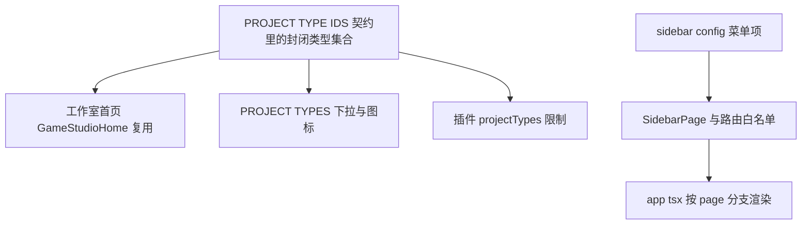
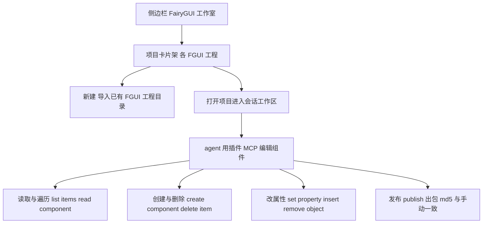

# FairyGUI 工作室接入分析（配合 FairyGUI 插件）

> 前置文档：`dev-docs/research/FairyGUI插件构建可行性分析.md`（插件包 `plugins/fairygui/` = Skills + MCP）
> 本文回答：如何把 FairyGUI 工程封装成类似「网页游戏 / 素材画布」的**新工作室**，与插件配合实现组件的读取、遍历、创建、删除、改属性、发布。
> 现成样例：**Godot** 是最近一次「新增工作室」的完整落地（新增 ProjectType + 侧边栏页 + 插件），照抄它的改动面即可。

## 一、结论先行

| 问题 | 结论 |
|---|---|
| 技术可行吗 | **可行**。新增工作室 = 新增一个 `ProjectType` + 一组纯前端改动；daemon 对项目类型几乎无感知（全库只有 2 个 daemon 文件特判过类型） |
| 新增类型还是复用 general | **新增 `"fairygui"` 类型**（走 godot-game 的路）。理由：工作室首页要按类型过滤项目卡片；插件的 `projectTypes` 按类型限制技能/MCP 是否出现在会话里——复用 general 会让 FairyGUI 工具泄漏到所有通用项目 |
| 工作室与插件的分工 | **工作室 = 壳（项目列表 + 新建/导入 + 会话工作区）**，**插件 = 手（MCP 工具 + Skill 规范）**。编辑/遍历/创建/删除/属性/发布全部是插件的 MCP 工具（`list_items`/`read_component`/`create_component`/`insert_object`/`remove_object`/`set_property`/`delete_item`/`publish`），工作室本身不写任何 FairyGUI 逻辑 |
| 工程怎么映射成「项目」 | `createProject` 支持 `workspacePath`（桌面目录选择器的绝对路径）——**直接把用户的 FGUI 工程目录绑定为项目工作区**，会话里的 agent 就在这个目录干活，与插件 MCP 的 `project` 参数指向同一个工程 |
| 改动面 | 约 10 个文件、全部是小改；无 daemon schema 变更、无新路由解析逻辑（godot 已证明加白名单成员即通） |
| 最大风险 | ① Web 预览对 FairyGUI 无意义，须确认 UI 正确隐藏预览入口（godot 已有同款处理）；② 编辑器必须开着（可最小化）——工作室首页可考虑展示桥连接状态（进阶项，可砍） |

## 二、现有工作室机制回顾（照抄 godot 的模板）

### 2.1 四个工作室怎么长出来的



关键事实（来自 `src/renderer/`、`src/shared/`）：

| 机制 | 位置 | 说明 |
|---|---|---|
| 类型封闭集合 | `src/shared/contracts.ts` `PROJECT_TYPE_IDS = ["general","web-game","interactive-story","asset-canvas","godot-game"]` | 加一个字符串，TS 联合类型全链路自动收紧 |
| 工作室表 | `src/renderer/studios.ts` `GAME_STUDIOS` | `GameStudioType = Exclude<ProjectType,"asset-canvas">` ——**新增类型后不在这里补条目会编译报错**（这是好事，编译器逼你补全） |
| 工作室首页 | `game-studio-home.tsx`（242 行，四个工作室共用） | 按类型过滤最近项目 + 示例 + 新建对话框 + 提示语 |
| 侧边栏 | `sidebar-config.ts`（`group: "studios"`）+ `routes.ts` 的 `SidebarPage` 联合与 `SIDEBAR_PAGES` 白名单 | godot 菜单项 id 是 `godot`，不是类型名 |
| 页面分发 | `app.tsx:69` 一行分支：`page === "godot" ? "godot-game" : page` | **page id 与类型名不同名的映射就发生在这** |
| 类型图标/文案 | `project-types.tsx` + `locales/{zh-CN,en}.ts` | `projectType.fairygui` 等 key |
| Web 预览边界 | `src/shared/project-runtime.ts` `isWebRuntimeProjectType` 只认 `web-game`/`general` | 新类型天然**无** Web 预览，不用改 |
| 社区发布边界 | `coding-workspace.tsx:129` `publishingUnavailable = type === "godot-game" || integration` | FairyGUI 同理要加进这个判断 |
| daemon 特判 | 仅 `plugin-authoring.ts`（projectTypes 校验文案）与 preview 的 interactive-story | 几乎零 daemon 改动 |

### 2.2 项目与磁盘目录的关系

`CreateProjectRequest`（`src/shared/contracts.ts`）：

```ts
{ name?, type?, exampleId?, viewport?, workspacePath?, pluginId? }
```

- `workspacePath`：桌面目录选择器返回的**绝对路径** ——「导入已有目录」的入口（TapTap Maker 的「已绑定目录导入」就是这么走的）。
- 会话工作区（`coding-workspace.tsx`）= coding agent + 文件浏览器 + 时间线，对项目类型无感知；agent 在 `workspacePath` 里读写文件、通过 daemon 代理调插件 MCP 工具。

**FairyGUI 的映射**：一个 FGUI 工程目录（含 `.fairy`、`assets/`）↔ 一个项目（`type: "fairygui"`，`workspacePath` 指向该目录）。多个 FGUI 工程就是工作室里的多张项目卡片。

## 三、目标形态

### 3.1 用户视角



- 工作室首页：与「网页游戏」首页同构（最近项目 + 新建对话框 + 提示语），新建对话框**默认走「导入已有目录」**（FGUI 工程通常已存在；也允许空目录让 agent 从零建工程）。
- 打开项目 = 会话工作区，agent 的能力 = FairyGUI 插件的 MCP 工具 + Skill（规范红线、制作循环、验证步骤）。

### 3.2 能力对照（用户要的操作 ↔ 插件工具，全部现成）

| 用户要的 | 插件 MCP 工具 | 备注 |
|---|---|---|
| 读取组件 | `read_component`（pkg, name） | 直接读盘 XML，拿到子对象命名/id |
| 遍历 | `list_packages` / `list_items`（含 id/路径/尺寸）/ `list_children` | 工程树与舞台子对象两级遍历 |
| 创建组件 | `create_component`（含 extention：Button/Label/List 等 8 种） | 官方 API、可撤销、package.xml 自动登记 |
| 删除 | `delete_item`（资源）/ `remove_object`（舞台子对象） | |
| 获取/改属性 | `set_property`（target 支持 `a/b` 路径）；读靠 `read_component` | 官方 API、可撤销 |
| 发布 | `publish`（pkg, out_path, branch） | 完成才返回；免费版可用；产物与 GUI 手动发布 md5 一致 |
| 编辑器保活/拉起 | Skill 里教 `node mcp/fgui.mjs ensure`（自动启动编辑器并等 ping 就绪） | 编辑器可最小化（bridge 已设 `runInBackground`） |

**工作室一行 FairyGUI 逻辑都不用写**——它只是把「对的目录 + 对的类型 + 插件就位」拼在一起。

## 四、改动清单（全量枚举，照 godot 抄）

| # | 文件 | 改动 | 性质 |
|---|---|---|---|
| 1 | `src/shared/contracts.ts` | `PROJECT_TYPE_IDS` 加 `"fairygui"` | 一行 |
| 2 | `src/renderer/studios.ts` | `GAME_STUDIOS` 加 `fairygui` 条目（page/title/placeholder/newLabel） | 编译器强制 |
| 3 | `src/renderer/project-types.tsx` | `ProjectTypeIcon` 加分支（icon 组件，可仿 `godot-icon.tsx` 建一个 FGUI logo 组件） | 小 |
| 4 | `src/renderer/locales/{zh-CN,en}.ts` | `projectType.fairygui` + `studio.fairygui.{title,placeholder,new}` | 文案 |
| 5 | `src/renderer/routes.ts` | `SidebarPage` 加 `"fairygui"`；`SIDEBAR_PAGES` 白名单加成员 → `#/fairygui` 自动可解析 | 两处 |
| 6 | `src/renderer/sidebar-config.ts` | `SidebarItems` 加 `{ id: "fairygui", icon: "fairygui", group: "studios" }` | 一条 |
| 7 | `src/renderer/app.tsx:69` | godot 分支扩成 `page === "godot" ? "godot-game" : page === "fairygui" ? "fairygui" : page` | 一行 |
| 8 | `src/renderer/coding-workspace.tsx` | `publishingUnavailable` 加 `type === "fairygui"`；确认 Web 预览入口对该类型隐藏（`isWebRuntimeProjectType` 已天然排除） | 小 |
| 9 | `src/renderer/app-sidebar.tsx` | 若用 CSS mask 图标：`styles.css` 加 `.home-nav-icon-fairygui`；或走内联 SVG 分支 | 小 |
| 10 | `plugins/fairygui/.ohmygame-plugin/plugin.json`（前置文档的插件包） | `interface.projectTypes: ["fairygui", "general"]` | 一行 |
| 11 | `src/daemon/plugin-authoring.ts` | projectTypes 合法值文案里补 `fairygui`（AI 建插件的提示词） | 一行 |
| 12 | 可选：`game-studio-home.tsx` / 新建对话框 | FairyGUI 工作室的「新建」默认引导**导入已有目录**（`workspacePath` 而非示例模板） | 中，可后置 |

另有两处**建议核对而非必改**：`plugins.tsx` 的分组归类（新插件会落进「其它插件」，可加入「引擎与平台」组）；`home.tsx` 首页创建对话框的类型下拉（`GAME_PROJECT_TYPES` 会自动多出 FairyGUI，若不想首页出现可过滤）。

### 不需要动的

- daemon 路由/存储/会话（项目类型对其透明）；
- 路由解析（白名单成员即通，无需像 projects/plugins 那样写专属正则）；
- 预览系统（`isWebRuntimeProjectType` 不含新类型，Web 预览自然不存在）。

## 五、两个设计决策

### 5.1 新增类型 vs 复用 general

| | 新增 `"fairygui"`（推荐） | 复用 `general` |
|---|---|---|
| 工作室首页按类型过滤 | 天然支持 | 无法过滤，卡片混进通用项目 |
| 插件 projectTypes 限制 | 精确：FairyGUI 技能/MCP 只出现在该类项目 | 要么全项目可见，要么手动开关 |
| 编译器护航 | `GAME_STUDIOS` 类型会强制补条目，漏改即报错 | 无 |
| 代价 | 上表 12 处小改 | 几乎为零，但所有通用项目都会看到 FGUI 工具 |

选新增：改动全是机械的，且换来「能力按项目类型隔离」这个插件契约的核心语义。

### 5.2 类型命名

类型 id 用 `"fairygui"`（对应 godot 的 `"godot-game"` 位置）；侧边栏 page id 也用 `"fairygui"`（对应 godot 的 `"godot"`）。不像 godot 那样两处不同名，省掉 app.tsx 的映射心智。

## 六、风险与待验证

| # | 风险/待验证 | 对策 |
|---|---|---|
| 1 | Web 预览/社区发布入口对 FairyGUI 项目是否干净隐藏 | 抄 godot 的 `publishingUnavailable`；预览已被 `isWebRuntimeProjectType` 天然排除；P1 手测一遍 |
| 2 | 绑定 FGUI 工程目录后，agent 直改工程文件与编辑器内存态冲突 | 插件契约就是不直写（走官方 API）；Skill 红线写明「组件改动一律走 MCP 工具，不要手改 XML」 |
| 3 | 编辑器侧插件未装进该工程 → 工具全报连接失败 | 首页/首条消息提示前置检查：Skill 教 `ensure` + install 脚本；`ping` 失败给明确指引（进阶：工作室首页显示桥状态角标，P2 再说） |
| 4 | `workspacePath` 导入已有目录的交互是否已对「非空目录/已注册目录」有校验 | P1 验证（Maker 的导入已踩过该路，预期可用） |
| 5 | 多个 FGUI 工程多开编辑器 | bridge 支持端口递增 + `project` 参数路由；Skill 教多窗口必须传 `project` |
| 6 | `PROJECT_TYPE_IDS` 是 shared 契约，旧版本数据目录里若存了未知类型 | daemon 侧 `isProjectType` 兜底；我们只加不减，无迁移问题 |

## 七、落地阶段

| 阶段 | 内容 | 估时 | 出口标准 |
|---|---|---|---|
| P0 | 前置文档的插件包探活（编辑器插件 + `ping` 实测，含 `OpenDocument`/`screenshot` 可用性） | 半天 | 桥在目标编辑器上连通 |
| P1 | 插件包完整落地（`plugins/fairygui/`，Skill + MCP） | 1 天 | general 项目里 MCP 全链路（list→create→set_property→publish）通 |
| P2 | 工作室壳：第四节 1~9 项 + 新建走导入目录 | 1 天 | `#/fairygui` 首页出现、卡片可开、会话里 FGUI 技能/MCP 就位、预览与发布入口正确隐藏 |
| P3 | 打磨：桥状态角标、示例工程、defaultPrompt、文案 | 按需 | — |

依赖顺序：P2 依赖 P1（工作室里得有插件可用），P1 依赖 P0。

## 八、类比理解

插件和工作室的关系，像**商场里的铺位和整层楼面**：

- 插件（前置文档）是铺位——自带售货机（MCP 工具）和说明书（Skill），但客人得先知道来哪家店；
- 工作室是给 FairyGUI 专开的一层楼面——门口挂招牌（侧边栏菜单）、楼层里有各家店的橱窗（各 FGUI 工程的项目卡片），客人进任何一家店（打开项目），铺位里的售货机就自动通电（`projectTypes` 匹配，技能与工具出现在会话）；
- `workspacePath` 绑定 = 橱窗背后就是真实仓库（用户的 FGUI 工程目录），agent 在仓库里干活、通过售货机操作编辑器。

## 九、引用说明

### 本仓库（机制依据）

- `src/shared/contracts.ts` —— `PROJECT_TYPE_IDS`、`CreateProjectRequest.workspacePath`
- `src/renderer/studios.ts` —— `GAME_STUDIOS` 与 `GameStudioType = Exclude<ProjectType, "asset-canvas">`（编译器强制补条目）
- `src/renderer/game-studio-home.tsx` —— 四工作室共用的首页（项目过滤 + 新建 + 提示语）
- `src/renderer/routes.ts` —— `SidebarPage` 联合、`SIDEBAR_PAGES` 白名单（godot 成员即范例）
- `src/renderer/app.tsx:69` —— page → projectType 分支（godot 映射点）
- `src/renderer/sidebar-config.ts` / `app-sidebar.tsx` / `styles.css` —— 菜单项与图标（数据驱动改造后加一条配置）
- `src/renderer/project-types.tsx` / `locales/{zh-CN,en}.ts` —— 类型图标与文案
- `src/shared/project-runtime.ts` —— `isWebRuntimeProjectType`（新类型天然无 Web 预览）
- `src/renderer/coding-workspace.tsx:129` —— `publishingUnavailable`（godot 同款处理）
- `src/daemon/plugin-authoring.ts` —— projectTypes 合法值文案
- `docs/plugins.md` —— 插件契约（projectTypes 限制技能/MCP 出现范围）

### 上游（能力来源，均已在 thirdparties/）

- `thirdparties/fairygui-agent-bridge/mcp/server.mjs` —— MCP 工具层（19 条命令）
- `thirdparties/fairygui-agent-bridge/plugin/main.js` —— 编辑器内 HTTP 桥（官方 API、可撤销、发布 md5 一致）
- `thirdparties/fairygui-agent-bridge/README.md` —— `ensure` 拉起编辑器、多实例 `project` 路由、免费版发布

### 前置文档

- `dev-docs/research/FairyGUI插件构建可行性分析.md` —— 插件包设计（本文 P1 的输入）
- `dev-docs/research/侧边栏菜单与页面代码逻辑分析.md` —— 菜单/路由/页面分发链路细节
