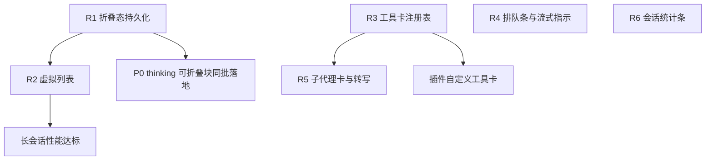

# 对话框后续增强需求（thinkrail 借鉴项）

日期：2026-11-03
来源：`dev-docs/research/2026-11-03-thinkrail-chat-compare.md` 第 5 节「其他值得借鉴」整理
性质：需求池（尚未排期）。本文只覆盖顺带记录的六个借鉴项；thinking 显示 / questionnaire / todo 列表三大主项见调研文档第 2-4 节，不在本文重复。
代码基线：`thirdparties/thinkrail` @ `c469b724`，本仓库 `src/renderer`。

---

## 需求总览

| 编号 | 需求 | 来源文件 | 改动面 | 优先级建议 |
|------|------|---------|--------|-----------|
| R1 | 折叠状态按行 id 持久化 | `chat/foldState.ts` | renderer 小 | 高（与 P0 thinking 显示天然同批） |
| R2 | 虚拟列表 + 行高估算 | `chat/virtualRows.ts`、`rowHeightEstimates.ts` | renderer 中 | 中（长会话出现性能问题时启动） |
| R3 | 工具卡注册表 | `chat/toolRegistry.tsx` | renderer + 协议 中 | 中（依赖插件体系诉求） |
| R4 | 流式指示器 / 队列条 | `StreamIndicator.tsx`、`QueueStrip.tsx` | renderer 小 | 中低 |
| R5 | 子代理转写对话框 | `SubagentTranscriptDialog.tsx` | renderer 中 | 低（接 pi-subagents 时一并做） |
| R6 | 会话统计条 | `SessionStatsBar.tsx` | renderer + daemon 中 | 低 |

---

## R1 折叠状态按行 id 持久化

### 现状与问题

chatbox 的折叠用 `src/renderer/lazy-details.tsx`（LazyDetails，原生 `
` 封装）：折叠态是组件本地 state（或 open 属性），**组件卸载/重挂载即丢**。典型丢失场景：

- 切换会话再切回（timeline 重建）；
- 父组件重渲染导致行 key 变化；
- 后续做 R2 虚拟列表后，滚动出视口的行卸载，折叠态必然丢失。

### thinkrail 参考

`thirdparties/thinkrail/apps/web/src/chat/foldState.ts`：`useFold(id)` 把每个可折叠行（activity 组、thinking 组）的展开态存在**按行 id 索引的全局存储**（模块级 Map），行 id 为稳定标识（如 `turnId:thinking:blockIndex`）。卸载重挂载后状态恢复；thinkrail 明文用它扛虚拟化（「Per-call UI state survives virtualization — a module-level cache keyed by id，since react-virtuoso unmounts off-screen rows」）。

### 需求描述

1. 为 timeline 中所有可折叠行（tool-group、image-read、compaction 等 LazyDetails 使用点，以及 P0 新增的 thinking 块）提供**按稳定行 id 持久**的展开态；
2. 行 id 必须在会话内稳定（沿用现有 item/group id 生成规则，不依赖数组下标）；
3. 状态作用域：单个会话视图内持久即可（切会话重置可接受，与 thinkrail 行为一致）；不必写入磁盘。

### 验收要点

- 展开一个工具组，切走再切回该会话，组仍展开；
- 同一会话内滚动/重渲染不重置折叠态；
- 不引入全局可变 state 泄漏（会话卸载时清理）。

---

## R2 虚拟列表 + 行高估算

### 现状与问题

`agent-timeline.tsx` 整条 timeline 全量渲染，无虚拟化。长会话（数百 turn / 上千 item）下 DOM 数量与渲染开销线性增长。

### thinkrail 参考

- `chat/virtualRows.ts`：基于 react-virtuoso 的行虚拟化；
- `chat/rowHeightEstimates.ts`：按行类型估算高度（markdown 文本按字符数、工具组按条数），供虚拟列表初始定位，避免滚动跳动；
- 与 R1 的 foldState、ask 卡的 per-call state cache 配套，解决「虚拟化卸载丢状态」。

### 需求描述

1. timeline 引入虚拟列表（react-virtuoso 或等价方案），只渲染视口附近行；
2. 提供按行类型的行高估算，滚动无明显跳变；
3. 所有依赖「行常驻」的交互（折叠态 R1、进行中的 QuestionnaireCard/ApprovalCard 焦点）必须与虚拟化兼容；
4. 兜底：交互中的卡片（inProgress 的 userInputRequest / approvalRequest）不虚拟化卸载或卸载后可无损恢复。

### 启动条件

出现可感知的长会话卡顿或 DOM 规模问题再启动（YAGNI：当前若无明显性能问题，此项排队）。

---

## R3 工具卡注册表

### 现状与问题

chatbox 的工具调用渲染硬编码在 `agent-timeline.tsx`：按 `item.type` / `tool` 名分支（`work-items.ts` 的 `toolCategory`、timeline 内的分支渲染）。本项目已有插件体系（`src/daemon/plugin-integration.ts`、`src/renderer/plugin-integration.tsx`、plugins 目录），但**插件无法注入自定义工具的专属渲染卡**。

### thinkrail 参考

- `chat/toolRegistry.tsx`：工具名 → 渲染组件注册表，核心只认注册契约（ToolRenderProps）；
- `thinkrail-extensions/ask-user-question` 等扩展包通过 descriptor 注册自己的卡（`{ chrome: "bare", interactive: true }`），核心零改动即可扩展；
- `ExtUiPrompt.tsx` 提供 `interaction` 注入（respond / superseded / ended / focusComposer），交互卡不碰宿主内部。

### 需求描述

1. 建立渲染层工具卡注册表：`tool 名（含 mcp:server:tool 形态） → 卡组件`，未注册的回落到现有通用工具组渲染；
2. 注册入口对内（renderer 内置卡）与对外（插件声明式注册）一致；
3. `ToolRenderProps` 契约至少含：toolCallId、args、result、status、streaming、interaction（如后续需要交互卡再扩展 respond）；
4. 与 daemon 侧 `agent-tools.ts` / 插件工具定义对齐：插件装了工具但 renderer 没注册卡时回落通用渲染，不报错。

### 验收要点

- 内置工具卡（如现有 tool-group）迁移到注册表后行为不变；
- 一个示例插件能注册自定义工具 + 自定义卡并正常渲染。

---

## R4 流式指示器 / 队列条

### 现状与问题

chatbox 有 `src/renderer/message-queue.tsx`（排队逻辑），但排队中的消息在 UI 上不可见——用户发多条消息时不知道哪条在跑、哪条在排队、当前跑到第几条。流式进行中的状态只有工具组旁的 shimmer。

### thinkrail 参考

- `chat/StreamIndicator.tsx`：流式进行中的轻量指示（当前动作摘要）；
- `chat/QueueStrip.tsx`：排队消息条——待发消息以小条形式列出，进行中/排队状态可辨。

### 需求描述

1. 输入框上方（或 timeline 底部）提供排队条：显示排队中的用户消息（截断文本），按序排列；
2. 当前正在处理的消息有区分态（进行中），后续为排队态；
3. 支持从队列中移除未开始的消息（如 message-queue 已支持取消则暴露入口）；
4. 流式指示器：turn 进行中在 composer 附近常驻一行「正在做什么」的轻量摘要（可复用 `toolGroupSummary` 现有摘要函数）。

### 验收要点

- 连发 3 条消息，UI 能看出第 1 条进行中、2-3 条排队中；
- 排队条不与 QuestionnaireCard/ApprovalCard 抢占同一区域时布局不冲突（需与现有「输入框上方挂交互卡」的布局协调）。

---

## R5 子代理转写对话框

### 现状与问题

chatbox 当前无子代理（subagent）可视化；调研文档已记录 thinkrail 的 `pi-subagents` 包与 `chat/tools/subagent/AgentCard.tsx`（子代理卡片：运行状态、结果摘要）。此项**依赖先接入 pi-subagents 运行时**，单独做 UI 没有意义。

### thinkrail 参考

- `chat/tools/subagent/AgentCard.tsx` + `runDetails.ts`：子代理作为一张工具卡出现在 activity 组内；
- `chat/SubagentTranscriptDialog.tsx`：点开卡片弹出**该子代理的完整转写**（对话框形式），子代理的会话独立于主会话渲染。

### 需求描述（接入 pi-subagents 时一并实现）

1. 子代理调用渲染为专属卡：子代理名/任务、运行/完成/失败态、结果摘要；
2. 卡片可点开转写对话框：完整子代理消息流（含其 thinking 与工具调用，复用主 timeline 的行渲染）；
3. 多个子代理并发时各自独立卡片，可同时打开多个转写对话框或单对话框切换。

---

## R6 会话统计条

### 现状与问题

chatbox 无会话级 token/费用展示；agent-usage.tsx（用量页）是全局统计视角，不是「当前对话花了多少」。

### thinkrail 参考

`chat/SessionStatsBar.tsx` + `useSessionStats.ts`：会话底部统计条——token 用量（输入/输出/缓存）、估算成本、消息数等，随会话事件增量更新。

### 需求描述

1. 对话视图提供统计条（可折叠/隐藏）：本轮会话累计输入 token、输出 token、缓存命中（如协议可提供）、估算费用；
2. 数据来源：daemon 侧会话级 usage 聚合（pi 会话事件已含 usage 数据，需确认 chatbox 事件协议是否透传，可能需要 daemon 小改）；
3. 费用计算沿用项目已有的计费配置（模型定价表），不重复造轮子；
4. 展示为次级信息（不抢占主视线），默认收起、点击展开。

---

## 依赖与实施关系

- R1 建议与 thinking 显示（P0）同批做：thinking 块本身就是新的可折叠行；
- R2 依赖 R1（虚拟化前必须先解决状态丢失）；
- R3 是 R5 与插件自定义卡的前置；
- R4、R6 相互独立，可单独排期。

---

## 引用说明

- 调研底稿：`dev-docs/research/2026-11-03-thinkrail-chat-compare.md`
- thinkrail 参考实现：`thirdparties/thinkrail/apps/web/src/chat/` 下 `foldState.ts`、`virtualRows.ts`、`rowHeightEstimates.ts`、`toolRegistry.tsx`、`ExtUiPrompt.tsx`、`StreamIndicator.tsx`、`QueueStrip.tsx`、`SubagentTranscriptDialog.tsx`、`SessionStatsBar.tsx`、`tools/subagent/AgentCard.tsx`
- 本仓库对应现状：`src/renderer/lazy-details.tsx`、`agent-timeline.tsx`、`work-items.ts`、`message-queue.tsx`、`plugin-integration.tsx`；daemon 侧 `src/daemon/agent-tools.ts`、`plugin-integration.ts`
- 仓库地址：https://github.com/JetBrains/thinkrail
