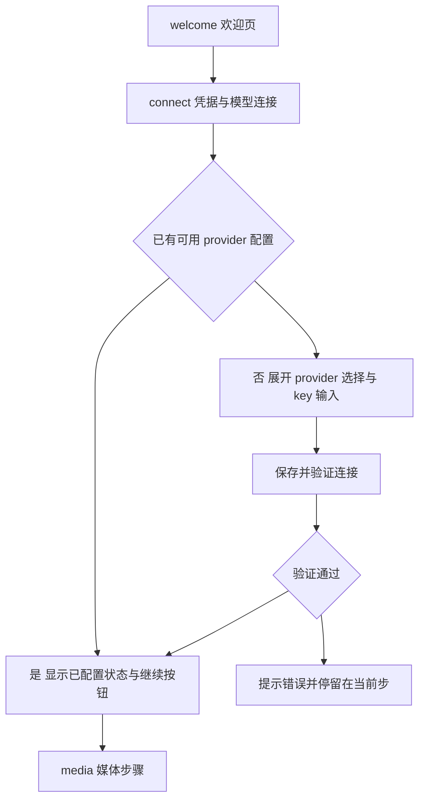

# grasp 设置面板实现分析与 API key 设置步骤落地方案

> 分析对象：`thirdparties/grasp`（服务端 Go + web 端 Vue3）。
> 目标：在当前项目（game-workbench）中添加一个 API key 设置步骤。
> 结论先行：**当前项目已有 onboarding 步骤机和 provider key 存储，方案是扩展 onboarding 的 connect 步骤为「凭据 → 模型连接」两小步，复用现有 provider-models UI，借鉴 grasp 的「同一面板复用为设置页与向导步骤」模式。**

## 一、grasp 设置面板的实现

### 1.1 总体架构

grasp 把「设置」拆成三层：声明式导航、通用面板骨架、类型化 API 客户端。

```
web/src/
  data/settingsNav.ts              声明式设置导航（分组、激活规则、integrations 查询态）
  components/settings/
    SettingsPageHeader.vue         页头
    SettingsSection.vue            分节容器
    SettingsRow.vue                单行设置项
    SettingsStatStrip.vue          统计条
  views/SettingsView.vue           设置主视图（按路由子路径渲染对应面板）
  lib/api/clients/settingsClient.ts  类型化 REST 客户端（GET/PUT /settings）
  lib/workspace/credentialKinds.ts    凭据种类注册表
  components/workspace/
    WorkspaceCredentialsPanel.vue  凭据面板（1537 行，双 tab，可复用为向导步骤）
    CredentialEditorSurface.vue    凭据编辑器外壳
    CredentialProviderLogo.vue     供应商 logo
```

### 1.2 凭据种类注册表（credentialKinds.ts）

声明式单一来源，前端面板和向导都从这里读「有哪些可设置的 key」：

```ts
export type CredentialSecretKind = 'apiKey' | 'loginFile' | 'multiline'

export const CREDENTIAL_KINDS: CredentialKind[] = [
  { id: 'claude_code', type: 'ai', provider: 'claude_code', envKey: 'GRASP_CLAUDE_API_KEY', secret: 'apiKey', logoProvider: 'claude' },
  { id: 'codex',       type: 'ai', provider: 'codex',       envKey: 'GRASP_CODEX_AUTH_JSON', secret: 'loginFile', logoProvider: 'codex' },
  { id: 'github',      type: 'git', provider: 'github',     envKey: 'GITHUB_TOKEN',          secret: 'apiKey', logoProvider: 'github' },
  // ...cursor、codebuddy、trae、opencode、deepseek、kimi、gitlab、ssh_key
]
```

每个种类声明四件事：唯一 id、归属类型（ai/git/ssh）、注入到运行环境的环境变量名、秘密形态（单行 key / 登录文件 / 多行文本）。面板据此渲染输入控件（单行密码框、文件上传、多行文本域），服务端据此做域校验。

### 1.3 凭据面板（WorkspaceCredentialsPanel.vue）

核心设计是**一个面板，两种视图，两种宿主**：

| props | 作用 |
|-------|------|
| `inline` | 页面内嵌（非弹层）布局 |
| `scope` | `'all' \| 'model' \| 'git'`，过滤显示哪类凭据 |
| `view` | `'credentials' \| 'models'`，双 tab：凭据列表 / 模型连接配置 |
| `setup` | 向导模式：简化为只创建不管理 |
| `configurationId` | 向导模式回显已选配置 |

关键交互：

- 列表项用「已配置 / 未配置」掩码展示（`configuredText`），永不回显完整密钥
- 添加走下拉菜单选种类（`addFromMenu`），按种类渲染对应编辑器
- 完成保存后 emit `credentialSaved` / `modelSaved` 事件——**宿主据此推进向导步骤**
- `editing` 事件通知宿主「正在编辑中」，禁止向导中途跳步

### 1.4 服务端存储（Go）

凭据存数据库，落库前加密。三层防线：

1. **静态加密**：`internal/crypto/secrets.go`，AES-256-GCM，密文格式 `base64(nonce || ciphertext)`。
   主密钥可插拔：默认读环境变量 `GRASP_SECRETS_KEY`（base64 32 字节），服务器启动时通过
   `SetKeySource` 接到配置层（config 文件 `security.secrets_key`，env 覆盖）。密钥视为固定盐值，
   轮换即旧密文不可解。
2. **域契约校验**：`internal/services/credential_domain.go`。每条凭据显式声明
   `purpose`（model_api / tool_auth / git / ssh / mcp / custom）+ `secret_kind`
   （api_key / token / login_file / multiline）+ `envKey`；读取时只认显式声明的域，
   不从名字或环境变量猜测用途，旧格式行直接判为无效（不自动升级）。
3. **环境变量回退**：`internal/envauth/keys.go`。每个 ACP 后端对应一个内置凭据槽
   （如 `GRASP_CLAUDE_API_KEY`），运行时映射到 CLI 的原生认证变量（如 `ANTHROPIC_API_KEY`）；
   数据库里没配时可用环境变量顶上。

REST 接口（`router.go`）：

```
GET    /api/workspace/credentials              列表（掩码，不含明文）
POST   /api/workspace/credentials              创建
PUT    /api/workspace/credentials/:id          更新（写新 revision）
DELETE /api/workspace/credentials/:id          清除值（保留行）
DELETE /api/workspace/credentials/:id/account  移除整条
POST   /api/workspace/credentials/github/device + poll   GitHub 设备码授权流
```

### 1.5 设置步骤（OnboardingWizard.vue）

向导步骤是**声明式数组 + 事件驱动推进**：

```ts
export const ONBOARDING_STEPS: OnboardingStep[] = [
  { id: 'prefs',          labelKey: 'pages.onboarding.steps.prefs' },
  { id: 'credentials',    labelKey: 'pages.onboarding.steps.credentials' },
  { id: 'model',          labelKey: 'pages.onboarding.steps.model' },
  { id: 'gitCredentials', labelKey: 'pages.onboarding.steps.gitCredentials' },
  { id: 'git',            labelKey: 'pages.onboarding.steps.git' },
  { id: 'team',           labelKey: 'pages.onboarding.steps.team' },
  { id: 'workflow',       labelKey: 'pages.onboarding.steps.workflow' },
  { id: 'done',           labelKey: 'pages.onboarding.steps.done' },
]
```

要点：

- 每步一个主题一页，`draft.step` 持久化进度，`firstInstall` 与 `retry` 两种模式走同一组步骤
- 凭据步骤直接嵌入面板：`<WorkspaceCredentialsPanel inline scope="model" view="credentials" @credential-saved="completeCredentialStep" />`——**面板本身即步骤内容，向导不重复实现表单**
- 守卫规则：未完成 model 步时想向后跳，强制拉回 `goToStep('model')`；`editing` 期间禁跳
- credentials 步保存凭据 → model 步把凭据绑定到模型连接（协议 + baseUrl + 认证方案 bearer 或 x-api-key）→ 后续步骤引用 `modelConfigurationId`

## 二、当前项目现状对照

当前项目（game-workbench）**已有同能力的本地化实现**，不需要引入 grasp 的服务端加密栈：

| 能力 | grasp | 当前项目现状 |
|------|-------|--------------|
| 步骤机 | ONBOARDING_STEPS 数组 | `src/shared/onboarding.ts`：`welcome \| connect \| media` 三步 |
| API key 存储 | DB + AES-256-GCM 落库 | daemon 本地文件（dataDirectory 下 JSON，`provider-model-settings.ts`，含可打印 ASCII 校验） |
| 模型连接配置 | model_api 凭据 + 模型连接（协议、baseUrl、认证方案） | `models.json` + 自定义 provider（含 apiKey、baseUrl、模型列表） |
| key 设置 UI | WorkspaceCredentialsPanel（可复用为步骤） | `provider-models.tsx` + `custom-provider-dialog.tsx`（设置页内） |
| 密钥掩码 | configuredText 掩码 | 有（provider 设置不回显明文） |
| 连接验证 | 服务端可达性测试 | 有（provider 连接测试） |

本地优先单机应用，key 存本地文件与 grasp 存 DB 加密是两种合理取舍：grasp 面向多用户自托管服务端，必须防「拖库泄密」；当前项目 key 与应用同机存放，加密的主密钥也只能落在同一台机器上，加密收益有限。**维持本地文件存储，不引入 AES 栈**；若未来出多用户/云形态再按 grasp 方案补加密。

## 三、落地方案

### 3.1 目标

onboarding 增加一个明确的「设置 API key」步骤：新用户首次进入即可配好模型 key，不必先摸索设置页；已有用户可跳过。

### 3.2 流程



### 3.3 实际落地（P0，含后续简化）

实现前浏览器实测发现：方案中的「已配置摘要态」「providerConfigured 字段」**大部分已被现有实现覆盖**——
ProviderPicker 已把已连接服务商置顶并显示掩码状态，跳过按钮（skipAndStart）已存在，
onboarding 状态只在 `status=pending` 时消费，`providerConfigured` 字段没有真实读者，做了即死代码。

实测找到的真缺口：**connect 首屏只显示运行时选择网格，「LLM 服务商」列表（API key 入口）
折叠在 Game Workbench 选项后面，第一眼找不到设置 key 的入口**。

按产品决策进一步简化为两步向导（welcome + connect）：

1. **移除「连接智能体」运行时网格**（`onboarding-agents.tsx` 删除）：connect 步只保留
   LLM 服务商列表（搜索、已连接掩码、API 密钥、自定义服务商）。CLI 智能体（Claude Code、
   Codex、OpenCode）不再有 onboarding 入口，仍在设置页配置。
2. **移除第三步「添加创作工具」**（`onboarding-media.tsx` 删除）：媒体服务商（图像/视频/3D/音频）
   在设置页配置。旧数据里 `step: "media"` 加载时归一化为 `connect`，PUT schema 同步收缩。
3. connect 步主按钮直接为「开始创作」（完成前落默认模型），无模型时保留「跳过并开始」。
4. i18n 清理双语孤儿 key 14 个；进度文案「共 3 步」改「共 2 步」。

验证：vitest 定向 49 用例全绿（onboarding-renderer/onboarding/i18n-ui）；全量测试仅剩
既有 Windows symlink 环境失败（与改名基线一致，零新增）；浏览器实测两步向导
（截图 `dev-examples/onboarding-connect-shots/03-connect-two-step.png`）。

### 3.4 可选增强（P1，借鉴 grasp 再做）

- **凭据种类注册表**：如果后续要管理的 key 种类变多（图像/3D/音频/编码 agent 各自的 key），
  把「有哪些 key 可配」收敛为一个声明式数组（对齐 `credentialKinds.ts`），
  面板与向导共用，避免散落各处的表单各自为政。触发条件：种类超过三个再动手。
- **设置页统一骨架**：设置分节组件化（参照 SettingsSection/SettingsRow），
  触发条件：设置页条目继续膨胀、出现重复布局代码再做。
- **独立凭据面板复用为两处宿主**（对齐 grasp 的 inline/setup 双模式）：
  当前 onboarding 与设置页表单已够用，暂不抽象。

### 3.5 不做的事

- 不引入服务端 AES-256-GCM 加密栈（本地单机收益有限，见第二节取舍）
- 不引入凭据 revision/域契约（当前无多版本凭据轮换需求）
- 不改 `welcome | connect | media` 三步结构（connect 已是 key 的自然归属地）

## 四、验证口径

- vitest：onboarding 渲染测试（`test/onboarding-renderer.test.tsx`）覆盖「已配置/未配置/验证失败」三分支
- 浏览器实测（browser-selftest）：首次进入 onboarding 走完 connect 步、跳过路径、
  设置页回显三场景；断言 provider 掩码不回显明文 key

## 引用

- grasp 凭据种类注册表：`thirdparties/grasp/web/src/lib/workspace/credentialKinds.ts`
- grasp 凭据面板（inline/setup 双模式）：`thirdparties/grasp/web/src/components/workspace/WorkspaceCredentialsPanel.vue`
- grasp 向导步骤机与面板嵌入：`thirdparties/grasp/web/src/components/onboarding/OnboardingWizard.vue`、`thirdparties/grasp/web/src/lib/pm/onboardingWizard.ts`
- grasp 服务端凭据域契约与路由：`thirdparties/grasp/server/internal/services/credential_domain.go`、`thirdparties/grasp/server/internal/router/router.go`
- grasp 静态加密实现：`thirdparties/grasp/server/internal/crypto/secrets.go`
- grasp 环境变量回退：`thirdparties/grasp/server/internal/envauth/keys.go`
- 当前项目 onboarding 步骤定义：`src/shared/onboarding.ts`、`src/renderer/onboarding.tsx`
- 当前项目 provider key 存储：`src/daemon/provider-model-settings.ts`
