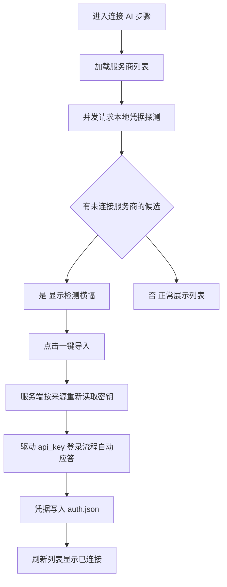

# 本地凭据自动导入方案（onboarding connect 步）

> 目标：onboarding 的「连接 AI」步骤自动探测本机已有的 API key（环境变量、Codex 登录文件、
> OpenCode 认证文件），发现后显示一条横幅，一键导入为对应服务商的凭据，免手动重复输入。

## 一、现有能力（实现前已查证）

- Pi 认证解析链（`resolveProviderAuth`）：会话级 api-key → auth.json（应用内登录写入）→
  models.json 自定义服务商 apiKey → **环境变量回退**（`ANTHROPIC_API_KEY` 等）。
  因此 env 里的 key 本来就会让服务商显示「已连接」——env 来源的导入价值在于
  **显式落库**（脱离 env 依赖、跨重启稳定可见）与**可发现性**（用户不知道 env 已生效）。
- `ModelAuthService`（`src/daemon/model-auth.ts`）已有程序化驱动能力：
  `start(providerId, "api_key")` → 收到 prompt 事件 → `respond(operationId, promptId, key)` →
  completed。导入可直接复用这条链，不需要新的凭据写入实现。

## 二、探测源（实现后实际范围）

| 来源 | 位置 | 提取方式 | 映射到 |
|------|------|----------|--------|
| Codex 登录文件 | `~/.codex/auth.json` | JSON 的 `OPENAI_API_KEY` 字段 | openai |
| OpenCode 认证文件 | `~/.opencode/auth.json` | `{providerId: {type: "api", key}}` | 同名内置服务商 |

**环境变量不纳入探测**（实现时验证）：Pi 的 `checkAuth` 解析链已包含 env 回退，
env 里有 key 的服务商在 UI 上直接显示「已连接」，无需也无候选可导入。
探测只针对未连接且支持 API key 登录的服务商；同服务商多来源时 codex 优先。

明确不做的（v1）：

- `~/.claude` 的凭据：是 OAuth token 不是 API key，导入需要 token 刷新逻辑，价值低复杂度高
- `~/.codex/auth.json` 的 ChatGPT OAuth tokens：同上
- CLI 特有配置（自定义 baseUrl 等）：只导入 key，连接配置仍走自定义服务商表单

## 三、流程



## 四、接口

### 探测：`GET /settings/models/providers/local-credentials`

返回候选数组（**不含明文 key**，导入时服务端自行重读）：

```ts
{ items: [{ providerId: string; source: "codex" | "opencode";
            keyHint: string }] }   // keyHint: 掩码，如 "sk-…a1b2"
```

只返回当前未 configured 的服务商；同服务商多来源时 codex 优先。

### 导入：`POST /settings/models/providers/:providerId/import-local`

body `{ source }`；服务端重新读取对应来源的 key（不信任客户端传值），然后：

1. `modelAuth.start(providerId, "api_key")`
2. 等待 prompt 事件 → `respond(operationId, promptId, key)`
3. 等待 completed → `onCredentialsChanged` 刷新列表

返回 `{ connected: true }`；provider 不存在 404、来源无 key 404、流程失败 502。

## 五、UI

connect 步 provider 列表上方一条横幅（现有 onboarding-feedback 样式族）：

> 检测到本机已有密钥：Anthropic（环境变量）、OpenAI（Codex 登录文件）　[一键导入]

- 仅有候选且对应服务商未连接时显示；导入成功后横幅消失、列表刷新
- 导入失败在横幅内显示错误并保留重试；可关闭（会话内不再显示）

## 六、验证口径

- daemon 单测：探测（env 注入 / codex、opencode fixture 文件）、导入成功与失败路径
- renderer 测试：横幅渲染、点击导入、失败重试
- 浏览器实测：注入假 env key → 横幅出现 → 导入 → 列表已连接；无候选时横幅不出现

## 引用

- Pi 认证解析链与 env 回退：`node_modules/@earendil-works/pi-coding-agent/docs/providers.md`（Use an API key from the environment）、`docs/models.md`
- 现有凭据写入流程：`src/daemon/model-auth.ts`（start/respond/#prompt）
- 服务商列表与状态：`src/daemon/app.ts`（providerSummaries）、`src/renderer/onboarding.tsx`
