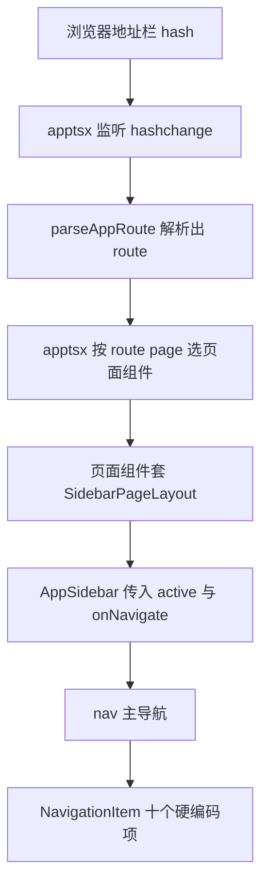

# 侧边栏「主导航」显示机制分析与可配置化方案

> 目标：搞清楚 `http://127.0.0.1:43120/#/` 左侧 `<nav aria-label="主导航">` 的显示由什么控制，并给出改成可配置的方案。

## 一、一句话结论

主导航**不是数据驱动，是硬编码 JSX**：`src/renderer/app-sidebar.tsx` 第 122~135 行的 `<nav>` 里手写了 10 个 `NavigationItem` + 1 个分组标题。每个导航项由「页面 id + 图标 + i18n 文案 + 点击跳转」四样东西拼成，分散在 4 个文件里；**没有任何 feature flag / 配置文件 / 服务端开关**，想增删改导航项只能改这份 JSX。

## 二、显示链路（从地址栏到渲染）



关键节点：

| 环节 | 文件 | 职责 |
|---|---|---|
| 路由解析 | `src/renderer/routes.ts` | `parseAppRoute(hash)` 把 `#/<page>` 解析成 `AppRoute`；`SidebarPage` 联合类型定义了全部合法页面 id；`SIDEBAR_PAGES` 白名单决定哪些 id 能从 hash 直达 |
| 页面骨架 | `src/renderer/sidebar-page.tsx` | `SidebarPageLayout` 把 `<AppSidebar active onNavigate>` 和页面内容拼进 `home-shell` |
| 侧边栏本体 | `src/renderer/app-sidebar.tsx` | **主导航 JSX 在这里**（`<nav aria-label={t("sidebar.mainNavigation")}>`），`NavigationItem` 子组件负责单个按钮的渲染（active 高亮 / title / aria-current） |
| 页面容器 | `src/renderer/app.tsx` | hash 路由分发，`navigateToSidebarPage` 把点击变成 hash 变化 |
| 文案 | `src/renderer/locales/zh-CN.ts` / `en.ts` + `src/renderer/i18n.ts` | `t("sidebar.home")` 等 key 的中英文；语言偏好存 localStorage `ohmygame:language` |
| 图标 | `src/renderer/styles.css`（2836~2880 行）+ `src/renderer/icons.ts` | 两种机制，见下表 |

## 三、一个导航项的四要素（以「首页」为例）

```tsx
<NavigationItem active={active === "home"} icon="home" label={t("sidebar.home")} onClick={() => onNavigate("home")} />
```

| 要素 | 来源 | 说明 |
|---|---|---|
| 页面 id | `routes.ts` 的 `SidebarPage` 联合类型 | "home" / "projects" / "library" / "plugins" / "general" / "web-game" / "interactive-story" / "godot" / "asset-canvas" / "community"，共 10 个 |
| 图标 | 两种：① CSS 类 `.home-nav-icon-{icon}`（styles.css，改背景图实现）；② 内联 SVG（`web-game`=Globe2、`general`=Gamepad2，写死在 `NavigationItem` 的三元里） | 加新图标要走 CSS 或改这个三元 |
| 文案 | i18n key：前 5 项用 `sidebar.*`，后 5 项（工作室分组）用 `projectType.*` | `t()` 是 i18next，语言切换 = 改 localStorage + 整页 reload |
| 跳转 | `onNavigate(id)` → `app.tsx` 改 hash（如 `#/#home`） | hash 再被 `parseAppRoute` 解析回 `route.page`，驱动页面切换与 active 高亮 |

当前 `<nav>` 里的实际顺序：**首页 / 项目 / 素材库 / 插件 / 社区** +（分组标题「工作室」）**web-game / interactive-story / godot / asset-canvas / general**。

## 四、容易踩的坑：侧边栏显示 ≠ 路由可达

`SIDEBAR_PAGES` 白名单（routes.ts 第 28 行）只有 7 个 id：home、library、general、web-game、interactive-story、godot、asset-canvas。projects/plugins/community **不在白名单里**，它们靠 `parseAppRoute` 里的专属正则分支解析（支持 `#/projects?type=...` 这类带参数的 hash）。

含义：想在侧边栏**加一项**，光在 JSX 加 `NavigationItem` 不够，还要确认 hash 能被解析（新页面 id 必须进白名单或加解析分支）；想**隐藏一项**则相反，JSX 不渲染就看不见了，但路由仍然可达（可以直接输 hash 进去）。

## 五、可配置化方案（三级，推荐 L1）

### L1 代码级配置文件（推荐，改动最小）

新建 `src/renderer/sidebar-config.ts`，把硬编码 JSX 换成数据驱动：

```ts
import type { SidebarPage } from "./routes.js";

export interface SidebarItemConfig {
  id: SidebarPage;              // 跳转目标
  labelKey: string;             // i18n key，如 "sidebar.home"
  icon: "home" | "project" | "library" | "general" | "web-game"
      | "interactive-story" | "godot" | "asset-canvas" | "community" | "plugins";
  group?: "main" | "studios";   // 分组：主导航 / 工作室
  visible?: boolean;            // 开关，默认 true
}

export const SIDEBAR_ITEMS: SidebarItemConfig[] = [
  { id: "home", labelKey: "sidebar.home", icon: "home", group: "main" },
  { id: "projects", labelKey: "sidebar.projects", icon: "project", group: "main" },
  // ...想藏掉哪项就把 visible 设 false，或直接删行
];
```

`app-sidebar.tsx` 的 `<nav>` 改成两段 `.map()` 渲染。**一处文件控制全部显示**，改完由 vite HMR 即时生效（见 dev-docs/experience 已验证的热更链路）。

### L2 设置页可视化开关

在 L1 之上：`visible` 改为读 localStorage（如 `xc-ui-flow:sidebar-hidden` 存隐藏 id 列表），设置页（Settings Section）加一组 checkbox。适合"使用者"自己调，改动面 +1 个设置页文件。

### L3 daemon 下发配置（不建议现在做）

daemon 提供接口返回导航配置，前端启动时拉取。适合多租户/远程开关场景；当前单机自用，属过度设计（YAGNI），等真有多前端需求再说。

### 类比理解

现在的导航像**印死的菜单牌**——菜名、顺序、分区都焊在墙上（JSX），换菜单要重新印墙。
L1 相当于把菜单牌换成**一块可擦白板**（配置数组），想换菜改白板即可；
L2 是给每位顾客发一支笔（设置页 + localStorage），各擦各的；
L3 则是总部每天远程下发菜单（daemon/服务端配置）——连锁店才需要。

## 六、实施核对清单（做 L1 时照着勾）

- [ ] 新建 `src/renderer/sidebar-config.ts`，搬入 10 项定义（顺序照现状）
- [ ] `app-sidebar.tsx`：`<nav>` 内改分组渲染（main 组在前、studios 标题 + studios 组在后），`NavigationItem` 不用动
- [ ] 隐藏项不渲染即可；若隐藏的是路由白名单页，考虑是否同步收紧 `SIDEBAR_PAGES`（防止直输 hash 进入空页面）
- [ ] 图标若要新增：优先 CSS 方案（`.home-nav-icon-xxx` + 背景图），与现有 8 个保持一致
- [ ] 两语言 locales 的 key 不动（labelKey 引用现有 key，零翻译成本）
- [ ] 用已运行的 vite dev（43120）验证 HMR 生效，中英文各切一遍

## 引用说明

本文分析基于以下项目源码（仓库根相对路径，ohmygame 上游代码）：

- `src/renderer/app-sidebar.tsx` —— 侧边栏组件，主导航硬编码 JSX 与 `NavigationItem` 定义
- `src/renderer/sidebar-page.tsx` —— `SidebarPageLayout`，AppSidebar 的挂载点
- `src/renderer/app.tsx` —— hash 路由分发与 `navigateToSidebarPage`
- `src/renderer/routes.ts` —— `SidebarPage` 类型、`SIDEBAR_PAGES` 白名单、`parseAppRoute`
- `src/renderer/i18n.ts`、`src/renderer/locales/zh-CN.ts`、`src/renderer/locales/en.ts` —— `t()` 与 `sidebar.mainNavigation`（"主导航"）等文案
- `src/renderer/styles.css`（约 2836~2880 行）—— `.home-nav-icon-*` CSS 图标
- `src/renderer/icons.ts` —— Globe2 / Gamepad2 内联 SVG 图标
