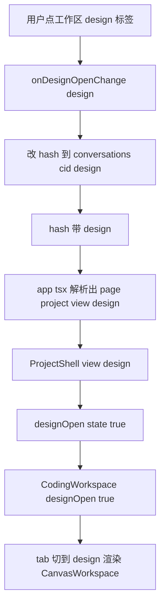
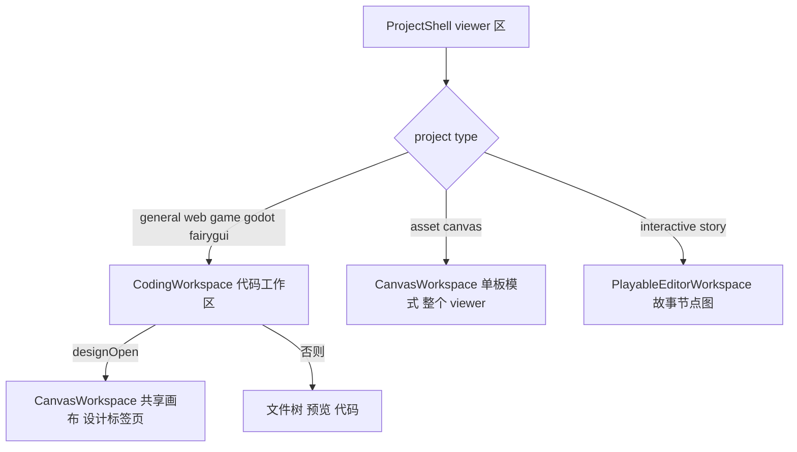

# 设计页面（design view）机制分析与自定义指南

> 触发问题：`#/projects/<id>/conversations/<cid>/design` 这个「设计」页的逻辑是什么？不同工作室类型是否对应不同设计页？如何自定义？
> 结论基于源码：`src/renderer/project-shell.tsx`、`coding-workspace.tsx`、`canvas-workspace.tsx`、`asset-canvas-workspace.tsx`、`src/daemon/canvas-*.ts`、`agent-tools.ts`。

## 一、结论先行

| 问题 | 答案 |
|---|---|
| 设计页是什么 | 项目会话工作区的一个**视图模式**（hash 带 `/design`），本体是 `ProjectShell` 按项目类型三向分支渲染的工作区组件 |
| 不同类型是否不同 | **是，三类**：①普通编码类（general/web-game/godot/fairygui）→ `CodingWorkspace`，设计页是其内嵌的**共享画布 CanvasWorkspace**；②素材画布（asset-canvas）→ 整个工作区就是 CanvasWorkspace（单板模式）；③互动故事（interactive-story）→ `PlayableEditorWorkspace`（节点图编辑器） |
| 设计数据存哪 | 就是**工程目录里的文件**：`canvas/boards/*.json`（画板）、`canvas/documents/*.md`（文档）、`canvas/tables/*.json`（表格）、`canvas/index.json`（索引）、`canvas/AGENTS.md` + `canvas/schemas/`（给 agent 的契约）。UI 和 agent 读写同一份文件 |
| 怎么自定义 | 三档：A 不写代码（定制 canvas 契约/引导文件）；B 给 FairyGUI 这类项目**换设计页内容**（新工作区组件 + project-shell 加分支）；C 改共享画布本身（影响所有类型，不建议） |

## 二、路由与视图切换链路



关键事实：

| 机制 | 位置 | 说明 |
|---|---|---|
| hash 解析 | `routes.ts` `{page:"project", view?:"design"}` | `view` 只有 `"design"` 一个值，`undefined` 即普通工作区 |
| 视图状态 | `project-shell.tsx:135` `designOpen = view === "design"` | 同时决定 `canvasOpen`（见下） |
| 三向分支 | `project-shell.tsx:943` 起 | 见第三节 |
| Godot 特例 | `project-shell.tsx:169-178` | 无 Web 预览，打开项目默认落 design 视图（除非用户收起过，存 localStorage） |
| 设计上下文 | `designContext` → composer 的 chip | 在画布选中节点后，发消息自动带上「设计：xxx」上下文，agent 能感知你正在看哪个节点 |

## 三、三向分支：谁用什么设计页



| 类型 | 工作区组件 | 设计页形态 | 数据 |
|---|---|---|---|
| general / web-game / godot / **fairygui** | `CodingWorkspace`（1613 行） | 工作区多一个「设计」标签 → 内嵌 `CanvasWorkspace`（248 行外壳） | `canvas/` 目录文件 |
| asset-canvas | `CanvasWorkspace` 直接当 viewer（`singleBoard`，无标签切换） | 画板即全部 | 同一套 `canvas/` 文件 |
| interactive-story | `PlayableEditorWorkspace` | 故事节点图（`graph.json`） | 走 playable 体系，不是 canvas |

**注意：FairyGUI 工作室现在用的设计页 = 共享画布（和网页游戏/通用一样），不是什么 FairyGUI 专属编辑器。** `canvasOpen = designOpen || type === "asset-canvas"`（`project-shell.tsx:427`）——画布打开时预览面板退位。

## 四、共享画布（CanvasWorkspace）的数据契约

设计页的「逻辑」其实是**文件契约 + 双端读写**：

| 文件 | 内容 | 谁写 |
|---|---|---|
| `canvas/index.json` | 画板/文档/表格索引（TypeBox schema 校验，version 1） | UI 与 agent |
| `canvas/boards/<id>.json` | 画板（节点树 + 编辑器布局，schema 继承 `ASSET_CANVAS_SCHEMA`） | UI 与 agent |
| `canvas/documents/<id>.md` | Markdown 文档节点 | UI 与 agent |
| `canvas/tables/<id>.json` | 结构化表格 | UI 与 agent |
| `canvas/AGENTS.md` + `canvas/schemas/` | 给 agent 的操作契约 | `canvas_init` 工具生成 |

daemon 侧路由（`canvas-routes.ts`）：`GET/PUT /projects/:id/canvas/workspace`、boards/documents/tables 的 CRUD、`/nodes/:id/generate`（节点级生成）。UI 用 `canvas-api.ts` 走这些接口（带 revision 乐观锁），agent 则把 `canvas/` 当普通工作区文件直接读写。

**agent 侧有两个专用工具**（`agent-tools.ts`）：

- `canvas_init`：设计/素材工作需要画布时初始化契约文件与空板（幂等，保留既有内容）
- `canvas_check`：编辑 canvas 文件后校验引用/媒体路径，只读

所以「设计页的逻辑」= UI 的 4000 行画板编辑器（`asset-canvas-workspace.tsx` 里的 `CanvasBoardEditor`）+ 上述文件契约，两端通过同一份 JSON/MD 会师。

## 五、如何自定义设计页（三档方案）

### 方案 A：不写代码——定制画布契约（适合大多数情况）

设计页对 agent 的行为主要由 `canvas/AGENTS.md` 和 `canvas/schemas/` 引导。想让 FairyGUI 项目的设计页「懂 FGUI」，只需让 agent 初始化画布后按你的约定组织节点（如每个组件一个文档节点、贴参考图、链接组件 XML 路径）。可以做一个项目模板或 Skill 来固化这套约定。

- 优点：零代码、随项目走
- 限制：外观与交互还是通用画布，不会出现 FGUI 专属的组件树/预览

### 方案 B：给特定类型换设计页组件（真正的自定义，FairyGUI 专属设计页走这档）

照 `project-shell.tsx` 三向分支的模式加第四向：

1. 新建 `src/renderer/<key>-design-workspace.tsx`，参考 `CanvasWorkspace` 的 **props 契约**（这是接入壳的全部要求）：

```tsx
{ project, onProjectUpdated, workspaceRevision, openFileRequest,
  onSaveReady, onContextChange,        // Ctrl+S 保存回调、设计上下文 chip
  chatOnRight, chatCollapsed, onHome, homeLabel, onToggleChat }
```

2. `project-shell.tsx` 分支处加：

```tsx
project.type === "<key>" ? <MyDesignWorkspace ...同一组 props/> : ...
```

3. 数据自定：可以继续用 `canvas/` 契约（推荐，`canvas_check`/`canvas_init` 白得），也可以定义自己的文件契约（需同步给 agent 的 Skill/AGENTS.md）。
4. 内容源接桥：FairyGUI 专属设计页的价值点——`list_items` 拉工程组件树、`read_component` 读结构渲染只读预览、选中节点映射到 `set_property` 操作。渲染层直连 `http://127.0.0.1:7531`（CSP 已放行 `127.0.0.1:*`，桥已带 CORS 头，FairyGUI 工作室的桥状态角标就是这么连的）。
5. 回归：既有三类项目不受影响（分支只在 `type === "<key>"` 命中）。

工作量参考：只读预览版 2~3 天；带编辑回写 1~2 周（要处理 revision、撤销、agent 并发写）。

### 方案 C：改共享画布本身

在 `asset-canvas-workspace.tsx`（4000 行）里加类型特化。**不建议**：一处改动影响全部类型，且这个文件是全仓库最大最复杂的渲染组件。

### 类比理解

ProjectShell 是个**展馆**，设计页是其中一个展厅。现在三类展品共用两套布展系统（画布、故事图）。方案 B 不是改布展系统，而是给你的展品单独隔一个展位（新组件 + 一个 if 分支），水电接口（props 契约）照旧从展馆接——所以隔壁展厅永远不受你影响。

## 六、推荐路径（如果要做 FairyGUI 专属设计页）

1. **先用方案 A 跑通约定**：让 agent 在画布里按「组件=文档节点 + 参考图」组织设计稿，验证这套工作流是否真的比纯会话好。
2. 有真实诉求再上方案 B 的**只读版**：组件树 + 组件截图（`open_doc` + OS 截屏）+ 跳转编辑器，2~3 天。
3. 编辑回写放最后：那要面对「agent 直写 XML vs 编辑器内存态」的全部问题（P0 报告已有结论：一律走桥的官方 API）。

## 七、引用说明

### 本仓库源码

- `src/renderer/app.tsx:60-100` —— project 路由与 `view === "design"` 传递
- `src/renderer/project-shell.tsx:135,169-178,427,943-1011` —— designOpen、Godot 特例、canvasOpen、三向分支（本分析的骨架）
- `src/renderer/coding-workspace.tsx:135,302-317,399` —— 设计标签页与 CanvasWorkspace 内嵌
- `src/renderer/canvas-workspace.tsx`（248 行）—— 画布工作区外壳（方案 B 的 props 契约参照）
- `src/renderer/asset-canvas-workspace.tsx`（4004 行）—— `CanvasBoardEditor` 画板编辑器本体
- `src/shared/canvas-workspace.ts` —— 画布文件契约（index/boards/documents/tables 的 schema 与路径函数）
- `src/daemon/canvas-routes.ts`、`canvas-workspace.ts` —— 画布 REST 路由与文件读写（revision 乐观锁）
- `src/daemon/agent-tools.ts:540-560` —— `canvas_check` / `canvas_init` 工具
- `src/renderer/fairygui-bridge-status.tsx` —— 渲染层直连编辑器桥的先例（方案 B 内容源的连法）

### 相关文档

- `dev-docs/design/FairyGUI工作室设计分析.md` —— 工作室壳的设计（本文方案 B 是它的自然延伸）
- `dev-docs/research/FairyGUI插件构建可行性分析.md` —— 桥与插件契约
- `.claude/skills/create-studio/references/add-studio-flow.md` —— 新增工作室 12 步（方案 B 落地时应给该流程补「设计页定制」可选步骤）
