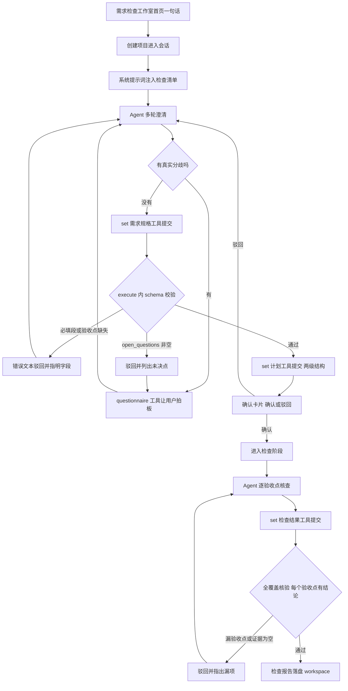

# 需求检查工作区改造成 Grasp 需求处理机制 - 可行性分析

> 目标：把 grasp（`thirdparties/grasp`）的需求处理机制（一句话 → 澄清 → 结构化规格 →
> 六层防漏）迁移进 xc-ui-flow 的「需求检查」工作室（requirement-check）
> 日期：2026-11-07
> 前置阅读：`dev-docs/research/2026-11-07-grasp-需求处理机制分析.md`

## 一、结论（可行性判断）

**高度可行，且大部分地基已存在。** grasp 机制的四个核心件
（结构化产物工具、schema 驳回、问卷拍板、全覆盖核验）在 xc-ui-flow
都有原生等价物，真正要写的是「业务层」，不是「引擎层」：

| grasp 核心件 | xc-ui-flow 原生等价物 | 状态 |
|---|---|---|
| set_clarified_requirement 等结构化 MCP 工具 | `agent-tools.ts` 的 `defineTool`（TypeBox schema），且已有按 `project.type` 条件注入工具的先例（interactive-story） | 机制已有，只差工具本体 |
| ask_question 用户拍板 | `questionnaire` 工具（多问题/选项/recommended/preview/allowOther，全链路到 renderer 问卷 UI） | **零迁移** |
| 服务端 schema 校验驳回 | TypeBox 校验参数形状 + `execute` 内业务校验（错误文本回给 agent 触发重试） | 机制已有，只差校验逻辑 |
| 产物存储 | `project.workspacePath`（`.data/projects/<id>/workspace/`）目录落 JSON | 零迁移 |
| 检查清单注入 agent | `agent-prompts.ts` / `prompt-context.ts` 按项目注入系统提示词 | 机制已有，只差清单文案 |

**最大的架构差异只有一个**：grasp 是 FSM 工作流引擎（节点流转、人工门节点、
收尾拦截），xc-ui-flow 是聊天会话模型（无节点、无收束状态）。
消化方案：**不迁移引擎**，用「产物驱动的阶段」替代——阶段由 workspace 里的
产物文件齐全度推断，门禁全部落在工具的 `execute` 校验里（提交即驳回）。

## 二、两侧机制对齐总表（迁移映射）

| # | grasp 组件 | grasp 源码位置 | xc-ui-flow 落点 | 迁移量 |
|---|---|---|---|---|
| 1 | ask_question 拍板 | MCP 工具 | `questionnaire`（`agent-tools.ts`，已有） | **零** |
| 2 | clarified_requirement schema（30+ 字段 SRS 子集） | `structured/doc.go` | TS 类型 + TypeBox schema 直译（必填段/FR 验收点/priority 枚举） | 中 |
| 3 | set_clarified_requirement / set_plan / set_root_cause 工具 | MCP tools.go | `agent-tools.ts` 加 requirement-check 条件分支的 `defineTool` ×3 | 小 |
| 4 | Parse* 服务端校验（中文报错指明字段） | `structured/doc.go` | 各工具 `execute` 内校验函数（错误文本即驳回理由） | 中 |
| 5 | open_questions 硬门禁 | `enforceOpenQuestionsGate` + retry 提示词 | set 工具 `execute`：open_questions 非空 → 返回错误列出逐条，要求先 questionnaire | 小 |
| 6 | 产物契约（bug 必须有 root_cause / 非 bug 不得有） | `node_agent.go` finalizeAgent | 同上：execute 内按 work_kind 校验一致性 | 小 |
| 7 | clarify/plan checklist 技能注入 | agent workspace skills/ | `prompt-context.ts` 给 requirement-check 项目注入系统提示词（检查清单文案直译） | 小 |
| 8 | 人工门「确认并流转」 | human gate 节点 + inbox | `chat-text-action` 机制（会话卡片确认链接）或 questionnaire 确认选项 | 小-中 |
| 9 | plan 两级结构（g1/g1.2 叶子编号） | `plan.go` | set_plan execute 内解析编号（叶子提取函数直译，~60 行） | 小 |
| 10 | PlanCoverageOK 全覆盖核验 | `plan_coverage.go` + `verdict.go` | set_check_result（新工具）execute 内核验：每个验收点叶子恰好一条、passed、evidence 非空、引用用例真实通过 | 中（~100 行直译） |
| 11 | 产物渲染面板（spec 表格/验收点清单） | web Vue 组件 | MVP：会话消息卡片；后续：`create-workspace` 建 RequirementCheckWorkspace | 可选 |
| 12 | FSM 节点流转引擎 | engine 全套 | **不迁移**：产物文件齐全度推断阶段 | - |
| 13 | leftover 遗留清单 | `output_leftover.go` | **MVP 后置**：检查报告的 findings 段落先承载 | 后置 |
| 14 | Live 预览 / page.html 页面稿 | set_preview / demoHtml | **后置**：questionnaire 的 preview 字段可先承载文字对比 | 后置 |

## 三、改造后的目标流程



产物落盘结构（workspace 内）：

```text
.data/projects/<id>/workspace/
├── requirements/
│   ├── clarified-requirement.json    需求规格（SRS 子集）
│   ├── plan.json                     两级计划（g1/g1.2 叶子）
│   └── root-cause.json               work_kind=bug 时必有
└── check/
    └── check-result.json             检查结果（验收点全覆盖映射）
```

## 四、需要迁移的东西清单（按依赖顺序）

### P1 - MVP：纯会话内闭环（无新 UI，1 个 daemon 文件为主）

1. **schema TS 直译**（源：`structured/doc.go` 的字段表 + 校验规则）
   - `src/shared/requirement-check.ts`（新文件）：类型 + 校验函数
   - 必填段非空、FR 每条 detail + ≥1 验收标准、priority 枚举、
     work_kind 枚举、open_questions 读取、plan 叶子提取/编号
2. **三个 defineTool**（源：MCP set_* 工具语义）
   - `agent-tools.ts` 的 requirement-check 分支：
     `set_requirement_spec` / `set_check_plan` / `set_check_result`
   - execute：校验 → 不过则返回错误文本（即驳回）→ 过则写 workspace JSON
3. **检查清单提示词注入**（源：`agents/ClarifyAgent/workspace/skills/*-checklist`）
   - `prompt-context.ts`：requirement-check 项目的系统提示词追加自检清单
4. questionnaire 已有，直接复用

### P2 - 确认门与结构化渲染

5. **确认卡片**：`chat-text-action` 机制做「确认并流转 / 驳回」链接
   （或 questionnaire 单问确认，更 lazy）
6. **spec 卡片渲染**：工具调用的 details 渲染验收点表格
   （renderer 会话消息层，参照 todo 卡片渲染）

### P3 - 专属工作区（可选，用 create-workspace 技能）

7. `RequirementCheckWorkspace`：阶段条（产物齐全度推断）+ 验收点面板 +
   检查结果视图——`create-workspace` 技能走 wire.py 流程接线

### 后置（明确不做进 MVP）

- leftover 遗留清单机制（检查报告 findings 段先承载）
- page.html 页面稿 / Live 预览（questionnaire preview 文字对比先承载）
- FSM 引擎、多 agent 团队（Clarify/Implement/TestReview 三 profile）

## 五、风险与坑

| 风险 | 说明 | 对策 |
|---|---|---|
| 会话无「收尾」状态 | grasp 第二层门禁（拦收尾）无处落——若 agent 不调 set 工具而是闲聊结束，产物缺失不会被拦截 | 只做 set 时驳回（grasp 第一层同效）；提示词强约束「产物未落盘不得结束」；P2 确认卡片作为用户侧出口 |
| questionnaire 无 demoHtml | grasp 的选项级 HTML 并排对比没有原生等价物 | 文字 preview 先行；页面稿对比确有需求再后置 |
| 长会话上下文膨胀 | spec 变大后每轮带全量 | 产物落盘后提示词改为「读 workspace 产物文件」（pi 已有 read 工具），会话只携带增量 |
| 校验逻辑直译走样 | grasp 校验有大量细节（编号、trim、scenario_ids 过滤） | 直译时对照 `doc.go` 原函数逐条搬；vitest 单测锁行为 |
| 工具误用 write 兜底 | grasp 禁止 write_artifact 冒充结构化产物 | xc-ui-flow 的产物工具自带 schema，自由文本没有写入入口，此坑天然不存在 |

## 六、类比理解

grasp 是**工厂流水线**（FSM 传送带，每站有质检门，站与站由引擎推动）；
xc-ui-flow 是**一个老练的工头带本子蹲在现场**（聊天会话，工具是本子上的表格）。
改造不是把传送带搬进现场——而是把**质检标准**搬过来：工头手里的三张表格
（规格表/计划表/检查表）改成带校验的制式表格，填不齐就退回重填，
本子（workspace）归档。传送带（引擎）不需要，因为现场本来就没有「下一站」，
只有「下一张表」。

## 引用说明

- grasp 需求处理机制分析：`dev-docs/research/2026-11-07-grasp-需求处理机制分析.md`
- grasp 源码（本仓库副本）：`thirdparties/grasp/`（schema：`server/internal/mcp/structured/doc.go`；
  核验：`server/internal/mcp/plan_coverage.go`；门禁：`server/internal/runtime/acp_react.go`）
- xc-ui-flow 工具注入点：`src/daemon/agent-tools.ts`（createAgentTools）+ `src/daemon/app.ts:876`（projectAgentTools）
- chat-text-action 机制：`.claude/skills/chat-text-action/`
- create-workspace 技能：`.claude/skills/create-workspace/`
