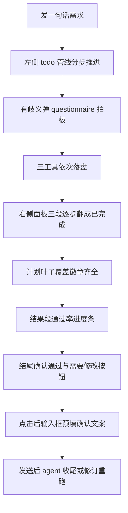

# 需求检查工作区 - 手动测试指南（P3 版）

- 适用：需求检查工作室（requirement-check 项目类型）grasp 化改造 P1+P2+P3（分支 `feat/requirement-check-grasp`，最新 commit `4952fb2`）
- 更新：2026-11-09（P3：专属产物面板 + 进度统计 + 确认门链接）

## 入口与前置

| 入口 | 链接 |
|---|---|
| 需求检查工作室（新建项目） | `http://127.0.0.1:43120/#/requirement-check` |
| 已有测试项目（验收-需求检查） | `http://127.0.0.1:43120/#/projects/6f2c5f7a-db27-4cc7-b0f4-7492a28dd280` |

```powershell
# 两个服务（daemon 43110 / renderer 43120）
bun run dev          # 或分开：bun run dev:daemon + bun run dev:renderer
```

- daemon 已用 `--watch --watch-path=./src` 跑。两个已知坑（详见 `dev-docs/experience/daemon-watch-kills-agent-session.md`）：
  - 发消息永远思考中 + updatedAt 停滞 → 查 daemon 是否中途重启
  - **跑着会话时改了 daemon 侧代码** → watch 重启 EADDRINUSE 卡死（health 仍 200 但跑旧代码），需杀链重起
- 浏览器**硬刷新**后再测（tsx/daemon 重启后页面可能持旧 JS）。

## P3 新增：专属产物面板

打开 requirement-check 项目的任一会话，右侧**不再**是「从工作区文件树中选择一个文件」空画布，而是「需求检查产物」面板：

| # | 检查点 | 预期 |
|---|---|---|
| 1 | 阶段条 | 面板顶部三个胶囊：需求规格 / 检查计划 / 检查结果，各带状态小字（未开始 / 生成中 / 已完成） |
| 2 | 空态 | 无产物时三段虚线卡显示「发送一句话需求开始流程，产物落盘后在这里展示。」 |
| 3 | 生成中 | agent 跑流程时，未落盘的阶段显示转圈「生成中」 |
| 4 | 规格段 | 全量渲染：标题 + workKind 徽标（feature/bug）+ 概述 + f1/f2 编号 + must/should 徽标 + **FR 详情全文** + 验收点列表 + 范围内/外彩色标签 |
| 5 | 计划段 | g1/g2 两级树；**每个叶子右侧带覆盖徽章**（通过=绿 / 未通过=红 / 未覆盖=灰——未覆盖=计划叶子没进检查结果） |
| 6 | 结果段 | 头部**绿色通过率进度条 + passed/total 大数字**（如 15/ 15 100%）；覆盖表逐条带徽章 + 证据；findings 带严重度徽标（blocker/major/minor/info） |
| 7 | 刷新 | agent 每落盘一份产物，面板对应段从「生成中」翻成全量内容（workspaceRevision 驱动，无需手动刷新） |

**快速复验（不跑模型）**：打开已有产物的会话（上面第二入口的任一旧会话），三段直接全「已完成」。

## P3 新增：确认门链接

agent 跑完全链路（set_check_result 落盘）后，结尾消息底部出现两个按钮样式链接：

| # | 检查点 | 预期 |
|---|---|---|
| 1 | 链接渲染 | 「确认通过」「需要修改」两个绿色胶囊按钮（非普通文本、非空白新标签链接） |
| 2 | 点击「确认通过」 | 输入框预填「确认通过这份检查结果，请结束流程。」——你检查后按发送，agent 收尾 |
| 3 | 点击「需要修改」 | 输入框预填「需要修改：」——补上意见后发送，agent 按意见修订重落盘，再抛确认链接 |
| 4 | 兜底 | 模型若漏输出链接（prompt 约束非硬保证），questionnaire 确认通道仍可用 |

### 默认假设拍板（2026-11-09 修复后预期）

用户原话未明确、影响行为/范围/优先级的点（如：切换作用范围、偏好是否持久化、是否提供某选项）：

| # | 检查点 | 预期 |
|---|---|---|
| 1 | 澄清阶段 | agent 在落盘前用 **questionnaire 逐点提问**（选择型拍板，带推荐选项与理由，多题分 tab），而不是自行写默认假设 |
| 2 | 结果阶段 | 检查结果不应再出现「默认假设」类 info 发现；若模型仍漏出，agent 会在确认门前把每个假设作为 questionnaire 题目逐点拍板，再修订产物重落盘 |
| 3 | assumptions 字段 | 只能装用户已确认的内容，不确认的默认值写进去属违规 |

历史会话（修复前）里看到的三个 info 假设发现是旧 prompt 的产物，新对话不应再现。

已知残留（模型遵循度，非结构问题）：拍板答案全部选默认值时，agent 可能跳过「修订重落盘」直接结束而漏出最终确认链接——追问一句「请继续完成最终确认环节」即可补出；另偶见模型收到追问后只推理不输出的怪异响应，重发一次即可。

## 完整用例（全链路，2~5 分钟）

新建对话，发送：

```
登录页支持手机号验证码登录，验证码60秒内送达，5分钟内有效
```

观察全链路：



时间线里同时保留 P2 的三张工具卡（三层折叠，逐层点开：turn 折叠 → 工具组折叠 → 工具卡折叠）。

## 其它用例

| 用例 | 输入 | 预期 |
|---|---|---|
| 歧义拍板 | `加一个搜索功能，要快` | 中途弹 questionnaire；拍板后不再重复追问 |
| bug 类需求 | `下单后订单列表不刷新，偶现，概率大概10%` | 面板规格段 workKind 徽标 bug（红）、含根因 |

## 已知边界（不算 bug）

- **旧会话的确认链接**：P3 prompt 指令只影响新对话；旧对话结尾是纯文本确认（可继续对话触发新回复带链接）。
- **同项目多对话**：产物文件是**项目级**（三份 json 全项目共享）——面板显示最新落盘版本，与哪个对话无关；建议一个需求一个项目。
- **模型生成耗时**：全链路 2~5 分钟正常；「思考中」期间会话 updatedAt 持续变化即健康。
- **openQuestions 非空拒收**：规格带未解决待澄清点时 set_requirement_spec 被拒（设计行为：先 questionnaire 拍板再落盘）。
- **renderer 测试基线失败**：时间线/i18n 渲染测试在本机基线即挂（与本改造无关，stash 比对一致）；渲染验证以本指南实机步骤为准。

## 提 bug 时附上

- 会话 URL + 现象描述 + 截图（存 `dev-examples/browser-selftest-shots/`）
- daemon.log 相关片段（`dev-examples/daemon.log`）

## 关联文档

- 差距分析（P3 设计输入）：`dev-docs/research/2026-11-09-grasp渲染效果差异分析.md`
- P1/P2/P3 报告：`dev-docs/progress-result/需求检查grasp化-P{1,2,3}-执行报告.md`
- 坑文档：`dev-docs/experience/daemon-watch-kills-agent-session.md`
