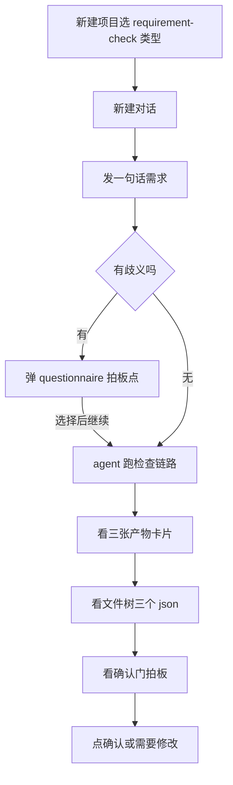

# 需求检查工作区 - 手动测试指南

- 适用：需求检查工作室（requirement-check 项目类型）grasp 化改造（分支 `feat/requirement-check-grasp`，P1 结构化产物与门禁 + P2 确认门与卡片渲染）
- 更新：2026-11-09（watch 误杀修复后）

## 前置条件

```powershell
# 两个服务（daemon 43110 / renderer 43120）
bun run dev          # 或分开：bun run dev:daemon + bun run dev:renderer
```

- daemon 已用 `--watch-path=./src` 跑（commit `2f5dac3` 修复「agent 跑起来 watch 误报 node_modules 变化重启杀会话」）。若发消息永远思考中且 updatedAt 停滞，先查 daemon 是否中途重启（见 `dev-docs/experience/daemon-watch-kills-agent-session.md`）。
- 浏览器开 `http://127.0.0.1:43120`。

## 测试流程总览



## 用例一：基本链路（顺畅需求）

新建对话，发送：

```
登录页支持手机号验证码登录，验证码60秒内送达，5分钟内有效
```

依次验证：

| # | 环节 | 预期 | 不符时 |
|---|---|---|---|
| 1 | todo 管线 | 左侧出现分步 todo 卡片（梳理需求 → 规格落盘 → 制定计划 → 执行检查），随进度勾选 | 无 todo 卡片 → 提示词未生效 |
| 2 | questionnaire | 无歧义则不弹；有歧义弹选择题 | - |
| 3 | 规格卡片 | 工具卡展开后为**卡片**：标题 + workKind 徽标（feature 蓝色）+ FR 列表（f1/f2 编号 + must/should 徽标 + 验收点）+ 范围内/外 | 展开是原始 JSON 串或卡片空 → arguments 被截断（compact 未生效）|
| 4 | 计划卡片 | 两级树 g1 → g1.1/g1.2（叶子带标题） | 层级塌平 → 渲染分支未命中 |
| 5 | 结果卡片 | 覆盖表（planId + 通过/未通过徽标 + evidence）+ passed/total 计数 + findings 带严重度徽标（blocker 红/major 橙）| - |
| 6 | 文件树 | 右侧工作区出现 `requirements/requirement-spec.json`、`requirements/check-plan.json`、`check/check-result.json` 三个文件 | 文件缺失 → 工具 execute 未落盘 |
| 7 | 如实上报 | 无实现环境的叶子 passed=false + findings 说明原因（不假通过） | 全 passed 且无证据 → 不如实 |
| 8 | 确认门 | 结尾抛待拍板点 + 请你确认（确认 / 需要修改）；点「需要修改」给意见后应修正重落盘再确认 | 直接结束不再确认 → 确认门纪律未生效 |

## 用例二：歧义需求（测 questionnaire 拍板）

新建对话，发送：

```
加一个搜索功能，要快
```

预期：中途弹 questionnaire 选择题（搜索范围、延迟标准等拍板点），选择后链路继续，不再重复追问已拍板的问题。

## 用例三：bug 类需求（测 workKind 徽标）

新建对话，发送：

```
下单后订单列表不刷新，偶现，概率大概10%
```

预期：规格卡片 workKind 徽标显示 **bug**（红色）而非 feature，含根因表述（rootCause）。

## 已知边界（不算 bug）

- **历史会话卡片数据为旧**：compact 修复（`ba45836`）之前创建的会话，工具卡 arguments 已被持久化截断成字符串，卡片会缺 FR/覆盖数据——只在新对话验证。不迁移历史数据。
- **模型生成耗时**：一条需求全链路 2~5 分钟正常（三份结构化产物生成量大）；「思考中」期间 updatedAt 持续变化即正常。
- **openQuestions 非空会拒收**：规格若带未解决 openQuestions，set_requirement_spec 会被拒（rejection 提示先经 questionnaire 拍板）——这是设计行为。
- **renderer 测试套件基线失败**：`test/agent-timeline*`、i18n 相关渲染测试在本机基线即挂（与本改造无关，stash 比对一致）；渲染验证以本指南实机步骤为准。

## 提交 bug 时附上

- 会话 URL（`#/projects/<id>/conversations/<id>`）
- 现象描述 + 截图（存 `dev-examples/browser-selftest-shots/`）
- daemon.log 相关片段（`dev-examples/daemon.log`）

## 关联文档

- 设计：`dev-docs/design/需求检查工作区grasp化改造-可行性分析.md`
- P1 报告：`dev-docs/progress-result/需求检查grasp化-P1-执行报告.md`
- P2 报告：`dev-docs/progress-result/需求检查grasp化-P2-执行报告.md`
