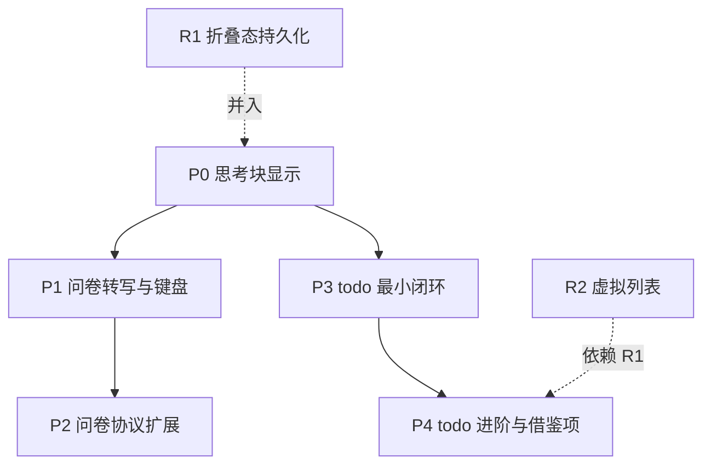

# 对话框增强执行计划（thinking / questionnaire / todo）

日期：2026-11-03
依据：`dev-docs/research/2026-11-03-thinkrail-chat-compare.md`（对比分析）与 `dev-docs/design/2026-11-03-chat-enhancement-requirements.md`（R1-R6 需求池）
范围：P0 thinking 显示、P1/P2 questionnaire 增强、P3 todo MVP、P4 进阶与借鉴项
目标：分四个阶段把 chatbox 对话框三大缺失能力补齐，每阶段独立可交付、可验证

---

## 阶段总览

| 阶段 | 内容 | 改动面 | 预估规模 | 交付物 |
|------|------|--------|---------|--------|
| P0 | thinking 可折叠显示 | 仅 renderer | 小 | 思考内容可展开查看（含历史会话） |
| P1 | questionnaire 低配增强 | 仅 renderer | 小-中 | 答题转写记录 + 键盘交互 + tab 导航 |
| P2 | questionnaire 高配（协议扩展） | contracts + daemon + renderer | 中 | multiSelect / preview / notes / recommendedReason |
| P3 | todo MVP | contracts + daemon + renderer | 中 | agent 可维护任务清单、用户可见进度 |
| P4 | todo 进阶 + R2-R6 借鉴项 | 视项而定 | 大 | 分组、用户加 todo、侧栏面板等（另行细化） |

依赖关系：



通用验证命令（每阶段完成后必跑）：

```
bun run typecheck
bun run test
bun run build:renderer
```

手动验证：`bun run dev` 起开发态，按各阶段「验证清单」逐项确认。UI 新文案同步加 `src/renderer/locales/en.ts` 与 `zh-CN.ts`。

---

## P0 thinking 可折叠显示

### 前置事实（已核实）

- 数据链路完整：daemon 流式发 `item.reasoning.textDelta`（`src/daemon/agent.ts:1824-1845`），前端 `src/renderer/state.ts:179` 累积 text；历史会话加载时从 pi 会话记录重建 reasoning item（`src/daemon/agent.ts:250`，id 形如 `entryId:thinking:index`，跨重载稳定）。
- 当前 UI 丢弃：`src/renderer/agent-timeline.tsx:541` `if (item.type === "reasoning") return null`。
- 现有折叠组件 `LazyDetails`（`src/renderer/lazy-details.tsx`）无状态持久。

### 实施步骤

1. **新建折叠态小工具（并入 R1）**：在 `src/renderer/agent-timeline.tsx` 内（或抽独立文件）加模块级 `Map<string, boolean>` + `useFold(id)` hook，按 item id 记展开态；会话卸载时可整体丢弃（不落盘）。
2. **新建 `ThinkingBlock` 组件**（渲染 reasoning item）：
   - 折叠条：脑图标 + 「思考」标签 + headline（首行非空文本，剥掉首尾 `**`/`__`，参考 thinkrail `extractThinkingHeading` 的简化版）+ 摘要（字符数 `N 字`，沿用现有 durationLabel 风格做 i18n）；
   - `status === "inProgress"` 时折叠条显示现有 ShimmerText 效果，且默认展开、结束后保持用户手动设定；
   - 展开体：`whitespace-pre-wrap break-words` 渲染 `item.text` 纯文本（不走 markdown，避免思考里半截语法渲染异常）；
   - 使用 `useFold(item.id)` 持久展开态。
3. **接入**：`TimelineItem` 中把 `return null` 改为 `return <ThinkingBlock item={item} />`；确认 `projectTurnDisplay` 的 `withoutInitialThinking`（进行中 turn 隐藏开头 reasoning）与 `work-items.ts` 的 ThinkingActivity shimmer 两个路径都改为渲染 ThinkingBlock（shimmer 信息并入折叠条，删除独立 `ThinkingActivity`）。
4. **样式**：`src/renderer/styles.css` 加 thinking 块样式（折叠条 hover、缩进对齐现有 tool-group）。
5. **i18n**：`locales/en.ts` + `zh-CN.ts` 加 `timeline.thinking`、`timeline.thinkingChars` 等 key。
6. **不做**（记录为升级路径）：thinking 与其后工具调用的父子嵌套（thinkrail `nestRoutineRun`）——chatbox 已有 tool-group 折叠，收益边际，后续有需要再做。

### 验证清单

- 进行中会话：思考流式追加可见，折叠条有动效；工具调用开始后思考块仍在原位可回看；
- 已完成会话：折叠条显示 headline 与字数，展开看全文，折叠/展开态切会话再切回不丢；
- 历史会话（重启 daemon 后加载）：thinking 内容同样可见；
- 无 reasoning 的会话无空白块；空文本 reasoning item（state.ts:298 已清理）不渲染。

### 风险与对策

- reasoning item 可能很长（数千字）：展开体加 `max-height` + 内滚动，避免一条思考撑爆 timeline。
- `hadThinking`「已停止思考」文案与新块可能信息重复：保留文案但确认不冲突。

---

## P1 questionnaire 低配增强（仅 UI）

### 前置事实

- 交互卡由 `src/renderer/project-shell.tsx:412` 检出 `inProgress` 的 `userInputRequest` 挂在输入框上方；答完后 `projectTurnDisplay` 无条件过滤 `userInputRequest`（`src/renderer/turn-display.ts`），对话里不留痕。
- 卡片 `src/renderer/questionnaire-card.tsx`：自动跳题 + 全部答完自动提交，无键盘漫游、无 tab 导航。

### 实施步骤

1. **保留转写记录**：
   - `turn-display.ts`：把 `item.type !== "userInputRequest"` 的过滤改为「仅在 inProgress 时过滤」（inProgress 卡片仍在输入框上方渲染，避免双份）；completed/failed 的进入 `messages` 流；
   - `agent-timeline.tsx`：新增 `QuestionnaireRecord` 只读渲染（参考 thinkrail `QuestionRecap`）：每问列出全部选项，选中项打勾高亮、未选中灰化，自定义答案引号显示，skip 时显示「已跳过」；数据源为 item 的 `questions` + `answers`（协议已有）。
2. **tab 导航**：`questionnaire-card.tsx` 顶部加 question chips（当前高亮、已答打勾，参考 thinkrail `TabChip`，`role="tablist"/tab/tabpanel` 语义）；替换现有「上一问/下一问」按钮（保留 skip）。
3. **键盘交互**：选项容器加 `radiogroup` 语义（单选场景）；ArrowUp/Down 移动并选中、Space 选中、Enter 确认当前题（确认 = 跳下一题，最后一题 = 提交）；「其他」行聚焦其输入框；Enter 空答时行内提示「先选择一个选项」（带 `aria-live`）。保留现有鼠标点击与自动跳题逻辑不变。
4. **i18n + 样式**：新增 key（已答标记、跳过标记、空答提示等）双语；chips/record 样式进 styles.css。

### 验证清单

- 答完一轮问卷：上方卡片消失，timeline 出现转写记录，选项勾选状态与实际回答一致；skip 后记录显示「已跳过」；
- 历史会话加载：旧 userInputRequest（completed）也渲染记录；
- 键盘-only 完成整轮问卷可行；Tab 键可达所有控件；
- inProgress 期间 timeline 不出现第二份卡片。

### 风险与对策

- `answers` 里 `custom: true` 的答案没有对应选项：record 渲染按 questionId 匹配 + custom 引号显示，两者都兜住。

---

## P2 questionnaire 高配（协议扩展）

### 实施步骤

1. **协议扩展**（`src/shared/contracts.ts`，全部 Optional 字段保证旧数据兼容）：
   - `QuestionnaireQuestion` 加 `multiSelect?: boolean`、`header?: string`；
   - `QuestionnaireOption` 加 `preview?: string`、`recommendedReason?: string`；
   - `QuestionnaireAnswer` 加 `notes?: string`；`value` 在 multiSelect 下为逗号/换行拼接的选中 value 集合（保持 `value: string` 不破坏现有提交协议 `answers: [{ questionId, value }]`）。
2. **工具 schema 更新**（`src/daemon/agent-tools.ts` questionnaire defineTool）：
   - questions `maxItems` 3 → 4；选项加 `preview`（maxLength 约 2000）、`recommendedReason`（maxLength 300）、问题加 `multiSelect`（boolean，描述写明「仅当允许多个答案同时成立时使用」）；
   - 结果 text 拼接带上 notes（`questionId: label (备注: …)`）。
3. **渲染升级**（`questionnaire-card.tsx`）：
   - multiSelect：checkbox 语义 + 空格切换 + 多选后「提交」按钮（不再自动跳题）；单选保持自动流；
   - preview：任一选项带 preview 时双栏布局，右侧渲染 preview（markdown 可先 `pre` 纯文本，P2 内不引入 markdown 依赖）；
   - recommendedReason：选项卡内内联「为什么：…」小字；
   - notes：每个已勾选项下方「添加备注 / 编辑备注」入口，Enter 收起、Shift+Enter 换行、Escape 关闭不丢文本；
   - P1 的 QuestionnaireRecord 同步支持 multiSelect 多勾与 notes 回显。
4. **skip 语义不变**：daemon 侧「用户跳过，继续用默认值」文案不动。

### 验证清单

- 旧会话（无新字段）加载与作答完全不受影响；
- 多选题可勾多个 + 备注，提交后 daemon 收到完整 value 与 notes；
- preview 双栏在窄屏退化为单栏；
- `bun run test`：为 schema 与提交拼接连通加测试（参照现有 test/ 中 agent 相关用例风格，最小断言即可）。

### 风险与对策

- 多选 value 拼接格式与 daemon 结果 text 的一致性：在 contracts 注释里写死格式（换行分隔），daemon/renderer 同读同写；
- preview 文本过长：渲染区 `max-height` + 滚动。

---

## P3 todo MVP

### 设计决策（沿用 `update_plan` 先例）

chatbox 已有「结构化工具结果 → 专属 ThreadItem」先例：daemon 拦截 `update_plan` 结果生成 `type: "plan"` item（`src/daemon/agent.ts:2055-2075`、历史加载 `:335-350` 同样重建）。todo MVP 沿用同模式：

- daemon 定义单个 `todo_write` 工具（全量快照式写入，模型每次重写整表——单工具、无增量更新语义，符合 MVP）；
- daemon 拦截其结果，解析为快照，产出 `type: "todoList"` ThreadItem（同 turnId 复用同 id，后写覆盖前写，最终 timeline 只留最新一张卡）。

### 实施步骤

1. **协议**（`src/shared/contracts.ts`）：
   - 新增 `TodoSnapshot { items: Array<{ title: string; status: "pending" | "in_progress" | "done" }> }`；
   - ThreadItem 加 `{ type: "todoList"; todos: TodoSnapshot }`（status 字段沿用 ItemStatus 表示工具调用完成态）。
2. **daemon**（`src/daemon/agent-tools.ts` + `src/daemon/agent.ts`）：
   - `defineTool`：name `todo_write`，description 指导「开始多步任务前列计划，每完成一步重写全表更新状态」；参数 `items` 数组（title + status 枚举）；
   - `agent.ts` 仿 plan 路径：工具开始时产出 inProgress 的 todoList item，结束时写入解析后的快照并 complete；历史加载分支同样从持久化 tool call 重建 todoList item；
   - 工具结果 text：返回当前清单人类可读文本（供模型自检）。
3. **renderer**：
   - `agent-timeline.tsx` 新增 `TodoListCard`：三段渲染（进行中在最上、待办、已完成灰色），行级状态图标（进行中转圈/完成勾/待办圈），当前项高亮；参考 thinkrail `TodoList.tsx` 的视觉但砍掉分组/review/变更集/用户编辑；
   - `turn-display.ts` / `work-items.ts`：todoList item 归入 `messages` 流（非 work item），保证它不被 tool-group 折叠吞掉；
   - `isWorkItem` 不含 todoList（避免被算进 work 摘要）。
4. **i18n + 样式**：`timeline.todo.*` key 双语；卡片样式对齐 plan-approval-card 风格。

### 验证清单

- agent 多步任务中调用 todo_write：卡片出现并随重写更新，进行中项可见；
- 会话完成后历史加载：最终清单可见（从持久化记录重建）；
- 多次 todo_write 只显示最新快照（同 id 覆盖）；
- 不调用工具的会话无任何变化；`bun run test` 为 daemon 的 todo 拦截/重建加最小测试。

### 风险与对策

- 模型不主动用工具：工具 description 写清触发时机；后续 P4 再考虑系统提示引导；
- 快照式重写丢状态：MVP 接受（thinkrail 的 reconcile 匹配进 P4）。

---

## P4 进阶（本计划只定边界，实施前另行细化）

1. **todo 进阶**：分组（todo_add/todo_update 增量工具 + 标题匹配 reconcile）、用户加 todo + nudge（仿 thinkrail `nudgeAgent`）、独立侧栏面板（挂到现有 workspace 面板体系）、事件驱动刷新。
2. **R2-R6 借鉴项**：按 `dev-docs/design/2026-11-03-chat-enhancement-requirements.md` 排期（R1 已并入 P0）。

---

## 里程碑与进度记录约定

- 每阶段完成即更新 `dev-docs/progress/执行进度.md` 里程碑表，并在 `dev-docs/progress-result/` 新建对应阶段执行报告（P0-执行报告.md …），记录：完成时间、交付清单、验证结果、遗留问题；
- 每阶段独立 git 分支（`feat/xxx`），目标分支按仓库规范；
- 阶段中途的架构决策（如 P3 的先例复用决策）同步记入进度文档。

---

## 引用说明

- 对比分析：`dev-docs/research/2026-11-03-thinkrail-chat-compare.md`
- 借鉴项需求池：`dev-docs/design/2026-11-03-chat-enhancement-requirements.md`
- 本仓库关键现状：`src/renderer/agent-timeline.tsx`（reasoning 丢弃点 :541）、`src/renderer/turn-display.ts`、`src/renderer/questionnaire-card.tsx`、`src/renderer/project-shell.tsx`、`src/daemon/agent-tools.ts`（questionnaire 工具）、`src/daemon/agent.ts`（reasoning 事件 :1824、plan 拦截先例 :2055、历史重建 :250/:335）、`src/renderer/lazy-details.tsx`
- thinkrail 参考实现：`thirdparties/thinkrail/apps/web/src/chat/` 下 `ActivityGroup.tsx`、`foldState.ts`、`TodoList.tsx`、`useChatTodos.ts`；`thirdparties/thinkrail/thinkrail-extensions/ask-user-question/web/AskUserQuestionCard.tsx`
- 仓库地址：https://github.com/JetBrains/thinkrail
