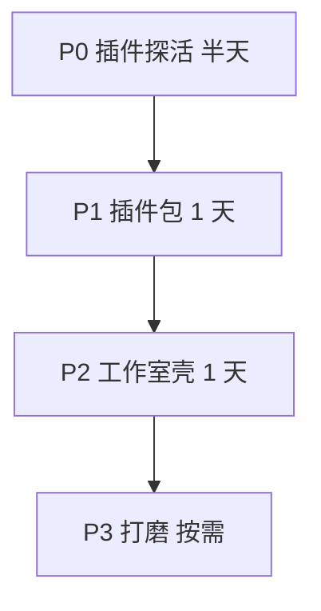

# FairyGUI 工作室执行文档

> 依据：`dev-docs/design/FairyGUI工作室设计分析.md`（方案）+ `dev-docs/research/FairyGUI插件构建可行性分析.md`（插件包设计）
> 范围：新增 `fairygui` 项目类型 + FairyGUI 工作室页 + `plugins/fairygui` 插件包，端到端可验收。
> 分支：master 直接提交，每阶段一个 commit；全程 typecheck 通过是硬闸门。

## 总览



| 阶段 | 内容 | 出口标准 | commit |
|---|---|---|---|
| P0 ✅ | 编辑器侧桥探活实测（2026-10-26 完成） | `ping` 通；`OpenDocument` 可用 / `screenshot` 被裁，结论已入文档 | （无仓库代码，补丁在 dev-examples 工程内） |
| P1 | `plugins/fairygui/` 插件包落地 | 插件页可启用；general 项目会话里 MCP 全链路通 | feat: fairygui plugin |
| P2 | 工作室壳（12 处小改） | `#/fairygui` 首页可开项目，会话工具就位 | feat: fairygui studio |
| P3 | 打磨（角标/文案/分组） | 无功能回归 | chore |

---

## P0 编辑器侧桥探活（半天，不改仓库代码）——✅ 已完成（2026-10-26）

实测环境：FairyGUI-Editor **6.1.4**（`D:\FairyGUI-Editor_6.1.4`），测试工程 `mini.fairy`。
完整结果见 `dev-docs/progress/FairyGUI工作室-P0-探活记录.md`，关键结论：

| 命令 | 结论 |
|---|---|
| ping / project_info / list_packages / read_component | 可用 |
| list_items | 可用（需带空目录判空补丁，否则真实工程必崩） |
| **open_doc** | **可用**（上游作者构建被裁，6.1.4 正常）→ 截图验收可走「打开组件→OS 截屏」 |
| **screenshot** | **不可用**（`ScreenCapture` 被裁）→ P3 用 PowerShell CopyFromScreen 截窗口 |
| create_component / set_property / save_all / delete_item | 可用；`set_property` 改尺寸用 `width`/`height`（`size` 字符串不落盘），改后须 `save_all` |

**P1 收编 plugin/main.js 时必须带两个本地补丁**（见 `dev-docs/experience/fairygui-agent-bridge-local-patches.md`）：① `itemInfo` 空目录判空；② `App.add_onUpdate` + `Timers` 双泵（保险）。

### 测试工程（已就位，探活已完成）

| 项 | 值 |
|---|---|
| 路径 | `dev-examples/fairygui-test-project/`（真实 client 工程副本，243MB，已 gitignore） |
| 工程文件 | `mini.fairy`（type **CocosCreator**，version 5.0） |
| 包数量 | 88 个（`box_*` / `_gm` 前缀，如 `box_room_info`） |
| 既有插件 | `plugins/customInspector`、`gamePackageRun`、`uideclare`（与 agent-bridge 无冲突，可共存） |
| 桥插件 | 已装：`plugins/agent-bridge/`（上游 `4b3abc1` + 两个本地补丁） |

注意：工程里还有自带脚本（`publishFGUI*.py`）与 `.objs` 构建缓存；create/delete 往返选一个专用测试包，别碰 `box_*` 业务包。

### 步骤（已完成，命令留存备考）

1. ~~准备测试工程、安装桥插件~~（已完成）。
2. ~~打开 `mini.fairy` 确认 bridge.log~~（已完成，`listening on http://localhost:7531/ v0.2.0`）。
3. ~~逐条实测~~（已完成，结果见顶部结论表；`<某包>` 实用 `box_room_info`，冒烟组件 `XcSmokeTest` 用后即删）：

```bash
curl -X POST http://localhost:7531/ -d "{\"cmd\":\"ping\"}"
curl -X POST http://localhost:7531/ -d "{\"cmd\":\"project_info\"}"
curl -X POST http://localhost:7531/ -d "{\"cmd\":\"list_packages\"}"
curl -X POST http://localhost:7531/ -d "{\"cmd\":\"open_doc\",\"args\":{\"pkg\":\"<某包>\",\"name\":\"<某组件>\"}}"
curl -X POST http://localhost:7531/ -d "{\"cmd\":\"screenshot\",\"args\":{\"path\":\"C:/tmp/fgui-test.png\"}}"
curl -X POST http://localhost:7531/ -d "{\"cmd\":\"create_component\",\"args\":{\"pkg\":\"<测试包>\",\"name\":\"SmokeTest\",\"width\":400,\"height\":300}}"
curl -X POST http://localhost:7531/ -d "{\"cmd\":\"delete_item\",\"args\":{\"pkg\":\"<测试包>\",\"name\":\"SmokeTest\"}}"
```

4. 编辑器**最小化**重复 `ping`，确认后台仍服务（`runInBackground` 生效）。

### 结论记录

已写入 `dev-docs/progress/FairyGUI工作室-P0-探活记录.md`；踩坑过程沉淀在 `dev-docs/experience/fairygui-agent-bridge-local-patches.md`（含「TCP 通但命令不执行」「Lua 冒号语法打死插件」「监听仅 IPv6」三个坑）。

任何一条不过：P1/P3 范围相应裁剪，**不阻塞 P1**（创建/属性/发布不依赖这两条）。（本轮仅 screenshot 不可用，P3 已有 OS 截屏退路，不阻塞。）

---

## P1 插件包（1 天）

### 目录结构（新建 `plugins/fairygui/`）

```text
plugins/fairygui/
├── .ohmygame-plugin/plugin.json
├── mcp.json
├── mcp/
│   ├── server.mjs          # 收编自 thirdparties/fairygui-agent-bridge/mcp/server.mjs
│   ├── fgui.mjs            # 收编 cli/fgui.mjs（ensure/launch 用）
│   └── instances.mjs       # 收编 cli/instances.mjs
├── editor-plugin/          # 将被安装进用户 FGUI 工程的编辑器侧插件
│   ├── main.js             # 收编 plugin/main.js
│   └── package.json        # 收编 plugin/package.json
├── scripts/
│   ├── install.bat         # 改造自上游：把 editor-plugin/ 复制到目标工程 plugins/agent-bridge/
│   ├── install.sh
│   └── lint_components.mjs # 收编
├── skills/fairygui-ui/SKILL.md
├── assets/icon.svg
└── assets/NOTICE.md        # 上游来源 + commit + MIT 声明
```

### 1.1 收编文件

```powershell
# 在仓库根执行
$src = "thirdparties/fairygui-agent-bridge"
New-Item -ItemType Directory -Force plugins/fairygui/mcp, plugins/fairygui/editor-plugin, plugins/fairygui/scripts, plugins/fairygui/skills/fairygui-ui, plugins/fairygui/assets | Out-Null
Copy-Item "$src/mcp/server.mjs"    plugins/fairygui/mcp/
Copy-Item "$src/cli/fgui.mjs"      plugins/fairygui/mcp/
Copy-Item "$src/cli/instances.mjs" plugins/fairygui/mcp/
Copy-Item "$src/plugin/main.js","$src/plugin/package.json" plugins/fairygui/editor-plugin/
Copy-Item "$src/scripts/lint_components.mjs" plugins/fairygui/scripts/
```

收编后**逐个检查文件内相对路径引用**（`server.mjs` 若 import `../cli/*` 需改成同目录）。改 install 脚本的源目录从 `plugin/` 指向 `editor-plugin/`。

**P0 已验证的两个补丁必须一并打进 `editor-plugin/main.js`**（可从 `dev-examples/fairygui-test-project/plugins/agent-bridge/main.js` 直接 diff/复制，那里已验证可用）：

1. `itemInfo` 空目录判空（`if (ch == null) return o;`）——不带此补丁，真实工程 `list_items` depth>1 必崩；
2. `boot()` 双泵（`App.add_onUpdate` + `CS.FairyGUI.Timers.inst.Add(0.1, 0, onUpdate)`）与心跳日志。

改完必跑 `node --check editor-plugin/main.js`（JS 文件里误用 Lua 冒号语法会静默打死插件）。

### 1.2 `plugin.json`

```json
{
  "name": "fairygui",
  "version": "0.1.0",
  "enabledByDefault": false,
  "description": "Build FairyGUI components and publish UI packages through the editor bridge.",
  "skills": "./skills/",
  "mcpServers": "./mcp.json",
  "requirements": { "commands": ["node"] },
  "configuration": {
    "editor-exe": {
      "type": "text",
      "label": "FairyGUI 编辑器可执行文件",
      "description": "留空自动探测常见安装位置。"
    },
    "bridge-url": {
      "type": "text",
      "label": "Bridge URL",
      "description": "缺省 http://localhost:7531；多实例时填实际端口。"
    }
  },
  "interface": {
    "beta": true,
    "displayName": "FairyGUI",
    "shortDescription": "Assemble FairyGUI components and publish UI packages via the editor.",
    "longDescription": "Drive the FairyGUI editor through an in-editor bridge: list assets, create components, insert objects, set properties, and publish packages byte-identical to manual publishing. Requires the bridge plugin installed in your UI project (see Skill) and a running editor (free version works, can be minimized).",
    "icon": { "type": "preset", "id": "layers" },
    "defaultPrompt": [
      "List the packages in my FairyGUI project and describe the main components.",
      "Create a settings panel component with a title, close button, and toggles, then publish the package.",
      "Read this component and suggest how to refactor duplicated buttons into a common component."
    ],
    "projectTypes": ["fairygui", "general"]
  }
}
```

注意：P1 阶段 `"fairygui"` 类型还不存在，`projectTypes` 先只写 `["general"]`；**P2 第 1 步加类型后再补上 `"fairygui"`**（两个 commit 各自保持可运行）。

### 1.3 `mcp.json`

```json
{
  "mcpServers": {
    "fairygui": {
      "command": "node",
      "args": ["./mcp/server.mjs"],
      "env": {
        "FGUI_BRIDGE_URL": "${config.bridge-url}",
        "FGUI_EDITOR_EXE": "${config.editor-exe}"
      },
      "lifecycle": "lazy"
    }
  }
}
```

### 1.4 `skills/fairygui-ui/SKILL.md`（骨架，正文按此扩写）

```markdown
---
name: fairygui-ui
description: Create, inspect, edit, and publish FairyGUI UI components through the editor bridge, following FairyGUI authoring standards.
---

# FairyGUI UI

## 环境准备（一次性）
1. 桥不通时先装编辑器侧插件：`scripts/install.bat <UI 工程路径>`（把 editor-plugin 复制到 `<工程>/plugins/agent-bridge/`）。
2. 拉起并确认就绪：`node mcp/fgui.mjs ensure '{"project":"<UI 工程绝对路径>"}'`；ping 通才继续。

## 制作循环
list_items 找素材 → read_component 拿子对象命名 → create_component / insert_object / set_property 摆 UI → save_all → lint → publish 出包 → 游戏侧加载验证。
组件改动一律走 MCP 工具（官方 API、可撤销），禁止手改组件 XML 与 package.xml。
改尺寸用 props 里的 width/height（size 字符串不落盘）；任何写操作后必须 save_all 再 read_component 验证。

## 规范红线（违反会打不开组件或运行时事故）
- displayList 只有 10 种标签：image/graph/loader/loader3D/text/richtext/list/component/jta/group。
- extention 合法值 8 种：Button/Label/ComboBox/ProgressBar/Slider/ScrollBar/List/Tree；拼写就是 extention。
- 输入框是 text + input="true"；复选/单选是 Button mode="Check/Radio"；动画是 jta。
- 单组件 ≤ 80 个显示对象；动态重复结构用 list + defaultItem。
- 颜色用 6 位 #RRGGBB + alpha="0.x"（8 位色运行时只取后 6 位）。
- 九宫格、GLoader fill、relation、controller+Gear、GList、ScrollPane、GGraph、grayed 等引擎内置能力禁手搓。

## 验证
发布前必跑：`node scripts/lint_components.mjs <工程根>`。
截图给人看：`open_doc` 打开组件（6.1.4 实测可用）后用 OS 级窗口截屏（编辑器内置 ScreenCapture 被裁）。
多编辑器窗口时所有工具必须显式传 project 参数，避免操作错窗口。
```

### 1.5 `assets/NOTICE.md`

记录：上游仓库 URL、锁定的 commit（`4b3abc1`）、MIT 许可、收编文件清单与本地改动（install 脚本源目录、import 路径）。

### 1.6 验收

1. 重启 dev（daemon 需重扫 `plugins/`），插件页出现 FairyGUI 卡片（Personal/Beta 徽标）。
2. 启用插件 → 详情页「检查依赖」：node 可用、无黄项。
3. 新建/打开一个 general 项目，会话 `@` 菜单出现 FairyGUI 图标；对 agent 说「列出我的 FairyGUI 工程包」，确认 MCP 工具被调用且返回真实数据。
4. 全链路：让 agent `create_component` 一个测试组件 → `set_property` 改 title → `read_component` 验证落盘 → `delete_item` 还原。
5. `bun run typecheck` 通过。

commit：`feat: add fairygui plugin package (bridge from fairygui-agent-bridge@4b3abc1)`

---

## P2 工作室壳（1 天，12 处小改，按序执行）

> 顺序原则：先加 shared 契约（让编译器指出所有强制改动），再补渲染层。每步后 `bun run typecheck`，报错清单就是下一步的待办。

### 步骤 1：类型契约

`src/shared/contracts.ts`：

```ts
export const PROJECT_TYPE_IDS = ["general", "web-game", "interactive-story", "asset-canvas", "godot-game", "fairygui"] as const;
```

typecheck 此时会指向 `studios.ts`（GAME_STUDIOS 缺条目）——这正是编译器护航，接着补。

### 步骤 2：工作室条目

`src/renderer/studios.ts` 的 `GAME_STUDIOS` 加：

```ts
fairygui: {
  page: "fairygui",
  title: t("studio.fairygui.title"),
  placeholder: t("studio.fairygui.placeholder"),
  newLabel: t("studio.fairygui.new"),
},
```

### 步骤 3：文案

`src/renderer/locales/zh-CN.ts`：

- `projectType` 块加 `fairygui: "FairyGUI"`
- `studio` 块加：

```ts
fairygui: {
  title: "要做哪个界面的 UI？",
  placeholder: "描述你想制作或修改的 FairyGUI 界面…",
  new: "新建 FairyGUI 项目",
},
```

`src/renderer/locales/en.ts` 对应补：`"FairyGUI UI"` / `title: "What UI should we build?"` / `placeholder: "Describe the FairyGUI interface to create or edit…"` / `new: "New FairyGUI project"`。

### 步骤 4：路由

`src/renderer/routes.ts`：

- `SidebarPage` 联合加 `| "fairygui"`
- `SIDEBAR_PAGES` 集合加 `"fairygui"`（放在 `"asset-canvas"` 前后皆可，保持 studios 相邻）

### 步骤 5：侧边栏菜单项

`src/renderer/sidebar-config.ts` 的 `SidebarIcon` 联合加 `"fairygui"`，`SIDEBAR_ITEMS` 在 `godot` 之后加：

```ts
{ id: "fairygui", labelKey: "projectType.fairygui", icon: "fairygui", group: "studios" },
```

### 步骤 6：侧边栏图标

`src/renderer/styles.css` 在 `home-nav-icon-*` 系列处加（需先放一个 `src/renderer/assets/sidebar/fairygui.svg`，用 FairyGUI 官方 logo 简化版，静态 SVG）：

```css
.home-nav-icon-fairygui {
  mask-image: url("./assets/sidebar/fairygui.svg");
  -webkit-mask-image: url("./assets/sidebar/fairygui.svg");
}
```

> SVG 要求：与现有 sidebar/*.svg 同规格（纯形状、可作 mask 的单色镂空）。

### 步骤 7：页面分发

`src/renderer/app.tsx:69` 的分支改为：

```tsx
if (route.page === "general" || route.page === "web-game" || route.page === "interactive-story" || route.page === "godot" || route.page === "fairygui") {
  const projectType = route.page === "godot" ? "godot-game" as const : route.page === "fairygui" ? "fairygui" as const : route.page;
  return <GameStudioHome key={route.page} projectType={projectType} ... />;
}
```

### 步骤 8：类型图标

1. 新建 `src/renderer/fairygui-icon.tsx`（照抄 `godot-icon.tsx`，指向 `./assets/fairygui.svg`）。
2. `src/renderer/styles.css` 加 `.project-type-fairygui-icon`（照抄 `.project-type-godot-icon`，mask 指向同一 svg）。
3. `src/renderer/project-types.tsx` 的 `ProjectTypeIcon` 加分支：

```tsx
if (type === "fairygui") return <span className="project-type-fairygui-icon" style={{ width: size, height: size }} aria-hidden="true" />;
```

### 步骤 9：工作区边界

`src/renderer/coding-workspace.tsx:129`：

```ts
const publishingUnavailable = project?.type === "godot-game" || project?.type === "fairygui" || !!project?.integration;
```

（Web 预览无需改：`isWebRuntimeProjectType` 不含 `fairygui`，入口天然隐藏。）

### 步骤 10：插件 projectTypes 补全

`plugins/fairygui/.ohmygame-plugin/plugin.json` 的 `projectTypes` 改为 `["fairygui", "general"]`。

### 步骤 11：daemon 文案

`src/daemon/plugin-authoring.ts` 中 projectTypes 合法值列表补 `fairygui`（AI 建插件的提示词，grep `asset-canvas` 定位）。

### 步骤 12：首页类型下拉（决策点）

`home.tsx` 用 `GAME_PROJECT_TYPES`（自动含 fairygui）。若不希望首页「新建游戏」下拉出现 FairyGUI，改为显式过滤：`.filter(({ value }) => value !== "fairygui")`。**建议先不过滤**（少一行是一行），观察体验再定。

### P2 验收

1. `bun run typecheck` 通过；`bun run dev:daemon` + `dev:renderer` 起服务。
2. 侧边栏「工作室」组出现 FairyGUI 项，图标正常，点击进 `#/fairygui`。
3. 首页：空态文案正常 → 新建对话框选目录（绑定一个装好编辑器插件的 FGUI 工程）→ 卡片出现。
4. 打开项目进会话：`@` 菜单出现 FairyGUI；agent 能 `list_packages`（同 P1-4 链路，但现在项目类型是 fairygui）。
5. 边界：会话无 Web 预览入口、无社区发布入口。
6. 回归：godot/web-game/素材画布 三工作室正常。

commit：`feat: add fairygui studio (project type + sidebar + workspace boundaries)`

---

## P3 打磨（按需，各独立 commit）

| 项 | 内容 | 前置 |
|---|---|---|
| 桥状态角标 | 工作室首页轮询 `ping`，卡片上显示「编辑器已连接/未连接」 | P0 完成 |
| 截图验收 | P0 已确认 `open_doc` 可用 + `ScreenCapture` 被裁：Skill 增加「open_doc → PowerShell CopyFromScreen 截编辑器窗口 → 贴给用户看」步骤（脚本可放插件包 scripts/） | P0 完成 |
| 插件页分组 | `src/renderer/plugins.tsx` 的 `PLUGIN_CATEGORIES.engines.plugins` 加 `"ohmygame:fairygui"`（落「引擎与平台」组，否则在「其它」） | P2 |
| defaultPrompt / 文案调优 | 按实际试用改三语提示 | P2 |
| 示例工程 | examples 里放一个 FGUI demo 工程 | 按需 |

---

## 风险与回退

| 风险 | 缓解 | 回退 |
|---|---|---|
| `PROJECT_TYPE_IDS` 扩集合引发未预期的穷举检查报错 | 这正是护航机制，报错点全补齐即可；步骤按序做，每步 typecheck | git revert P2 commit，类型即收回 |
| 新类型写入数据目录后回退旧版本代码 | daemon 有 `isProjectType` 兜底；只加不减无迁移问题 | 无需数据迁移 |
| 用户 FGUI 工程没装编辑器插件 → 工具全报连接失败 | Skill 环境准备 + longDescription 写明前置 | — |
| 编辑器多窗口串台 | bridge 按 `project` 路由；Skill 红线已写 | — |
| 上游 bridge 更新 | 子模块保留在 thirdparties/ 作参照；NOTICE 记录来源 commit | 手动 diff 同步 |

## 进度记录

按 CLAUDE.md 约定：P0 结论落 `dev-docs/progress/`，每阶段完成同步更新 `dev-docs/progress/执行进度.md` 并新建 `dev-docs/progress-result/P{n}-执行报告.md`（新阶段新文件，不追加他人）。
