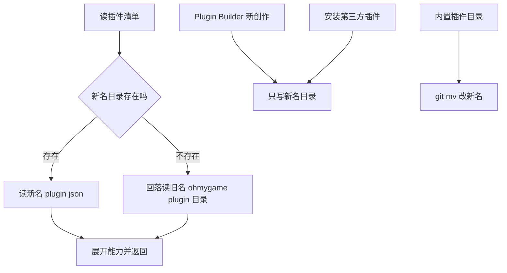

# .ohmygame-plugin 目录改名执行文档

- 日期：2026-11-03
- 背景：用户提出 `.ohmygame-plugin/plugin.json` 目录名仍是 ohmygame，要求评估改名。分析结论：技术上可行（读取方全在本仓库），但有兼容代价；用户拍板「先做执行文档」，方案按**双读发现 + 写入侧新名**的便宜路线展开。
- 前置决策待拍板项见文末 D1~D3。

## 一、现状事实（已量化）

| 面 | 事实 |
|---|---|
| 目录名常量 | `PLUGIN_MANIFEST_PATH = ".ohmygame-plugin/plugin.json"`（`src/shared/plugins.ts`，协议名冻结清单在 `docs/protocol-names.md`） |
| 读取方（7 处 src） | `local-plugins.ts`、`plugin-discovery.ts`、`plugin-authoring.ts`、`plugin-portability.ts`、`plugin-setup.ts`、`plugin-capabilities.ts`、`shared/plugins.ts` |
| 写入方 | `plugin-authoring.ts`（Plugin Builder 创作写入）、`plugin-installer.ts`（安装解包） |
| 内置插件 | 14 个 `plugins/*/` 目录，纯目录名，无额外引用 |
| 存量数据 | 用户机器 `.data/plugins/installed/` 已装插件均带旧目录名；项目归档（archive）内插件同理 |
| 上游生态 | 为上游 ohmygame 写的第三方插件（Claude marketplace / git 安装）现在拿来即用——目录名即兼容面 |
| 测试 | `plugins-protocol.test.ts` 等 14 个测试文件引用旧名 |

## 二、方案总览（双读发现 + 写入侧新名）

核心原则：

1. **发现侧双读**：读取顺序「新名优先，旧名回落」，一处封装（`readPluginManifest` / `validatePluginBundle` 内部），所有调用方零改动受益。
2. **写入侧只用新名**：Plugin Builder 创作、安装解包、内置插件目录一律新名——存量旧名数据只读不写。
3. **旧名是永久兼容面**：回落逻辑不设淘汰期，注释标注来历（同 `OHMYGAME_FFMPEG_PATH` fallback 的处理方式）。
4. **归档隐藏目录白名单同步**：`PLUGIN_ARCHIVE_ALLOWED_HIDDEN_DIRECTORIES` 增加新名，保留旧名（旧归档仍要能解）。

## 三、分阶段执行

### P0 准备与决策落定（半天内）

1. 拍板 D1（新目录名）：候选 `.xcflow-plugin`（与 `xcflow-` 符号前缀一致，短）或 `.xc-ui-flow-plugin`（与品牌全名一致，长）。默认 `.xcflow-plugin`。
2. 拍板 D2（内置 14 个插件目录是否同步 git mv）：默认同步（跟随写入侧新名原则）。
3. 拍板 D3（`docs/protocol-names.md` 的 `.ohmygame-plugin` 行处置）：默认保留该行，改述为「写入已迁移新名，读取回落保留」。

### P1 双读发现（核心，半天）

1. `src/shared/plugins.ts`：
   - `PLUGIN_MANIFEST_PATH` 保留为旧名（兼容常量，冻结注释不动）
   - 新增 `PLUGIN_MANIFEST_PATHS = [".xcflow-plugin/plugin.json", ".ohmygame-plugin/plugin.json"]`（顺序即优先级）
2. 读取链改双读（一处封装）：
   - `local-plugins.ts` 的 `readPluginManifest`：按顺序探测首个存在者
   - `validatePluginBundle` / `inspectPluginFiles`：目录探测改双读
   - `plugin-discovery.ts` / `plugin-portability.ts` / `plugin-setup.ts` / `plugin-capabilities.ts`：凡直接拼 `.ohmygame-plugin` 路径处改走双读常量
3. 隐藏目录白名单：`PLUGIN_ARCHIVE_ALLOWED_HIDDEN_DIRECTORIES` 头部插入新名（旧名保留）
4. 回落处加注释：`// 旧名是已装插件与上游生态的兼容面，永久回落，见 docs/protocol-names.md`

### P2 写入侧与内置目录迁移（半天）

1. `plugin-authoring.ts`（Plugin Builder）：创作清单写入新名目录
2. `plugin-installer.ts`：安装解包保持插件原有目录名（**不迁移存量**，旧名原样落盘照样能被发现）
3. `plugins/*/` 内置 14 目录 `git mv .ohmygame-plugin .xcflow-plugin`（按 D2）
4. `plugins/fairygui/scripts/install.bat`、分发副本与 `thirdparties/xc-link-plugin/` 源码里若有引用同步检查（预期无——该目录是 FGUI 工程插件目录，与本协议无关）

### P3 测试与文档同步（半天）

1. 测试双场景补齐：
   - 旧名单独存在（存量插件）→ 可发现（回落路径）
   - 新旧名同时存在 → 新名优先
   - 新名单独存在 → 可发现
2. `test/plugins-protocol.test.ts` 等断言按新名主路径改写，回落路径单独用例保留
3. `docs/plugins.md`（en）插件包契约改新名 + 兼容说明；zh-CN 侧无独立 plugins 文档则只改 en
4. `docs/protocol-names.md` 双语按 D3 更新
5. `.claude/skills/` 里引用 `.ohmygame-plugin` 的技能（create-studio、backup-template 等）同步检查更新

### 验收

1. `bun run typecheck` 单独跑看退出码
2. 插件相关测试全绿：`plugins-protocol` / `bundled-plugins` / `plugin-catalog-api` / `local-plugins` / `plugin-installer` / `plugin-portability` / `plugin-builder` / `preinstalled-plugins` / `agent-tools`
3. 运行时冒烟：重启 daemon 后 `GET /plugins` 返回 14+ 插件且 `errors: []`；fairygui 测试工程会话可用
4. 存量兼容冒烟：手工在已装插件目录放旧名清单（或用现有 `.data` 存量），确认回落发现
5. `dev-docs/progress/执行进度.md` 更新 + `progress-result/` 新报告；经验坑点落 `dev-docs/experience/`

## 四、风险与坑（预填）

| # | 坑 | 对策 |
|---|---|---|
| 1 | 双读顺序写反（旧名优先）导致新名永远不被读到 | 顺序数组 `[新名, 旧名]` 常量一处定义，测试断言优先级 |
| 2 | `plugin-portability` 导出/导入来回拷贝把旧名复制成两份 | 导入侧不迁移不重命名；导出侧原样拷贝 |
| 3 | 归档隐藏目录白名单漏加新名 → 新名插件打进归档被拒收或被剥离 | P1 第 3 步显式改，`plugin-portability` 测试补双名用例 |
| 4 | 上游 marketplace 插件结构校验（format: claude 等）与本目录无关，误改断兼容 | 只动 ohmygame 格式的清单路径，claude/codex 格式探测不动 |
| 5 | 第三方文档/技能已教用户 `.ohmygame-plugin` 结构 | 文档保留「旧名仍受支持」一句话，不删旧名说明 |
| 6 | 管道退出码陷阱（老坑） | typecheck 与 commit 分开跑看退出码 |
| 7 | 批量替换误伤（老坑） | 路径常量集中改，禁全局 sed；改完 grep 复扫 `.xcflow-plugin` 引用完整性 |

## 五、工作量预估

P0 决策半小时；P1 半天；P2 半天；P3 半天。合计约 1.5~2 天（含测试与文档同步）。

## 六、待拍板决策

| 编号 | 决策 | 选项 | 默认 |
|---|---|---|---|
| D1 | 新目录名 | `.xcflow-plugin` / `.xc-ui-flow-plugin` | `.xcflow-plugin`（短，与 xcflow- 符号前缀一致） |
| D2 | 内置 14 插件目录是否 git mv 新名 | 迁移 / 保留旧名（只改发现与写入） | 迁移（跟随写入侧新名原则，仓库内彻底一致） |
| D3 | protocol-names.md 旧名行处置 | 保留改述 / 删除 | 保留改述（回落仍是协议，只是降级为兼容读） |

## 引用说明

- 冻结政策与现状：`docs/protocol-names.md`、`dev-docs/research/插件系统结构分析.md`
- 同类先例（旧名回落 + 新名优先）：`src/daemon/publish/media.ts` 的 `XCUIFLOW_FFMPEG_PATH || OHMYGAME_FFMPEG_PATH`、`src/daemon/project-process.ts` 的双前缀过滤
- 批量替换踩坑先例：`dev-docs/experience/批量替换误伤标识符与模板串.md`
