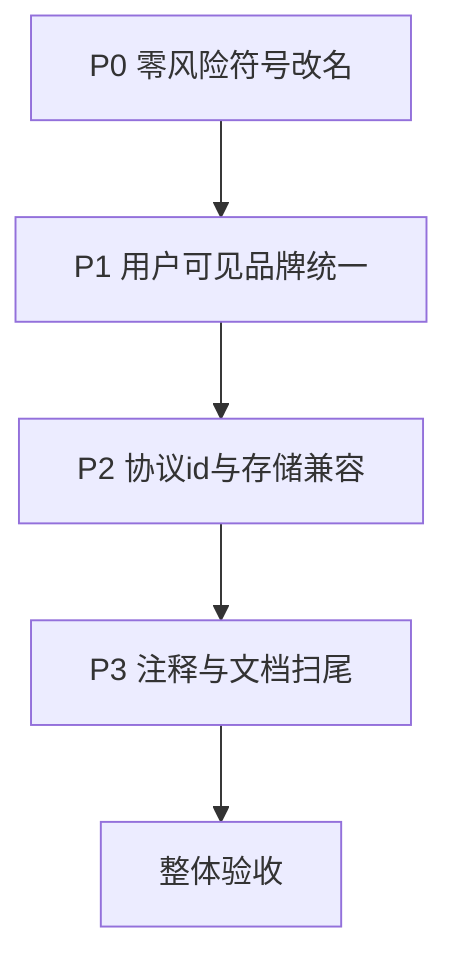

# ohmygame 品牌清理执行文档

> 依据：`dev-docs/research/ohmygame残留盘点.md`（2026-11-02）
> 目标：把仓库从「xc-ui-flow 门面 + OhMyGame 内里」的分裂状态，逐层统一为 xc-ui-flow 品牌；上游参照与出处链接永不动。
> 分支约定：master 直接提交，每阶段一个 commit；每阶段末 typecheck + test 通过才 commit（typecheck 与 commit 分开跑，防管道退出码陷阱）。

## 前置决策（P1 开工前必须拍板，未拍板则 P1 阻塞）

| # | 决策项 | 选项 | 默认方案 |
|---|--------|------|----------|
| D1 | 桌面产品名（electron-builder productName） | xc-ui-flow / XCUIFlow / 其它 | `xc-ui-flow` |
| D2 | appId | `ai.ohmygame.desktop` 改成什么 | `com.xc.uiflow`（或用户指定的反向域名） |
| D3 | 下载/更新域名 | 有无自有域名接管 `ohmygame.ai` / `updates.ohmygame.ai` | **无自有域名时：README 徽章链接改为 GitHub Releases；`DESKTOP_UPDATE_URL` 留空并在文档注明暂无自动更新**（砍掉上游 feed 依赖，不冒充上游域名） |
| D4 | npm 包名（package.json name） | `xc-ui-flow` / `@xclib/ui-flow` | `xc-ui-flow` |
| D5 | UI 文案品牌词 | locales 中 "OhMyGame" 替换词 | 跟 D1 一致 |
| D6 | `.ohmygame-plugin` 目录约定是否改 | 改（破坏兼容+迁移） / 不改（无限期保留） | **不改**：它是插件发现协议，牵动 15 个插件 + 存量工程 + 子模块镜像，收益低风险高。保留为「历史协议名」，只在 NOTICE/docs 里说明来历。若未来改，单独开 P2+ |

> D6 默认「不改」的理由：`.ohmygame-plugin` 是磁盘上的目录约定（类似 `.git` 目录），改名等于让所有已安装第三方插件失效。除非有强需求，这个协议名冻结。

## 阶段划分

### P0 零风险改名（B 类 + 局部）

**范围**（无行为影响、无兼容问题的名字/资产）：

1. `src/shared/assets/ohmygame-mark-v2.svg`、`ohmygame-mark-dark-v2.svg` → 先确认是否还被引用（`grep -rn "ohmygame-mark" src/`）：
   - 已无引用 → 直接删除（旧品牌图，已被 xc-ui-flow 品牌替代）
   - 仍被引用（如默认头像/加载页兜底）→ 重命名为 `xcflow-mark-*` 并同步引用处
2. `integrations/skills/ohmygame-studio/` → `integrations/skills/xcflow-studio/`，同步 `src/daemon/agent-runtimes/skills.ts` 等处的发现路径（先 grep 引用再动）
3. `build/installer.nsh` 的 `OhMyGameInstallProgress*` 函数名 → `XcFlowInstallProgress*`（纯 NSIS 内部符号）
4. `vite.config.ts` `project: "ohmygame"`（sentry/遥测 project 名）→ `xc-ui-flow`；`vite.sandbox.config.ts` `OhMyGamePlayableSandbox` → `XcFlowPlayableSandbox`

**出口标准**：`grep -rn "ohmygame-mark\|ohmygame-studio" src/ scripts/ test/` 零命中（thirdparties 除外）；typecheck + 相关 test 通过；commit。

### P1 用户可见品牌统一（C 类，依赖前置决策 D1~D5）

1. `package.json`：`name` → D4；repository/bugs url 指向本仓 remote（`ssh://localhost:2222/mickorz/xc-ui-flow` 不对外，改写为占位或 GitHub 地址由用户定）
2. `electron-builder.yml`：productName → D1、appId → D2、artifactName 模板同步
3. locales 双语：`src/renderer/locales/en.ts` + `zh-CN.ts` 所有 "OhMyGame" → D5 品牌词（含 `ohMyGameAccount` 这类 i18n key 改不改？**key 不改**，只改 value——改 key 要全仓 grep 引用，收益低）
4. `.env.example`：`OHMYGAME_FFMPEG_PATH` → `XCUIFLOW_FFMPEG_PATH`（daemon 读取处同步 + 向后兼容读旧名，一处 guard）；`DESKTOP_UPDATE_URL` 按 D3
5. README.md / README.zh-CN.md 徽章与下载链接按 D3；`.github/workflows/release-desktop.yml` 与 issue 模板里的产品名同步
6. `docs/` 双语同步：desktop-releases.md 等含 ohmygame.ai 的读者向文档按 D3 改写（README.md 与 README.zh-CN.md 同 PR 对齐）

**出口标准**：构建产物名、UI 文案、README 不再出现 OhMyGame；`bun run typecheck` + `test/access.test.ts` 等相关测试过；commit。

### P2 协议 id 与存储兼容（D 类，依赖 D6 决策）

**D6 默认不改 `.ohmygame-plugin` 时，本阶段只剩 id/前缀类**：

1. `src/shared/mcp.ts` `GODOT_MCP_SERVER_ID = "ohmygame-godot"`：id 是字符串匹配协议（daemon ↔ 插件两端约定）——**跟随 D6 精神不改**，仅注释标注来历
2. `src/shared/plugins.ts` `OHMYGAME_MARKPLACE id "ohmygame"`：市场索引 id，同理不改，displayName 可改
3. 检查点文件名（`ohmygame-pruned.json` 等）与临时目录前缀（`ohmygame-workspace-` 等）：**不改**（`.data/` 存量数据按名寻址，改名要写迁移读旧名，收益为零）
4. **本阶段收敛为**：把上述「不改」决策写进 `docs/`（协议名来历说明，双语）+ `plugins/fairygui/assets/NOTICE.md` 已有记录引用

> 若用户推翻 D6 要求全改，本阶段升级为：每个 id 改名配「读旧名 fallback」guard + 存量数据迁移函数 + 全量 test 同步，预计多 2~3 倍工作量。

**出口标准**：协议来历文档落盘双语；commit。

### P3 注释与文档扫尾（E 类）

1. `src/` 157 文件中的注释提及（OhMyGame 注释词）批量替换（脚本 sed/python 批量，**只动注释与字符串提示，不动 id/key/路径**）
2. `test/` 181 文件：断言里跟随 D 类符号的部分**不动**（符号没改），跟随文案的部分随 P1 同步；其余注释提及随手替换
3. `plugins/` 上游插件（game-studio/web-game-studio/threejs-world/taptap-maker）技能与脚本文案提及：只改用户可见文案，上游出处注明保留
4. `dev-docs/`、`.claude/skills/` 的历史叙述**不改**（记录的是当时事实）

**出口标准**：`grep -ri ohmygame src/ test/ docs/ plugins/ scripts/ --exclude 允许清单` 命中数收敛到「协议名 + 上游出处」白名单内；commit。

### 验收（V）

1. 全量 `bun run typecheck` + `bun test`（分开跑，看退出码）
2. 构建冒烟：`bun run build:renderer`（P1 后桌面构建 `build:desktop` 视 D3 决策决定是否跑）
3. 浏览器走查：欢迎页文案、设置页账号文案、README 渲染
4. 真实插件加载冒烟：fairygui 插件 `.ohmygame-plugin/plugin.json` 仍被 daemon 发现（P2 决策不破坏插件加载）
5. 落 `dev-docs/progress/执行进度.md` + `dev-docs/progress-result/P{n}-执行报告.md`

## 风险与坑（预填）

| 坑 | 对策 |
|----|------|
| i18n key 与 value 混淆 | 只改 value 不改 key；改完 `test/i18n-ui.test.tsx` 必跑 |
| 批量替换误伤协议名/id | P3 批量脚本先 dry-run 打印 diff，人工过目白名单再落盘；替换词表显式排除 `.ohmygame-plugin`、`ohmygame-godot` 等 |
| 旧名环境变量失效 | `OHMYGAME_FFMPEG_PATH` 读取处留旧名 fallback 一版，docs 注明弃用 |
| typecheck 退出码被管道吃掉 | `typecheck` 单独跑完看 exit code 再 commit |
| shell 转义污染含反引号/正则的改写 | 一律 python 脚本 + write 工具，禁 bash inline/heredoc |

## 工作量预估

P0 半天内；P1 1 天（含双语与文档对齐）；P2 半天（默认方案收敛后）；P3 1 天（批量替换 + 白名单收敛）。合计约 3 天。

## 引用说明

- 盘点底账：`dev-docs/research/ohmygame残留盘点.md`
- 上游仓库：https://github.com/WhiteTowerAI/ohmygame
- 插件协议：`src/shared/plugins.ts`
- 桌面发布文档：`docs/desktop-releases.md`
