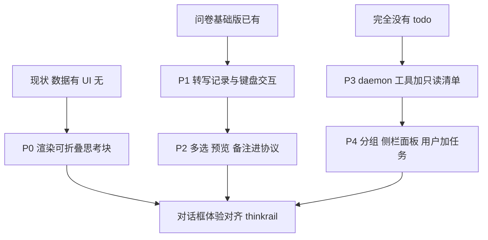

# thinkrail 与 chatbox 对话框功能对比分析

日期：2026-11-03
范围：对话框（聊天）功能的三大缺失项——详细 thinking 内容显示、ask-question 选项、todo 列表，以及整体消息流架构。
代码基线：`thirdparties/thinkrail` @ `c469b724`（submodule），本仓库 `src/renderer` + `src/daemon`。

---

## 0. 一句话结论

| 能力 | chatbox 现状 | thinkrail 现状 | 差距定性 |
|------|------------|---------------|---------|
| 详细 thinking 显示 | **数据全有、UI 丢弃**（reasoning item 渲染为 null，只有 shimmer 占位） | 完整：可折叠 ThinkingGroup，嵌套工具调用，标题提取，折叠状态持久化 | 小差距，UI 层补一个可折叠组件即可 |
| ask-question 选项 | 已有 questionnaire 工具 + 卡片（单选、翻页、skip、自定义答案） | 完整：multiSelect、preview、per-option notes、recommendedReason、键盘漫游、tablist 语义、回答后转写记录 | 中等差距，协议+UI 双侧增强 |
| todo 列表 | **完全没有**（仅外部 OpenCode agent 的 todowrite 透传） | 完整全栈：pi-todos 包（core/tools/skill）+ 宿主 RPC + WS 刷新 + PlanRail 面板 UI + 用户加 todo 自动 nudge agent | 大差距，需要 daemon 工具 + 状态 + UI 三层新建 |

类比理解：chatbox 的对话流像一条「只播报结果的流水账」——模型思考的过程被收进了后台但从不投影到屏幕；thinkrail 的对话流像一份「带章节的施工日志」——每一段思考是一个可展开的章节，思考里做了哪些工具调用都归档在章节下，旁边还有一块任务看板（todo rail）实时挂着施工进度。

---

## 1. 整体消息流架构对比

### 1.1 chatbox（本仓库）

数据链路：

```
pi 会话（src/daemon/agent.ts）
  → ThreadItem 事件流（src/shared/contracts.ts 定义，state.ts 前端归约）
  → Turn → projectTurnDisplay（src/renderer/turn-display.ts）
  → WorkDisplayItem（src/renderer/work-items.ts）
  → AgentTimeline 渲染（src/renderer/agent-timeline.tsx）
```

关键设计：

- **Turn 投影层**：`projectTurnDisplay()` 把一个 turn 的 items 分成 `work`（工作过程）、`messages`、`finalMessages`（final_answer）、`artifacts`。`reasoning` 被 `isWorkItem` 归入工作项，但 `TimelineItem` 里 `if (item.type === "reasoning") return null`（agent-timeline.tsx:541）——**内容直接丢弃**。
- **工具分组折叠**：`projectWorkItems()` 把连续的 tool 调用和 reasoning 归并为 `tool-group`（LazyDetails 折叠），`toolGroupSummary()` 生成「读取了 3 个文件，编辑了 2 个文件」式摘要。
- **无虚拟列表**：整条 timeline 直接渲染。
- **交互卡位置**：`QuestionnaireCard` / `ApprovalCard` / `PlanApprovalCard` 不在消息流里，而是由 `project-shell.tsx` 检出 `inProgress` 的 `userInputRequest` / `approvalRequest`，**渲染在输入框上方**；回答完成后从 timeline 中过滤掉（`item.type !== "userInputRequest"`），**不留回放记录**。
- **交互工具定义**：daemon 侧 `src/daemon/agent-tools.ts` 用 `defineTool` 定义 `questionnaire`（最多 3 问、每问 2-4 选项、allowOther、recommended）。

### 1.2 thinkrail（thirdparties/thinkrail）

数据链路：

```
pi 会话（消息 content 含 thinking / toolCall block）
  → ChatTurn → deriveRows（apps/web/src/chat/rows.ts）
  → ChatRow（markdown / activity / tool / …）
  → 虚拟列表（virtualRows + react-virtuoso，turns.tsx / ChatTranscript.tsx）
  → 行渲染器（含 ExtUiPrompt 交互插槽、toolRegistry 扩展卡注册）
```

关键设计：

- **行推导层**：`deriveRows()` 遍历 assistant 消息 content block：`thinking` → `ThinkingStep`；`text` → markdown 行；`toolCall` → 按 prominence 分「主行」或并入 activity run。
- **activity 嵌套**：`nestRoutineRun()` 把 thinking 之后的连续工具调用**挂进该 thinking step 的 `tools` 数组**——「思考 → 思考中做的事」形成父子结构。
- **折叠状态持久化**：`foldState.ts` 的 `useFold(id)`，折叠态按行 id 存活（可在会话切换/虚拟化后保留）。
- **虚拟化**：react-virtuoso + `rowHeightEstimates`。
- **扩展机制**：`toolRegistry` 让 `thinkrail-extensions/*`（ask-user-question、visualize、web-access）注册自定义工具卡；`ExtUiPrompt.tsx` 提供 `PendingExtUiContext`（等待中的交互工具插到 activity 组的 awaiting 槽位）。

### 1.3 架构差异总结

| 维度 | chatbox | thinkrail |
|------|---------|-----------|
| 消息组织 | Turn → work/message 投影 | ChatTurn → ChatRow 行推导 |
| thinking 定位 | work item（但 UI 丢弃） | activity run 的父节点 |
| 虚拟列表 | 无 | react-virtuoso |
| 折叠持久化 | LazyDetails（不持久） | foldState 按 id 持久 |
| 交互卡位置 | 输入框上方，回答后消失 | 消息流内，回答后转 resolved record |
| 工具卡扩展 | 硬编码在 agent-timeline | toolRegistry 注册制 + 扩展包 |
| 后端耦合 | daemon defineTool + ThreadItem 协议 | pi 原生消息 + 宿主 RPC + 扩展 descriptor |

---

## 2. 详细 thinking 内容显示

### 2.1 chatbox 现状（部分实现：数据有、显示无）

- **数据链路完整**：`src/daemon/agent.ts:1824-1845` 创建 `reasoning` ThreadItem 并发布 `item.reasoning.textDelta` 事件；`src/renderer/state.ts:179-180` 前端把 delta 累积到 item.text。
- **UI 丢弃**：`agent-timeline.tsx:541` `if (item.type === "reasoning") return null`。
- **仅有的可见痕迹**：
  - 进行中：`work-items.ts` 把 `reasoning inProgress` 变成 `{ kind: "thinking" }` → `ThinkingActivity` shimmer「思考中」；
  - 已停止：`hadThinking` 标志只用于文案「已停止思考」。
- 另有 `src/daemon/assistant-thinking.ts`：负责把泄漏到正文里的 `<thinking>` 标签剥掉——说明上游确实会产生思考文本。
- `reasoning-label.ts` 只是给「推理等级」（高/中/低）翻 i18n 标签，与内容显示无关。

### 2.2 thinkrail 实现

文件：`apps/web/src/chat/ActivityGroup.tsx`（ThinkingGroup）、`rows.ts`（ThinkingStep 推导）、`foldState.ts`。

- **推导**（rows.ts:181-187）：assistant content 的 `thinking` block（非空）→ `ThinkingStep { id, text, streaming, tools: [] }`；后续工具调用被 `nestRoutineRun()` 挂进来。
- **渲染**（ActivityGroup.tsx:100-160）：
  - `GroupDisclosure` 可折叠条：折叠时显示图标（脑图标）+ 标签「Thinking」+ **headline**（`extractThinkingHeading()` 从思考首行提取 `**加粗标题**`）+ 摘要（字数「N chars」或工具摘要「3 steps · bash ×2, read」）；
  - live 时转圈 + `liveActivityTicker`（正在思考/正在跑某工具）；
  - 展开时 `whitespace-pre-wrap` 渲染**完整思考原文**，子工具调用逐行排在下面；
  - 单独一段思考（无工具）也渲染为独立 ThinkingGroup。
- **折叠持久化**：`useFold(id)`，id 为 `turnId:thinking:blockIndex`。
- **思考不进 markdown 管道**，纯文本渲染，避免思考里的半截 markdown 干扰。

### 2.3 移植建议（最小改动）

chatbox 的数据（item.text、streaming 状态）已在前端 state 里，**后端零改动**，只改 UI：

1. `agent-timeline.tsx` 中把 `reasoning` 从 `return null` 改为渲染一个 `LazyDetails`（复用现有折叠组件）：
   - summary 行：脑图标 + 「思考」+ 首行标题截断（可参考 `extractThinkingHeading` 的纯文本版）+ 字数；
   - 展开体：`whitespace-pre-wrap` 渲染 `item.text`；
   - `status === "inProgress"` 时 summary 行加 shimmer。
2. 可选进阶：仿 `nestRoutineRun`，在 `projectWorkItems` 里把 reasoning 之后的 tool 调用挂到该 thinking 组内（chatbox 已有 tool-group 机制，把「thinking + 其后工具」合成一个组即可）。
3. 历史会话注意：`state.ts:298` 有清理空 reasoning item 的逻辑，确认持久化会话里 reasoning text 已保存（daemon 侧 `turn.items` 落盘是否含 reasoning text 需在实现时验证）。

---

## 3. ask-question 选项（问卷）

### 3.1 chatbox 现状（已有基础版）

协议（`src/shared/contracts.ts`）+ 工具（`src/daemon/agent-tools.ts` 的 `questionnaire`）+ UI（`src/renderer/questionnaire-card.tsx`，由 `project-shell.tsx` 挂载在输入框上方）：

已有能力：
- 1-3 个问题、每问 2-4 选项、`allowOther` 自定义答案、`recommended` 徽标、选项 `description`；
- 翻页（上一问/下一问）+ 跳过全部；
- 选中即自动跳到下一个未答问题，**全部答完自动提交**（`choose()` 里找 unanswered 自动 submit）；
- 提交协议：`answers: [{ questionId, value }]`，skip 时 daemon 返回「用户跳过，请用合理默认值继续」。

缺失（对照 thinkrail）：
- 无 `multiSelect` 多选；
- 无 `preview`（选项侧边预览，thinkrail 支持双栏布局 + markdown 渲染）；
- 无 `recommendedReason`（推荐理由内联显示「Why: …」）；
- 无 per-option `notes`（给某个选项附备注，thinkrail 连 multi-select 每个勾选项都能挂 note）；
- 无键盘漫游（ArrowUp/Down/Space/Enter 选择流）、无 tablist 语义、无屏幕阅读器 live region；
- **回答后无转写记录**：`projectTurnDisplay` 无条件过滤 `userInputRequest`，答完即从对话里消失，历史回看不知道当时问了什么、答了什么；
- 多问翻页是「上一问/下一问」按钮，thinkrail 是顶部 tab chips + 已答打勾标记。

### 3.2 thinkrail 实现

扩展包 `thinkrail-extensions/ask-user-question`（server/ 组装工具 + web/ 渲染卡），卡在 `web/AskUserQuestionCard.tsx`（约 900 行，测试文件同步）：

- **协议**（pi-ask-user-question core）：`questions`（1-4 个），每个含 `question`、`header`、`options`（2-4 个：label/description/preview/recommendedReason）、`multiSelect`。
- **生命周期状态机**：awaiting（可交互，卡片高亮 ring + AttentionLine）→ submitted → resolved record（回放：每问列出选项，勾选/未勾/自定义答案/note）；另有 superseded（用户直接打字取代了问卷）、ended（Stop/错误）分支。状态经 `ToolRenderProps.interaction` 注入，跨宿主重启还能修复（late response 配对）。
- **交互细节**（SPEC.md 明文契约，值得抄的密度）：
  - 单选 radiogroup / 多选 checkbox group 语义；箭头移动即选中（单选）、Space 切换（多选）、Enter 确认并翻页/提交；
  - 「Other」行：输入文本才算选了它（`customTextPatch`），光标路过不改变选择；
  - 每个已勾选项下挂「Add/Edit note」；Enter 收起 note 返回焦点到选项；Shift+Enter 换行；Escape 不丢文本；
  - 多问 = 顶部 tablist + 共享 tabpanel，最后一问显示 Submit（任一问已答即可提交，未答题静默按未答发送）；
  - 空确认不静默：Enter 无可提交时显示「先选一个选项」警告（带 live region 播报）；
  - 注意力管理：出现时 reveal + 一次性 focus claim，用户一旦有输入立即让位；提交后焦点交还 composer（仅 `:focus-visible` 时）；失败回滚并夺回焦点；
  - 每卡 UI 状态按 toolCallId 缓存，扛虚拟化卸载。
- **recommendedReason 内联渲染**（「Why: …」在选项卡内，非 tooltip）。

### 3.3 移植建议

分两档：

- **低配（纯 UI，不动协议）**：
  1. 答题后保留转写记录：不再无条件过滤 `userInputRequest`，completed 的渲染成 resolved record（复用 QuestionnaireCard 的只读版），参考 `QuestionRecap` 的结构；
  2. 翻页改 tab chips + 已答标记；
  3. 键盘漫游 + radiogroup/checkbox 语义 + live region。
- **高配（协议扩展）**：`QuestionnaireQuestion` 加 `multiSelect`、`preview`、`recommendedReason`，daemon `defineTool` schema 同步放开（maxItems 4），提交协议加 `notes`。注意 keep 兼容旧会话数据（contracts 是共享协议，daemon 与 renderer 同时改）。

---

## 4. todo 列表

### 4.1 chatbox 现状（缺失）

- 无 todo 工具、无 todo ThreadItem、无 UI。搜索仅命中 `src/daemon/agent-runtimes/opencode.ts` 的权限白名单（`todowrite`/`todoread`）——即外部 OpenCode agent 自己的 todo 工具调用被放行，但只作为普通 `dynamicToolCall` 显示在工具组里，无专属 UI。
- 相邻能力：`plan` ThreadItem + `update_plan` 内置工具 + `PlanApprovalCard`（计划模式审批），与 todo 是不同机制（plan 是一次性提交审批的方案，todo 是持续维护的任务清单）。

### 4.2 thinkrail 实现（全栈）

四层结构：

1. **核心包 `packages/pi-todos`**：
   - `core/`（store + 类型）：`TodoPlan { todos, groups, summary }`，Todo 含 `status`（pending/in_progress/done）、`origin`（agent/user）、`note/summary/verification/commitSubject/artifacts`、review 状态；分组 `TodoGroup`；文件版本化存储（v6）。
   - `tools/`：7 个 pi 自定义工具 `todo_list / todo_add / todo_update / todo_promote / todo_remove / todo_write / todo_plan_summary`，TypeBox schema + 薄封装；`todo_write` 按组+步骤标题匹配做**无损 reconcile**（重规划不清进度）；变更结果带 in-band nudge（如「有未完成项但无 in_progress」提醒）。
   - `skills/todos/SKILL.md`：教 agent 何时用 promote 而不是 add+remove 舞步、done 时要带 summary/verification/commitSubject。
2. **宿主 RPC/WS**：`todo.list / todo.add / todo.remove / todo.startReview / todo.reviewAll / todo.generateSummary`（useChatTodos.ts 经 transport 调用）；pi 事件（`tool_execution_end`、`agent_settled`）触发去抖刷新（250ms）。
3. **UI `apps/web/src/chat/TodoList.tsx`**：TodoRows 按 active/pending/done 三段渲染；组进度 `done/total`；空组显示「计划形成中」转圈；done 组默认折叠可展开；行级：状态图标（含「等待提问」「已暂停」glance 态）、变更集 chip（点开 commit/文件 diff）、用户来源标记、悬停删除按钮；`TodoAddRow` 让**用户直接加 todo**，加完自动 `nudgeAgent`（向会话注入提示文本让 agent 认领并推进）。
4. **承载面**：`panels/PlanRailPane.tsx`（侧栏 rail）、`panels/PlanPane.tsx`（整页）、`WorkspaceWorkbench.tsx`——todo 不在消息流内，而是常驻面板，与对话并行。

另有 plan 完成后自动生成总结（`useAutoPlanSummary`：全部 done 且无 summary 时请求宿主用廉价模型起草一次）。

### 4.3 移植建议（分级）

- **MVP（最小可用）**：
  1. daemon 侧仿 `questionnaire` 模式 `defineTool` 一个 `todo_write`（或 `todo_update` 单工具多操作），存储挂在会话/项目上（内存 + 会话落盘即可）；
  2. ThreadItem 协议新增 `todoUpdate` item（或复用 dynamicToolCall 的 details 携带 todo 快照）；
  3. renderer 侧在对话面板顶部（输入框上方，与 QuestionnaireCard 同区）渲染一个只读 todo 清单：三段状态 + 当前进度。
  - 这一层砍掉了 thinkrail 的分组、review、artifacts、用户加 todo、RPC 面板——但「agent 能列计划、用户能看到进度」的闭环成立。
- **进阶**：分组/用户加 todo + nudge、独立侧栏面板（可挂到 chatbox 已有的 workspace 面板体系）、事件驱动刷新。
- **不建议**第一版就搬 review（startReview/reviewAll 隐藏 subagent 审查）、plan summary 自动生成——那是 thinkrail 深度耦合其宿主能力的部分。

---

## 5. 其他值得借鉴（顺带记录）

| thinkrail 能力 | 文件 | 对 chatbox 的启发 |
|----------------|------|------------------|
| 折叠状态按行 id 持久化 | chat/foldState.ts | chatbox 的 LazyDetails 折叠态刷新即丢 |
| 虚拟列表 + 行高估算 | chat/virtualRows.ts, rowHeightEstimates.ts | 长会话性能兜底 |
| 工具卡注册表 | chat/toolRegistry.tsx | chatbox 工具卡硬编码在 agent-timeline，插件体系（本项目有 plugin-integration）可复用此模式 |
| 流式指示器/队列条 | StreamIndicator.tsx, QueueStrip.tsx | 对话排队可视化（chatbox 有 message-queue.ts 但 UI 弱） |
| 子代理转写对话框 | SubagentTranscriptDialog.tsx | 后续接 pi-subagents 时直接参考 |
| 会话统计条 | SessionStatsBar.tsx | token/费用展示 |

---

## 6. 推荐实施顺序

1. **P0 thinking 显示**：改动最小（一个 UI 组件），数据链路已通，收益立现。
2. **P1 questionnaire 增强（低配档）**：转写记录 + tab chips + 键盘/语义，不动协议。
3. **P2 questionnaire 高配档**：multiSelect/preview/notes 进协议（daemon + renderer 同步改，注意旧数据兼容）。
4. **P3 todo MVP**：daemon 工具 + 协议 item + 顶部只读清单。
5. **P4 todo 进阶 + 其他借鉴项**：按需。



---

## 7. 引用说明

本文分析所依据的主要代码与文档（均为本仓库内路径）：

- thinkrail 消息流推导：`thirdparties/thinkrail/apps/web/src/chat/rows.ts`、`turns.tsx`、`virtualRows.ts`
- thinkrail thinking 显示：`thirdparties/thinkrail/apps/web/src/chat/ActivityGroup.tsx`、`foldState.ts`
- thinkrail todo 全栈：`thirdparties/thinkrail/packages/pi-todos/`（core/tools/skills）、`thirdparties/thinkrail/apps/web/src/chat/TodoList.tsx`、`useChatTodos.ts`、`thirdparties/thinkrail/apps/web/src/panels/PlanRailPane.tsx`
- thinkrail ask-question：`thirdparties/thinkrail/thinkrail-extensions/ask-user-question/`（SPEC.md、server/、web/AskUserQuestionCard.tsx）
- thinkrail 扩展机制：`thirdparties/thinkrail/apps/web/src/chat/toolRegistry.tsx`、`ExtUiPrompt.tsx`
- chatbox 消息流：`src/renderer/turn-display.ts`、`work-items.ts`、`agent-timeline.tsx`、`state.ts`
- chatbox thinking 数据链路：`src/daemon/agent.ts`（reasoning item 与 textDelta 事件）、`src/daemon/assistant-thinking.ts`
- chatbox 问卷：`src/daemon/agent-tools.ts`（questionnaire 工具）、`src/renderer/questionnaire-card.tsx`、`src/renderer/project-shell.tsx`（挂载点）、`src/shared/contracts.ts`（协议）
- 仓库地址：https://github.com/JetBrains/thinkrail
