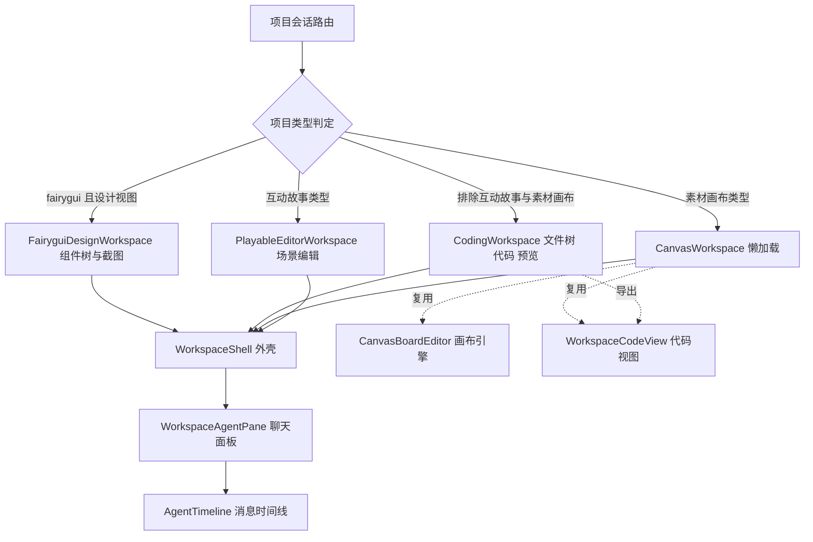

# 工作区组件全景图（Workspace Components Map）

- 日期：2026-11-06
- 范围：`src/renderer/project-shell.tsx` 的四向工作区分发 + 全部 Workspace 组件及其关联
- 结论一句话：项目会话页按**项目类型**四向分发到 4 个 Workspace 组件，全部包在共享外壳 `WorkspaceShell` 里，右侧聊天面板 `WorkspaceAgentPane` 各类型共用。

## 一、分发入口：project-shell.tsx（970~1040 行）

`ProjectShell` 的 JSX 三元链，按顺序判定：

| # | 条件（project.type） | 渲染组件 | 加载方式 |
|---|---|---|---|
| 1 | `fairygui` **且** `designOpen`（`#/…/conversations/<id>/design`） | `FairyguiDesignWorkspace` | 直接 import |
| 2 | 非 `interactive-story` 且非 `asset-canvas` | `CodingWorkspace` | 直接 import |
| 3 | `asset-canvas` | `CanvasWorkspace` | `lazy()` + Suspense |
| 4 | 兜底（即 `interactive-story`） | `PlayableEditorWorkspace` | 直接 import |

注意分支 2 是「排除法」：**所有未显式分派的新类型（如 requirement-check）自动落到 CodingWorkspace**——新增工作室类型不需要改这里，除非要专属工作区。

## 二、类型 → 工作区速查表

| 项目类型 | 会话页工作区 | 设计视图（/design） |
|---|---|---|
| `general` / `web-game` | CodingWorkspace（含 web 预览） | 共享画布（CodingWorkspace 内嵌） |
| `godot-game` | CodingWorkspace（onClose 特判收起） | 同上 |
| `fairygui` | CodingWorkspace | **FairyguiDesignWorkspace**（专属） |
| `requirement-check` 等新类型 | CodingWorkspace | 共享画布 |
| `asset-canvas` | CanvasWorkspace（lazy） | - |
| `interactive-story` | PlayableEditorWorkspace | 内嵌设计态 |

## 三、四大工作区组件

### 1. CodingWorkspace（通用代码工作区，主力）

- 文件：`src/renderer/coding-workspace.tsx`（约 1613 行，27 个本地 import）
- 职责：文件树 + 代码视图 + 预览 + 资产浏览 + 发布，服务 general/web-game/godot-game/fairygui（非设计视图）/requirement-check 等一切「普通」类型
- 关联组件（同文件导出，被内部和外部复用）：
  - `WorkspaceFileBrowser` / `workspaceFileTree` —— 文件树
  - `WorkspaceCodeView` / `HighlightedCode` —— 代码查看（**CanvasWorkspace 也复用它**）
  - `PreviewView` / `useWebGamePlayer` / `DesktopGamePreview` —— web 预览三件套
  - `AssetsView` / `AssetToolbar` / `WorkspaceAssetCard`（asset-browser.tsx）—— 资产浏览
  - `PublishDialog`（publish-dialog.tsx）、`ProjectSettingsDialog`、`ProjectRenameDialog`
- 关联 hook/工具：`useRuntimeConnection`、`useWorkspaceAssetUrl`、`WorkspaceTabs`、`GitChangesList`/`WorkspaceGitDiff`（workspace-git-changes.tsx）
- `publishingUnavailable`：godot-game / fairygui / requirement-check 类型禁发布（新类型记得在此登记）

### 2. FairyguiDesignWorkspace（FairyGUI 专属设计页，最小）

- 文件：`src/renderer/fairygui-design-workspace.tsx`（约 192 行，仅 5 个 import）
- 职责：FairyGUI 组件树（懒加载）+ 引擎级渲染截图 + XML 源码 + 设计上下文联动
- 关联：`WorkspaceBackButton`（workspace-shell.tsx）、`fairygui-design.css`、`ProjectState`/`PromptContext`（shared/contracts.ts）
- 数据来源：编辑器桥（xc-link-plugin，MCP）——`thirdparties/xc-link-plugin/`
- 方案出处：`dev-docs/design/设计页面机制分析与自定义指南.md` 的方案 B

### 3. CanvasWorkspace（共享画布工作区，lazy）

- 文件：`src/renderer/canvas-workspace.tsx`（约 248 行）
- 职责：画布文档恢复 + 画布/代码双视图，服务 asset-canvas 类型和其它类型的「共享画布」设计页
- 关联：**复用 `CanvasBoardEditor`**（来自 asset-canvas-workspace.tsx，画布编辑引擎）+ **复用 `WorkspaceCodeView`**（来自 coding-workspace.tsx）
- 数据层：`canvas-api.ts`（createCanvasBoard 等 daemon API）、`canvas-board-storage.ts`、`use-canvas-documents.ts`、`use-canvas-tables.ts`
- lazy 原因：画布链路重，首页不打进主 bundle

### 4. PlayableEditorWorkspace（互动故事编辑器）

- 文件：`src/renderer/playable-editor-workspace.tsx`（约 1298 行）
- 职责：互动故事场景编辑 + playable 预览 + 编辑器到 agent 的双向消息
- 关联：`playable-chat.ts`（`PlayableChatState`，编辑器与聊天面板的上下文桥）、发布链路同 CodingWorkspace

## 四、引擎库（不是分支目标，是被复用的）

- `asset-canvas-workspace.tsx`（约 4004 行，53 个 import，全仓库最大组件文件）
  - 导出 `CanvasBoardEditor`（画布节点编辑器核心）+ 一批画布工具函数
  - **CanvasWorkspace 的引擎**；画布节点类型/生成设置/3D 模型标签等全在这里
- `asset-canvas-home.tsx`：素材画布**工作室首页**（`#/asset-canvas` 路由，app.tsx 分发），与 Workspace 无关，别混淆——它只做快速开始列表

## 五、共享外壳与横切件

| 文件 | 导出 | 说明 |
|---|---|---|
| `workspace-shell.tsx`（144 行） | `WorkspaceShell` / `WorkspaceAgentPane` / `WorkspaceBackButton` | 布局外壳（左工作区/右聊天可折叠）+ 聊天面板容器 |
| `agent-timeline.tsx` | `AgentTimeline` | 消息时间线（thinking/问卷/todo 卡片），渲染在 WorkspaceAgentPane 内 |
| `workspace-version.ts` | `workspaceVersion` / `observeWorkspaceVersion` | 工作区文件版本号（agent 改文件后驱动刷新） |
| `use-workspace-asset-url.ts` | `useWorkspaceAssetUrl` / `CanvasAssetProvider` | 工作区资产 URL 解析（画布/代码视图共用） |
| `workspace-tabs.tsx` | `WorkspaceTabs` | 画布/代码/预览页签 |
| `workspace-git-changes.tsx` | `GitChangesList` / `WorkspaceGitDiff` | 变更列表与 diff 视图 |
| `chat-layout.ts` | `ChatLayout` | 聊天在左/右的布局枚举 |

## 六、分发流程图

## 七、新增工作室时的关注点（与 create-studio 技能衔接）

1. 新类型**自动落 CodingWorkspace**（排除法分支），无需注册。
2. 新类型若禁发布：在 `coding-workspace.tsx` 的 `publishingUnavailable` 登记（create-studio 步骤 9）。
3. 新类型要专属工作区：仿 FairyguiDesignWorkspace，在四向分支处加条件 + 新组件（create-studio「可选步骤：定制设计页」）。

## 参考引用

- 分发源码：`src/renderer/project-shell.tsx`（970~1040 行四向分支、112 行 ProjectShell 签名）
- 路由定义：`src/renderer/routes.ts`（45 行 project 路由类型、114~115 行 design/conversation 正则）
- 页面分发：`src/renderer/app.tsx`（74~96 行 ProjectShell 渲染）
- 设计页机制：`dev-docs/design/设计页面机制分析与自定义指南.md`
- FairyGUI 设计页落地报告：`dev-docs/progress-result/FairyGUI设计页-执行报告.md`
