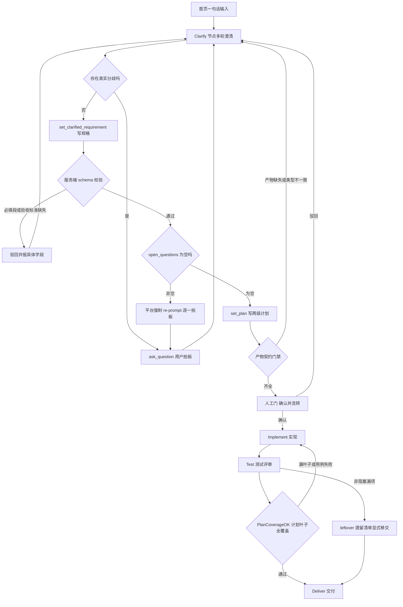

# Grasp 需求处理机制分析

> 分析对象：`thirdparties/grasp`（FSM 工作流编排 + 人工审批门的 coding agent 平台）
> 分析主题：原始需求如何被处理、转换成什么格式、如何保证需求不漏项
> 日期：2026-11-07

## 一、总体结论（先看这段）

Grasp 的需求处理是**一句话进、结构化规格出、六层防漏**的流水线：

1. **输入**：首页一句话 prompt（如「完成邮箱验证码登录」），进入默认工作流
   `Clarify → Implement → Test & review`
2. **转换**：ClarifyAgent 多轮对话把一句话对齐成两份机器可校验的 JSON 产物——
   `clarified_requirement.json`（ISO/IEC/IEEE 29148 SRS 裁剪子集）+ `plan.json`
   （严格两级 goals→subgoals）
3. **防漏**：六层机制叠加——服务端 schema 校验、open_questions 硬门禁、
   agent 技能检查清单自检、产物契约门禁、人工确认门、下游 plan_coverage
   反向全覆盖核验；漏项最终兜底进 leftover（遗留清单）机制

## 二、原始需求的处理流程

### 2.1 输入与流转

用户在首页输入一句话目标，run 进入 FSM 画布的 Clarify 节点。
ClarifyAgent 的行为契约由 `agents/ClarifyAgent/workspace/AGENTS.md` 注入
（随镜像打进 `server/internal/services/team_embed/`，运行时按 profile 复制到
`.localdata/app-data/profiles/需求澄清/workspace/`）。

### 2.2 澄清对话的规则（AGENTS.md 约束）

- **每轮聚焦一个小问题**；只有存在真实分歧、需要用户拍板时才 `ask_question`，
  提问后立即结束本轮等待选择；不编造空泛的开场选择题
- **work_kind 三分类**：目标已明确是 bug/feature 时直接记录不问；只有一句话两可时
  才让用户三选一；`work_kind=bug` 时必须写 `set_root_cause`（问题根因），非 bug 不写
- **边界**：澄清阶段不写实现代码、不改仓库；`write_artifact` 是自由文本兜底通道，
  **禁止用它冒充结构化产物**（旁路门禁）
- **辅助手段**（按需）：`set_research` 调研、`page.html` 页面稿
  （选项级对比用 `ask_question` 的 `demoHtml`，独立成稿写 page.html）、
  `set_preview` 启动真实应用给用户看效果

### 2.3 结束条件

必写产物齐全（`set_clarified_requirement` + `set_plan`，bug 加根因）、
`open_questions` 为空、根因与 work_kind 一致 → 等用户点「确认并流转」，
agent 不得自行结束。

## 三、转换成的格式

### 3.1 clarified_requirement.json（需求规格）

结构定义：`server/internal/mcp/structured/doc.go`（注释明确写着
「tailored ISO/IEC/IEEE 29148 SRS + product-PRD subset for the clarify gate
(no timeline, no tech design)」——**刻意裁掉排期与技术设计**，那是下游的事）。

| 字段 | 类型/约束 | 说明 |
|------|-----------|------|
| title / summary / background | 必填非空 | 标题/摘要/背景 |
| work_kind | bug\|feature\|other | 工作类型（bug 决定根因产物） |
| goals | 必填 ≥1 条 | 目标 |
| success_metrics | 可选 | 成功度量 |
| in_scope / out_of_scope | 必填 ≥1 条 | 范围边界 |
| personas / user_scenarios | 可选（自动编号 u1/s1） | 用户角色/场景（trigger/flow/outcome） |
| **functional_requirements** | **必填 ≥1 条** | 每条含 title+**detail 非空**+**acceptance_criteria ≥1**+priority(must\|should\|could，缺省 must)+scenario_ids（只保留存在的场景） |
| non_functional_requirements | 可选 | category 六类：performance/security/usability/reliability/compatibility/other，每条带 metric |
| external_interfaces / data_entities | 可选 | 外部接口（方向 in/out/both）/数据实体 |
| business_rules / edge_cases | 可选 | 业务规则/边界情况 |
| assumptions / dependencies / constraints | **必填 ≥1 条** | 无实质内容时写明「无额外…（已与用户确认）」，不得省略键 |
| limitations / risks / glossary | 可选 | 限制/风险（含 mitigation）/术语表 |
| **open_questions** | 结束时必须为空 | 未决问题（见门禁） |

服务端 `ParseClarifiedRequirement` 强校验：必填段缺失/为空、FR 无 detail、
验收标准为 0 条、priority 非法，**全部报错驳回**，错误信息中文可读
（如 `functional_requirements["xx"] acceptance_criteria 至少需要 1 条`）。

### 3.2 plan.json（执行计划）

结构定义：`server/internal/mcp/plan.go`。**严格两级**：`goals[] → subgoals[]`，
subgoal 是叶子不得再嵌套（嵌套直接校验失败）；服务端赋稳定编号 `g1`、`g1.2`；
叶子粒度要求「可被 Implement 单独标 in_progress/done」。

### 3.3 产物写入通道

结构化产物只能走专用 MCP 工具：`set_clarified_requirement` / `set_plan` /
`set_root_cause` / `set_research` / `set_test_result` 等——工具参数即 schema，
服务端解析校验后落成 run 级 artifact（按 run 隔离）。自由文本 `write_artifact`
仅作兜底，被规则明令禁止冒充结构化产物。

## 四、如何检查需求有没有漏（六层防漏）

这是 Grasp 最有参考价值的部分——**单层检查都不可靠，它把「漏」的检查拆成
六道正交的关卡**：

| 层 | 机制 | 位置 | 拦什么 |
|----|------|------|--------|
| 1 | **schema 服务端校验** | `structured/doc.go` ParseClarifiedRequirement | 结构不完整：必填段空、FR 缺 detail/验收标准、priority 非法——提交即驳回，错误信息指明字段 |
| 2 | **open_questions 硬门禁** | `runtime/acp_react.go` enforceOpenQuestionsGate + `models/prompts.go` ClarifiedOpenQuestionsRetry | 未决点被带走：agent 想收尾但 open_questions 非空 → 平台同会话强制 re-prompt，要求逐一 ask_question 让用户拍板；set 提交时非空同样驳回 |
| 3 | **技能检查清单自检** | `agents/ClarifyAgent/workspace/skills/clarify-checklist|plan-checklist/SKILL.md` | 质量漏项：验收点不可验证、范围边界与用户拍板不一致、plan 未覆盖澄清验收点、含糊「相关改动」条目——写产物前 agent 逐项自检（提示词注入） |
| 4 | **产物契约门禁** | `engine/node_agent.go` finalizeAgent + RequiredSchemas | 产物缺失/不一致：节点必须**本次执行实际写入**全部必填产物才准流转（「产物契约未满足」）；work_kind=bug 时 root_cause 必须存在且合法，非 bug 时**不得**存在 |
| 5 | **人工确认门** | `runtime/acp_react.go` clarifyProductsSettled + human gate 节点 | 以上全过才显示收束文案；用户在 inbox 看 spec/页面稿/diff 后点「确认并流转」，可驳回 |
| 6 | **下游反向核验** | `nodereg/verdict.go` TestVerdict → `mcp/plan_coverage.go` PlanCoverageOK | 实现/测试阶段漏做：test_result.json 的 plan_coverage 必须**每个 plan 叶子恰好一条**、passed=true、evidence 非空、引用的 case 必须真实 passed——漏一个叶子测试 verdict 即 fail，走 fail 出口回实现重做 |

### 4.1 漏项的最终兜底：leftover 机制

`engine/output_leftover.go`：凡是**非阻塞**但没解决的东西——澄清遗留的
open_questions、测试 defects、failed_case、评审 findings、action_item——
统一收成 leftover 条目（带 kind/severity/suggestion），连同 spec/plan 全文
（「产物全文」段落）打包给后续执行，明确声明「后续执行只读本文，不回查原
工作流或原 Run」。即：**阻塞项挡在门内，非阻塞项不静默丢失，全部显式移交**。

### 4.2 全流程图

### 4.3 类比理解

把 Grasp 的需求流水线类比成**工地开工审批**：

- 一句话需求 = 业主随口说「盖个能住人的房子」
- ClarifyAgent = 前期勘察员，逐个问清「几层？预算？要不要车库？」，绝不自作主张
- clarified_requirement.json = 合同图纸目录（每项都有验收标准，must/should/could
  是优先级章）
- schema 校验 = 图审办（缺页少项直接打回，打回单写明缺哪页）
- open_questions 门禁 = 「业主没签字的问题不许带进施工」——勘察员想收工，
  监理发现还有问题没确认，把人拽回来继续问
- 产物契约 = 开工许可（该交的文件一份不能少，bug 还要多附一份事故鉴定书）
- 人工门 = 业主最后签字
- plan_coverage 全覆盖 = 竣工验收对着合同逐条打勾，少一条都不发钥匙
- leftover = 装修遗留问题清单（不挡交房，但白纸黑字移交给物业，不许口头说没事）

## 五、关键源码索引

| 主题 | 文件 |
|------|------|
| ClarifyAgent 行为契约 | `agents/ClarifyAgent/workspace/AGENTS.md` |
| 澄清/计划/调研/页面稿检查清单 | `agents/ClarifyAgent/workspace/skills/*-checklist/SKILL.md` |
| 需求规格 schema 与校验 | `server/internal/mcp/structured/doc.go` |
| 计划两级结构与叶子编号 | `server/internal/mcp/plan.go` |
| open_questions 硬门禁 | `server/internal/runtime/acp_react.go`（enforceOpenQuestionsGate）+ `server/internal/models/prompts.go` |
| 产物契约门禁 | `server/internal/engine/node_agent.go`（finalizeAgent / RequiredSchemas） |
| 计划全覆盖核验 | `server/internal/mcp/plan_coverage.go` + `server/internal/nodereg/verdict.go` |
| 漏项兜底 leftover | `server/internal/engine/output_leftover.go` |
| 测试/评审检查清单 | `agents/TestReviewAgent/workspace/skills/*-checklist/SKILL.md` |

## 六、对 xc-ui-flow 的可借鉴点

1. **结构化产物优先于自由文本**：需求类结论落到带 schema 的 JSON 产物
   （专用写入工具 + 服务端校验），比 markdown 自由文本可校验得多
2. **未决点硬门禁**：open_questions 非空不准收尾——可直接借鉴到
   requirement-check 工作室的会话收束判断
3. **全覆盖反向核验**：验收点编号（f1）→ 计划叶子（g1.2）→ 测试用例引用
   （plan_coverage.cases）三级可追溯链，漏项在出口被程序化拦截而非靠人眼
4. **检查清单注入 agent 提示词**：把「写产物前的自检清单」做成技能文件随
   agent workspace 注入，与平台侧硬校验形成「软自检 + 硬校验」双保险

## 引用说明

- 分析基于本仓库 `thirdparties/grasp` 源码（上游 github.com/cocofhu/grasp）
- ISO/IEC/IEEE 29148 需求工程标准参考：https://www.iso.org/standard/72089.html
- Grasp 上游 README 与文档：`thirdparties/grasp/README.md`、`thirdparties/grasp/docs/`
