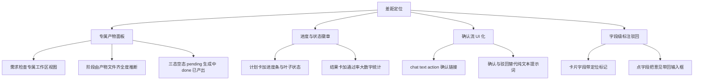

# grasp 与需求检查工作区渲染效果差异分析

- 日期：2026-11-09
- 背景：P2 验收后用户反馈「明显和 grasp 的渲染效果完全不一样」——本文分析两边渲染架构的真实差距，作为 P3（专属工作区视图）的设计输入。
- 结论先行：**差距是架构级的，不是样式级的**。grasp 把产物渲染为「运行详情页里的专属文档面板」（每类产物一个完整文档渲染器 + 确认流 + 标注回路）；我们目前把产物渲染为「聊天时间线里的折叠工具卡」。P2 有意选了后者（零协议改动、复用 ToolDetails 机制），grasp 对应能力在可行性分析里被划入 P3 专属工作区方向。

## 一、grasp 运行态的渲染架构

代码证据：`thirdparties/grasp/web/src/components/run/`

### 1.1 渲染位置：产物面板，不是聊天流

```
RunDetailView.vue                     运行详情页（右面板 + node tabs）
  └─ StructuredProductPanel.vue       产物面板（挂在 run + node 上）
       └─ StructuredArtifactView.vue  分发器：按保留产物文件名路由
            ├─ clarified_requirement.json → product/ClarifiedRequirementView.vue
            ├─ plan.json                → PlanView.vue
            ├─ root_cause.json          → product/RootCauseView.vue
            └─ test_result.json        → product/TestResultView.vue
ClarifyProductStage.vue               产物阶段面板（panel / pending / executedEmpty 三态空态）
```

产物是一等公民：独立面板、独立 tab、按节点挂载；聊天流（ClarifyChat.vue，2372 行）与产物面板**并存**，产物不折叠、不内嵌在消息里。

### 1.2 产物专属文档渲染器（每类产物一个完整报告视图）

`src/components/run/product/` 共 8 个 View（约 2573 行）：

| 渲染器 | 形态要点 |
|---|---|
| ClarifiedRequirementView | 规格完整报告：标题 + 概述 + workKind 徽标 + 背景 + 目标 + 成功度量 + 范围内外（彩色 chip）+ 数据实体/业务规则/边界/假设/依赖/约束/风险/术语表 + FR/NFR 分节；**每个字段带 data-json-path**（可定位） |
| PlanView（506 行） | **总进度条（done/total · pct%）** + 叶子状态徽章（in_progress 带呼吸动画）+ 设计分节（架构/数据/接口/组件/交互/测试设计）+ goals/subgoals 树 |
| TestResultView | **通过率进度条 + passed/failed 大数字统计** + 用例状态徽章（check/close 图标）+ defects 带严重度 |
| RootCauseView / PreflightView / ImplementationResultView / MergeRequestView / FeedbackLedgerView | 其余产物各自的报告视图 |

### 1.3 确认流是 UI 机制，不是提示词纪律

- `ConfirmFlowDialog.vue` / `ConfirmFlowOverlay.vue`：确认流模态/浮层（accept/dismiss/release 显式状态机）
- `GateApproval.vue` + 人工门禁节点（工作流画布上的「人工门禁」节点类型）：通过/不通过出口是**画布上的门禁审批**
- 对比我们：确认门是 `REQUIREMENT_CHECK_INSTRUCTIONS` 提示词纪律 + questionnaire，靠模型遵循度（P2 报告已记录观察点：agent 有时把拍板点写在结尾文本而非调 questionnaire）

### 1.4 标注回路：点字段 → 发回聊天 → agent 修订

- `AnnotateBtn.vue`：字段悬停出现「标注」按钮，带 jsonPath（如 `functional_requirements[f1].detail`）
- `reviewAnnotate` + `SelectionAddToChat.vue` + `addClarifyAnnotation`：标注/选区直接注入聊天草稿，形成「指着字段提意见」的修订闭环
- 对比我们：驳回意见是自由文本（questionnaire），无字段级定位

### 1.5 其它配套

- `UpstreamRequirementContext.vue`：实现节点展示上游需求上下文
- `HtmlPreview.vue`：page.html 产物直接预览
- `ExecutionTimeline.vue` / `ExecutionStatsPanel.vue`：执行统计
- 时间线里的工具调用（`AgentToolGroup.vue`）也是折叠单行聚合（「used N tools」）——**grasp 的时间线和我们的时间线形态类似，差的是时间线之外的产物面板体系**

## 二、我们目前的渲染架构

- 落点：`src/renderer/agent-timeline.tsx` 的 `ToolDetails` 按 tool 名分支（web_search/bash 先例），三张 `requirement-card`（spec / plan / result）
- 位置：聊天时间线内部，藏在**三层折叠**里（turn 折叠 → 工具组折叠 → 工具卡自身折叠）——用户实测反馈「看不到卡片」的直接原因
- 数据：daemon `toolArguments` compact（P2 加的）保住卡片字段
- 确认门：提示词纪律 + questionnaire
- 无产物面板、无进度条/状态徽章（计划卡是静态树）、无字段标注、无产物 tab、无空态

## 三、逐项差异对比

| 维度 | grasp | 我们（P2 现状） |
|---|---|---|
| 产物呈现位置 | 运行详情页专属面板 + node tabs，与聊天流并存 | 聊天时间线内的工具卡，三层折叠 |
| 产物默认可见性 | 面板常驻（三态空态设计） | 折叠藏起，需三次点击 |
| 规格渲染 | 20+ 分节完整报告 + 字段级 jsonPath | 标题 + 徽标 + FR 列表 + 范围 chip |
| 计划渲染 | 进度条 + 叶子状态徽章（含进行中动画） | 静态两级树 |
| 结果渲染 | 通过率进度条 + 大数字统计 + 严重度 | 覆盖表 + 徽标 + 计数 |
| 确认门 | ConfirmFlowDialog/Overlay + 画布人工门禁节点（UI 状态机） | 提示词纪律 + questionnaire（依赖模型遵循度） |
| 驳回修订 | 字段级标注（AnnotateBtn + jsonPath）发回聊天 | 自由文本意见 |
| 上游上下文 | UpstreamRequirementContext 显式展示 | 无 |
| 架构依托 | run / node / artifact 模型（工作流引擎） | 会话 + dynamicToolCall（聊天模型） |

## 四、差异根因

1. **架构模型不同**：grasp 有工作流引擎（run/node/工作流画布/人工门禁节点），产物面板挂在 node 生命周期上；xc-ui-flow 是聊天会话模型，无 run/node 实体——产物面板没有天然挂载点，这是可行性分析（`dev-docs/design/需求检查工作区grasp化改造-可行性分析.md`）里「不迁移 FSM 引擎、阶段由产物文件齐全度推断」决策的由来。
2. **P2 的 lazy 决策**：P2 目标是「零协议改动把产物变成可读卡片」，选了 ToolDetails 时间线分支（复用 web_search/bash 先例 + compact arguments），明确把专属面板/进度/标注划到 P3。用户看到的差距就是这个未做部分。
3. **确认门的形态差距**是机制差距：grasp 的确认流是前后端配合的 UI 状态机；我们的提示词纪律只是行为约束，无 UI 承载。

## 五、对齐路径（P3 设计输入）



优先级建议（按用户可感知收益排序）：

1. **专属产物面板**（最大差距）：需求检查工作区加产物区——阶段由 `requirements/requirement-spec.json`、`requirements/check-plan.json`、`check/check-result.json` 三文件齐全度推断，三态空态（未开始/生成中/已产出），已产出时用现有三张卡片的渲染逻辑全量展开（不复刻 grasp 的 20+ 分节，先保 spec/plan/result 三视图）
2. **计划进度 + 结果统计**：计划卡叶子带状态（完成/未覆盖），结果卡头部加通过率进度条与 passed/failed 数字——数据在 check-result.json 里已有
3. **确认流 UI 化**：chat-text-action 机制（会话文本可点击行为）做「确认 / 需要修改」链接，替代纯文本提示词纪律
4. **字段级标注**：收益递减项，等前三项落地后评估

## 六、参考

- grasp 产物渲染器：`thirdparties/grasp/web/src/components/run/product/`、`StructuredArtifactView.vue`、`StructuredProductPanel.vue`、`RunDetailView.vue`
- grasp 确认流：`ConfirmFlowDialog.vue`、`ConfirmFlowOverlay.vue`、`GateApproval.vue`
- grasp 标注回路：`AnnotateBtn.vue`、`lib/inbox/reviewAnnotate.ts`
- 我们的卡片：`src/renderer/agent-timeline.tsx`（ToolDetails 三分支 + requirement-card）、`src/daemon/agent.ts`（toolArguments compact）
- 可行性分析：`dev-docs/design/需求检查工作区grasp化改造-可行性分析.md`
- P2 报告：`dev-docs/progress-result/需求检查grasp化-P2-执行报告.md`
