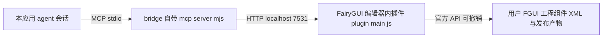

# 把 FairyGUI 接入本应用插件系统的可行性分析

> 目标澄清：这里的「插件」指**本仓库（xc-ui-flow / ohmygame 应用）插件页里的原生插件包**（`plugins/*`，`.ohmygame-plugin/plugin.json` 契约），不是给 FairyGUI 编辑器写编辑器插件。
> 参考底座：`thirdparties/fairygui-agent-bridge`（https://github.com/wingcd/fairygui-agent-bridge，锁 `4b3abc1`，MIT）
> 辅助参照：`thirdparties/FairyGUI-MCP`（https://github.com/kaohum/FairyGUI-MCP，锁 `7b54465`，MIT）

## 一、结论先行

| 问题 | 结论 |
|---|---|
| 技术可行吗 | **可行，且是本应用插件系统的标准玩法**——插件包 = Skills + MCP 服务器，fairygui-agent-bridge 正好自带一个零依赖 Node 的 stdio MCP server（`mcp/server.mjs`） |
| 接入方式 | 新建 `plugins/fairygui/` 插件包：`plugin.json`（配置字段 + 界面元数据）+ `mcp.json`（包内自带 bridge 的 server.mjs）+ `skills/fairygui-ui/SKILL.md`（使用与安装指引） |
| 参照模板 | **Godot 插件**（`plugins/godot/`）：同样是「本地编辑器 + MCP + Skill」，连「外部可执行路径」配置字段的设计都现成 |
| 需要解决的缺口 | ① 编辑器侧插件（`plugin/main.js`）必须先装进用户的 FairyGUI 工程——插件包管不到用户工程目录，只能靠 Skill 指引 + 自带安装脚本；② bridge 不是 npm 包，要把它的文件**收进插件包**（MIT 允许）；③ 截图在其构建上可能被裁，验收链路要留 OS 级兜底 |
| 工作量 | P0 探活半天 + P1 完整插件 1~2 天；无需改主程序任何代码 |

## 二、本应用的插件契约（我们要接入的形状）

### 2.1 包格式

```text
plugins/fairygui/
├── .ohmygame-plugin/plugin.json   # 清单（formatVersion 1）
├── mcp.json                       # MCP 服务器声明（stdio 或 http）
├── skills/fairygui-ui/SKILL.md    # 技能（name/description frontmatter）
└── assets/icon.svg                # 图标（可选）
```

`plugin.json` 关键字段（对照 `plugins/godot/.ohmygame-plugin/plugin.json`）：

| 字段 | 作用 | FairyGUI 插件怎么填 |
|---|---|---|
| `skills` | 技能目录 | `"./skills/"` |
| `mcpServers` | MCP 声明文件 | `"./mcp.json"` |
| `configuration` | 用户配置表单（text/secret/path/boolean/select） | 编辑器 exe 路径、UI 工程路径、bridge URL |
| `requirements` | 依赖声明（命令、平台），详情页「检查依赖」用 | `{"commands":["node"]}` |
| `interface` | 卡片元数据：displayName、icon、beta、projectTypes、defaultPrompt | `beta: true`，projectTypes 填 `["general","asset-canvas"]`（FGUI 是通用 UI 工具，不绑定项目类型） |
| `enabledByDefault` | 初始开关 | `false`（与 Cocos/Unity/Tiled 等 Beta 插件一致） |

配置值通过 `${config.<field-id>}` 注入 `mcp.json` 的 env/args/url；secret 字段存加密库，不进包。

### 2.2 运行时模型（对本方案有影响的点）

1. **coding agent 拿到的就是「Skills + 经 daemon 代理的 MCP 工具」**——插件不能塞自定义代码进宿主。fairygui-agent-bridge 的能力必须全部通过「MCP 工具」或「Skill 里教的命令行步骤」表达，这正好它都有（19 条 HTTP 命令 = MCP 工具；`cli/fgui.mjs` = Skill 里可教的命令）。
2. `lifecycle: "lazy"`——MCP 按需连接，不必应用启动时拉起。
3. 相对 `cwd` 以插件包根解析——**包内自带 `server.mjs` 可行**，不需要发布 npm。
4. 插件开关决定 agent 会话里是否有这些工具；projectTypes 限制技能候选。

## 三、FairyGUI 侧可复用的资产（两个上游怎么用）

### 3.1 fairygui-agent-bridge（主力）

三层结构，**我们只缺中间那一层的「宿主化」**：



| 资产 | 内容 | 在本方案中的角色 |
|---|---|---|
| `mcp/server.mjs`（262 行，零依赖） | 每条 HTTP 命令注册为一个 MCP tool，支持 `project`/`port`/`bridge_url` 参数 | **直接收进插件包**，`mcp.json` 指向它 |
| `plugin/main.js`（684 行） | 编辑器内 HTTP 服务：`ping`/`list_packages`/`list_items`/`read_component`/`create_component`/`insert_object`/`set_property`/`remove_object`/`publish`/`screenshot` 等 19 条，官方 API 可撤销，发布产物与 GUI 手动 md5 一致 | **随插件包分发**，但必须装进用户的 FGUI 工程才生效 |
| `cli/fgui.mjs` + `scripts/install.bat/.sh` | 零依赖 CLI 与插件安装脚本 | Skill 里教的「一次性的环境准备步骤」 |
| `STANDARDS.md` + `scripts/lint_components.mjs` | AI 手写 FGUI 工程的强制规范 + 机器 lint | **收编进 Skill 的教学正文**，lint 脚本随包分发 |
| `cli/instances.mjs` | 多编辑器实例发现 | 多工程场景用（bridge 已支持按 `project` 路由） |

### 3.2 FairyGUI-MCP（辅助）

不作为接入底座（Python + fastmcp 依赖重、文件轮询慢），但保留两个参考价值：

- `command_handler.lua` 里 `displayObj:GetScreenShot(nil, scale)` 的组件画布截图写法——agent-bridge 的 `ScreenCapture` 在作者那个编辑器构建被 Unity 裁掉，若我们也遇到，这是兜底实现方向；
- 它对「直写磁盘 vs 编辑器内存态」冲突的验证（写组件工具被整段禁用），反向证明 agent-bridge「只走官方 API」的路线是对的。

## 四、插件包设计（建议稿）

### 4.1 目录

```text
plugins/fairygui/
├── .ohmygame-plugin/plugin.json
├── plugin/                         # 从 agent-bridge 收编（装进用户 FGUI 工程）
│   ├── main.js
│   └── package.json
├── mcp/
│   ├── server.mjs                  # 收编（MIT，附 NOTICE 注明来源与版本）
│   ├── fgui.mjs                    # CLI（Skill 里的 ensure/install 用）
│   └── instances.mjs
├── scripts/
│   ├── install.bat / install.sh    # 把 plugin/ 复制进用户工程
│   └── lint_components.mjs
├── mcp.json
├── skills/fairygui-ui/SKILL.md
└── assets/icon.svg
```

> 不用 `npx -y` 拉远端包（Godot 那种方式）：bridge 没发 npm，且文档明确提示「未固定版本的 npx/bunx 会被依赖检查标黄」；收编进包 = 固定版本 + 可离线。

### 4.2 `plugin.json`（草案）

```json
{
  "name": "fairygui",
  "version": "0.1.0",
  "enabledByDefault": false,
  "description": "Build FairyGUI components and publish UI packages through the editor bridge.",
  "skills": "./skills/",
  "mcpServers": "./mcp.json",
  "requirements": { "commands": ["node"] },
  "configuration": {
    "ui-project-path": {
      "type": "path",
      "label": "FairyGUI UI 工程路径",
      "description": "包含 .fairy 工程文件与 assets 的目录；agent 会用它定位目标工程。"
    },
    "editor-exe": {
      "type": "text",
      "label": "FairyGUI 编辑器可执行文件",
      "description": "留空则自动探测常见安装位置。"
    },
    "bridge-url": {
      "type": "text",
      "label": "Bridge URL",
      "description": "缺省 http://localhost:7531；多实例时填实际端口。"
    }
  },
  "interface": {
    "beta": true,
    "displayName": "FairyGUI",
    "shortDescription": "Assemble FairyGUI components and publish UI packages via the editor.",
    "longDescription": "Drive the FairyGUI editor through an in-editor bridge: list assets, create components, insert objects, set properties, and publish packages byte-identical to manual publishing. Requires the bridge plugin installed in your UI project and a running editor (free version is fine).",
    "icon": { "type": "preset", "id": "layers" },
    "defaultPrompt": [
      "List the packages in my FairyGUI project and describe the main components.",
      "Create a settings panel component in FairyGUI with a title, close button, and toggles, then publish the package.",
      "Read this component and suggest how to refactor duplicated buttons into a common component."
    ],
    "projectTypes": ["general", "asset-canvas"]
  }
}
```

### 4.3 `mcp.json`（草案）

```json
{
  "mcpServers": {
    "fairygui": {
      "command": "node",
      "args": ["./mcp/server.mjs"],
      "env": {
        "FGUI_BRIDGE_URL": "${config.bridge-url}",
        "FGUI_EDITOR_EXE": "${config.editor-exe}"
      },
      "lifecycle": "lazy"
    }
  }
}
```

注意：`ui-project-path` 不必进 env——bridge 的 MCP 工具本身支持每次调用传 `project` 参数；配置字段主要给「检查依赖」和 Skill 上下文用。缺失配置只会让该服务未配置，不影响其他组件（文档明确行为）。

### 4.4 Skill（教学正文骨架）

`skills/fairygui-ui/SKILL.md`，frontmatter 照 Tiled 插件的极简风格，正文四块：

1. **环境准备（一次性）**：`node mcp/fgui.mjs ensure '{"project":"<UI 工程路径>"}'` —— 桥不通自动拉编辑器并等 ping 就绪；没装编辑器插件时先跑 `scripts/install.bat <工程路径>`。
2. **典型制作循环**：`list_items` 找素材 → `read_component` 拿子对象命名 → `create_component` / `insert_object` / `set_property` 摆 UI（官方 API，可撤销）→ `publish` 出包 → 游戏侧加载验证。
3. **规范红线**（收编 agent-bridge `STANDARDS.md`）：displayList 只有 10 种标签、`extention` 只有 8 种合法值（拼写就是 extention）、`text input="true"` 才是输入框、九宫格先查 §2.7 范围、单组件 ≤ 80 对象、颜色用 6 位 + `alpha` 分开写（8 位色运行时只取后 6 位）、禁止手搓引擎自带能力（GLoader fill / relation / controller+Gear / GList / ScrollPane / GGraph / grayed）。
4. **验证**：`node scripts/lint_components.mjs <工程根>` 必跑；截图验收需注意 `ScreenCapture` 在部分编辑器构建不可用，退路是 OS 级窗口截屏。

## 五、可行性核对表（逐条对插件契约）

| 契约要求 | FairyGUI 插件是否满足 | 说明 |
|---|---|---|
| 能力可表达为 Skills 或 MCP servers | 满足 | bridge 自带 stdio MCP server；规范教学进 Skill |
| MCP 服务器可声明 | 满足 | `node ./mcp/server.mjs`，零依赖，Node 18+（本应用自带 Node/bun 环境） |
| 配置走 configuration 表单 | 满足 | 工程路径 / 编辑器 exe / bridge URL 三个 text/path 字段 |
| 依赖检查 | 满足 | `requirements.commands: ["node"]`；详情页检查 PATH |
| 不引入新项目类型 / 宿主代码 | 满足 | 纯包内文件，主程序零改动（文档明确 Beta 插件「reuse the existing runtime」） |
| 图标 | 满足 | preset `layers` 或自制 SVG（静态子集，禁脚本/外链） |
| 凭据 | 不涉及 | 全本地，无 secret 字段 |
| 可导出/迁移 | 满足 | ZIP 导出 <50MB，排除 `node_modules`（我们零依赖，无影响） |

**一条契约缺口（最重要）**：编辑器侧插件必须存在于**用户的 FGUI 工程** `plugins/agent-bridge/` 里，插件包只能分发它、不能自动安装它。处理方式与 TapTap Maker「enabling alone does not install dependencies」同类：**装不装、何时装，交给 Skill 的一次性环境准备步骤**（跑自带 install 脚本或 `ensure` 前检查），插件详情页的 longDescription 写清前置条件。

## 六、风险与待验证

| # | 风险/待验证 | 影响 | 对策 |
|---|---|---|---|
| 1 | 编辑器构建差异：`OpenDocument` 在 bridge 作者构建里被裁（静默 null）；`ScreenCapture` 也可能被裁 | 「打开组件→截图→人抽检」验收链路 | P0 先实测我们目标编辑器版本的两条命令；截图退路 = OS 级截屏（PowerShell CopyFromScreen）或 FairyGUI-MCP 的 `GetScreenShot` 思路自加命令 |
| 2 | 用户 FGUI 工程装了编辑器插件后，交付工程是否污染 | 插件目录会出现在用户工程里 | install 脚本在工程 README/交付说明登记 `plugins/agent-bridge/ 为开发工具可删`；或交付前剔除 |
| 3 | 编辑器必须保持运行（可最小化，bridge 已设 `runInBackground`） | 无人值守流程 | Skill 里先 `ensure`（自动拉编辑器、轮询 ping 就绪），失败即明确报错 |
| 4 | 多工程/多编辑器实例串台 | 操作错窗口 | bridge 已有端口递增 + 注册表 + `project` 参数路由；Skill 教「多窗口时必须传 project」 |
| 5 | bridge 是外部仓库快照，后续更新 | 版本漂移 | 包内附 `NOTICE.md` 记录上游 commit；`thirdparties/fairygui-agent-bridge` 子模块保留作同步参照（同 ohmygame 的做法） |
| 6 | MCP server 进程生命周期（lazy 连接、会话重建） | 首次调用慢一点 | 无功能影响；连接测试面板已有 |
| 7 | 免费版编辑器能否发布 | 不能则 P4 发布环节砍掉 | bridge 已实测：免费版走 `PublishHandler` 可发布，`batchmode` 才被 `CheckProLicense` 拦 |

## 七、落地阶段

| 阶段 | 内容 | 估时 | 出口标准 |
|---|---|---|---|
| P0 探活 | 手动把 `plugin/main.js` 装进一个测试 FGUI 工程，`curl ping`；实测 `OpenDocument` / `screenshot` 在目标编辑器构建的可用性 | 半天 | 拿到 §六-1 的实测结论 |
| P1 插件包 | 按第四节建 `plugins/fairygui/`（收编 mcp/cli/plugin/scripts），写 Skill；插件页启用 → agent 会话里能看到 MCP 工具 | 1 天 | `list_packages` → `create_component` → `set_property` → `publish` 全链路在一个 demo 工程走通 |
| P2 打磨 | lint 收进 Skill 验证步骤；defaultPrompt 调优；图标；NOTICE | 半天 | 依赖检查零黄项；Skill 按规范红线可自我约束 |
| P3（可选）验收闭环 | 截图 + lint 报告进会话 | 按需 | 视 P0 截图实测结果定 |

不改的东西：主程序 `src/` 零改动；`plugins/` 目录与 bundled-plugins 装载机制现成（新增目录即被发现）。

## 八、类比理解

本应用的插件系统像一个**商场铺位**：宿主提供店面（插件页卡片）、收银台（configuration 表单）、电力（daemon 的 MCP 代理），商户只准带两种商品——Skill（说明书）和 MCP server（自动售货机）。

FairyGUI 接入就是开一家铺子：售货机直接搬 fairygui-agent-bridge 现成的那台（零依赖、插电即用）；说明书把它的 STANDARDS 翻译成给 agent 的操作守则。唯一商场管不到的，是「仓库」——编辑器侧插件必须装进用户自己的 FairyGUI 工程（铺位外面），所以说明书第一页教的就是怎么把货搬进仓库（install 脚本 + `ensure`）。

## 九、引用说明

### 本仓库（宿主契约与模板）

- `docs/plugins.md` —— 插件包契约全文：包格式、`mcp.json`、configuration、requirements、Bundled Beta 插件清单与「reuse the existing runtime」边界
- `plugins/godot/.ohmygame-plugin/plugin.json` + `mcp.json` —— 「本地编辑器 + MCP + Skill」的最接近模板（含外部可执行路径配置字段、`lifecycle: lazy`、固定版本 MCP）
- `plugins/tiled/.ohmygame-plugin/plugin.json` + `skills/tiled-maps/SKILL.md` —— `enabledByDefault: false` 的 Beta 插件与极简 Skill 写法
- `plugins/unity/.ohmygame-plugin/plugin.json` —— longDescription 写清前置条件（Editor 版本要求）的范例
- `src/daemon/bundled-plugins.ts` —— bundled 装载：扫 `plugins/` 子目录即注册，无需改代码

### 上游（能力来源）

- `thirdparties/fairygui-agent-bridge/mcp/server.mjs` —— 零依赖 stdio MCP server（将收编）
- `thirdparties/fairygui-agent-bridge/plugin/main.js` —— 编辑器内 HTTP 桥（将随包分发；`COMMANDS` 表、`PublishHandler`+`add_onComplete`、多实例注册、被裁 API 的 try/catch 实调写法）
- `thirdparties/fairygui-agent-bridge/STANDARDS.md` + `scripts/lint_components.mjs` —— Skill 正文与机器校验来源
- `thirdparties/fairygui-agent-bridge/README.md` —— 命令表、实测记录（`OpenDocument`/`ScreenCapture` 被裁、免费版可发布、8 位色坑、`CreateComponentItem` 传 null）
- `thirdparties/FairyGUI-MCP/plugin/MCPBridge/src/command_handler.lua` —— `GetScreenShot` 组件截图参考实现（截图兜底方向）
