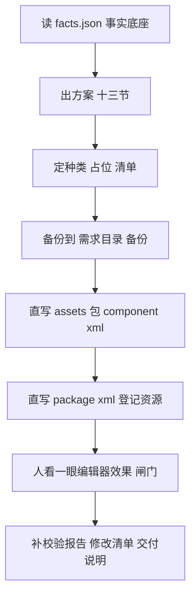
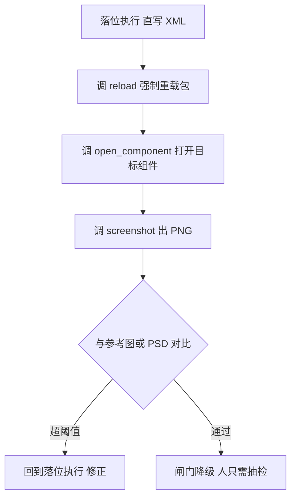

# 参考 FairyGUI-MCP 构建 FairyGUI 插件的可行性分析

> 子模块：`thirdparties/FairyGUI-MCP`（https://github.com/kaohum/FairyGUI-MCP，锁 `7b54465`）
> 目标：判断能否 / 如何参考它给 xc-ui-flow 的 FGUI 流程做一个编辑器插件，补上「改完自动验收」这一环。

## 一、结论先行

| 问题 | 结论 |
|---|---|
| 参考它做插件**技术可行**吗 | **可行**。它的 Lua 插件把 FairyEditor 的扩展点、坑、失效 API 全趟过一遍，直接抄能省掉大量试错 |
| 应该整份复用吗 | **不该**。它的 Python 半边是 MCP 服务抽象，我们的调用方是 OpenCode 里的 Python 脚本，不是 MCP 客户端，接进来是纯负担 |
| 推荐路径 | **复用 Lua 插件 + 文件桥协议，自建精简 Python 客户端**（方案 B），先只做「读 + 截图 + 重载」，写入仍走现有 s2 直写 XML |
| 最大价值单点 | **把 s2 的「人看一眼效果」闸门变成机器截图对比**，顺带解决 XML 直写后编辑器缓存不刷新的隐性风险 |
| 最大风险 | 插件必须装进 client 工程 `plugins/` 目录，会混进交付给程序的工程文件；且 XML 直写与编辑器内存态存在冲突（上游为此禁用了写组件工具） |

## 二、参考项目解剖

### 2.1 架构：三层 + 文件轮询桥


关键设计（Lua 侧 `main.lua`，131 行）：

| 机制 | 实现 | 为什么这么做 |
|---|---|---|
| 轮询 | `CS.FairyGUI.Timers.inst:Add(0.1, 0, callback)` | 插件没有事件回调入口，只能拉 |
| 后台运行 | 每轮把 `CS.UnityEngine.Application.runInBackground = true` 重设一遍 | F5 / Preview 模式会反复覆盖该值，设一次不够 |
| 热重载 | 检测 `bridge/reload_signal` 文件 → `dofile` 重载 `command_handler.lua` | 改插件代码不用重启编辑器 |
| 旧回调自杀 | `_G._mcpBridgeCallbackId` 与闭包内 ID 比对，不等就 `Timers:Remove` 自己 | 重载后旧定时器不停会双跑 |
| 日志缓冲 | 拦截全局 `fprint` 进环形缓冲（500 条） | 编辑器控制台翻不回去 |

### 2.2 能力清单（Lua 侧 25 个 action）

| 类别 | action | 依赖的编辑器 API |
|---|---|---|
| 工程读取 | `list_packages` / `list_components` / `get_component_info` | `App.project.allPackages`、`pkg.basePath`、`GetPackageByName` |
| 打开与预览 | `open_component` / `preview` / `save` / `close` | `App.docView:OpenDocument(url, true)`、`App.ShowPreview(item)`、`App.activeDoc` |
| 截图 | `screenshot` / `capture_preview` | `doc.content:GetScreenShot(nil, scale)` + `ImageConversion.EncodeToPNG` |
| 选择与检查器 | `get_selection` / `select_element` | `doc:SelectObject(...)`；检查器面板**改不动**（见 2.4） |
| 控制器 | `list_controllers` / `switch_controller` | 遍历 `pkg` 内 controller 定义 |
| 预览测试 | `start_test` / `stop_test` / `switch_device` / `list_devices` | `App.project:GetSettings("Adaptation")` |
| 重载 | `reload` / `reload_all_plugins` | `pkg:Touch()`、`App.project:RefreshPackage(pkg)` 多路兜底 |
| 发布 | `publish_package` / `publish_all` | `CS.FairyEditor.PublishHandler(pkg, branch):Run()` |
| 元能力 | `probe_plugin_api` / `probe_publish` | 反射探查 API 是否存在（`pcall` + 属性名清单） |

### 2.3 代码规模

| 部分 | 行数 | 复用价值 |
|---|---|---|
| `plugin/MCPBridge/main.lua` | 131 | 高（轮询/热重载/日志骨架几乎可直接用） |
| `plugin/MCPBridge/src/command_handler.lua` | 2543 | **最高**（FairyEditor API 用法全在这） |
| Python `tools/*.py` | 2070 | 低（MCP tool 装饰器 + 业务混合） |
| Python `parsers/*.py` | 782 | 中（XML 结构化解析，但我们已有 `scan_fgui.py`） |
| Python `bridge/command_queue.py` | 163 | 中（协议清晰，可精简到 ~60 行） |

### 2.4 上游自己承认的死路（省得我们再撞）

摘自 `TODO.md` / `CHANGELOG.md`：

| 限制 | 根因 | 对我们的意义 |
|---|---|---|
| `select_element` 无法让右侧检查器同步 | `Document.inspectingTarget` 是 C# `{get; private set;}`，反射 `canWrite=false`，setter 只在编辑器 selectionLayer 鼠标事件链路里触发 | 别指望插件能模拟完整人工操作；选中框能跟随就够用 |
| `capture_preview` 截图清晰度受用户手动滚轮缩放影响 | 调 `docContainer:SetScale` 会影响整个编辑器渲染 | 截图验收要固定 `scale` 参数，且要求预览窗保持默认缩放 |
| `start_test` 切设备分辨率无效 | 试过 `GRoot.inst:SetContentScaleFactor`（缩放整个编辑器）、`testView.contentPane:SetSize`（nil）、`viewWidth`、`stage:SetSize`（nil）均失败 | 多分辨率验收走 Adaptation 设置或直接跳过 |
| `fg_write_component` / `fg_create_resource` **被禁用** | 编辑器打开工程时缓存资源，直写磁盘与内存态冲突 | **直接印证我们 s2 直写 XML 的隐患**，见第四节 |

另外两条工程细节值得抄：

- `PublishHandler.Run()` 是异步（返回 Task），`handler.isSuccess` 在命令返回时还没更新——**判断发布完成只能看 `exportPath/{pkg}_fui.bytes` 的 mtime**。
- xLua 的 `GetType():GetMethods()` 枚举不到方法，找 API 只能翻编辑器自带的 `CS_FairyEditor_*.lua` 声明文件。

## 三、我们的现状与痛点

### 3.1 s2 现在怎么改工程



### 3.2 痛在哪

| 痛点 | 现状 | 插件能不能解决 |
|---|---|---|
| 验收靠人 | 唯一闸门要求「人看一眼效果」，脚本无法自证 | **能**：`open_component` + `screenshot` 出 PNG，与参考图/PSD 自动比 |
| 直写 XML 后编辑器看不到变化 | 依赖人手动刷新工程或重开包 | **能**：`reload`（`pkg:Touch()` 等多路兜底） |
| 直写 XML 可能被编辑器回写覆盖 | 编辑器有内存缓存，保存时可能覆盖磁盘 | **能缓解**：写后立即 reload；根治需改走编辑器内存模型 |
| 人指节点难对齐 | 「就这个按钮」→ 靠坐标猜 | **能**：`get_selection` 直接读选中元素 |
| 多态组件只看一态 | 控制器状态靠人点 | **能**：`list_controllers` + `switch_controller` + 逐态截图 |
| 发布要手点 | s4 之后人工发布 | **能**：`publish_package` 单包发布 |

## 四、最关键的一条风险：直写磁盘 vs 编辑器内存态

上游把 `fg_write_component` / `fg_create_resource` 两个工具**整段注释掉禁用**，是有意的：编辑器打开工程时把资源读进内存，外部直写磁盘产生三个后果——

1. **编辑器看不见改动**（内存里还是老版本，除非 reload 或重开工程）；
2. **编辑器保存时可能把内存态回写，覆盖掉外部改动**（尤其在编辑器里点了保存/切包）；
3. **`package.xml` 与组件 XML 不一致时，`RefreshPackage` 可能报错或丢资源登记**。

这正是我们 s2 现在的做法（直写 `assets/<包>/component/*.xml` 和 `package.xml`）。当前流程没炸，靠的是操作顺序默契（改的时候人在编辑器里刷）。**接插件的第一价值不是「让 AI 能改」，而是「让改完能立刻被验证」**——`reload` + `screenshot` 正好把这条隐患显性化。

结论：**插件先当验收器，别急着当编辑器**。写入继续走 s2 现有直写路径（已验证可用、可备份、可回退），插件只负责「重载 → 打开 → 截图 → 比对 → 报告」。等到验收闭环稳定，再评估是否把写入迁到插件内的编辑器 API（那条路要面对 2543 行 Lua 里同样的坑）。

## 五、三种构建方案对比

| 维度 | A 全套复用 MCP | B 复用 Lua + 自建 Python 客户端（推荐） | C 全自建最小插件 |
|---|---|---|---|
| 组成 | fastmcp 服务 + 4 个 tools 模块 + Lua 插件 | Lua 插件（整份抄）+ ~150 行 Python 桥客户端 | ~300 行 Lua，无 Python |
| 我们的调用方 | 必须是 MCP 客户端 → **要再加一层桥** | 现成的 Python 脚本直接调（`fgui_bridge.py`） | 同 B |
| 依赖 | fastmcp + pydantic + pywin32 + Pillow | 无（纯标准库文件 IO） | 无 |
| 路径约定 | 硬性要求 `.mcp.json` + `client/ui_project` 布局，**与我们的 client 工程结构不符** | 无要求，路径从命令参数传 | 无 |
| 能力覆盖 | 25 个 action 全有 | 25 个 action 全有（Lua 照抄） | 只做 4~6 个 |
| 改动面 | 大（要兼容 MCP 协议 + 改路径探测） | **小**（新增 1 个 Python 文件 + 复制插件目录） | 中（要重踩 API 坑） |
| 风险 | 抽象层与我们流程不匹配，双份维护 | 低 | 中（上游已踩平的坑要重踩一遍） |

### 为什么推荐 B

1. **执行层已经是 Python 脚本**（`scan_fgui.py` / `lookup.py` / `placeholder_png.py`），文件桥是两者唯一公共面，直连最省。
2. **Lua 那 2543 行是纯资产**：FairyEditor API 的用法、失效路径、`runInBackground` 反复覆盖、热重载自杀回调、`GetScreenShot` 的 Unity Y 轴翻转裁剪——自己写一遍等于把这些坑重踩。
3. **Python 那半边是负资产**：fastmcp 的 `@mcp.tool()` 装饰器把业务逻辑和协议耦在一起，`_detect_project_root()` 又是硬编码假设，剥出来比重写还费劲。
4. 遵循「不重复造轮子，也不为不需要的抽象付费」。

### 类比理解

上游交付的是**一台带遥控器的整机**：Lua 插件是机器本身（真功夫都在这），Python MCP 服务是那支专配遥控器（只认一种电池、一种信号）。

我们的场景里已经有一套自己的控制系统（Python 脚本流水线），需要的不是遥控器，而是**机器背面的接线端子**。
所以：机器整台搬过来，遥控器拆掉，用 30 根线自己焊个端子——比研究怎么让遥控器兼容我们的信号便宜得多。

## 六、方案 B 的最小设计

### 6.1 插件侧（复用 Lua，改 3 处）

```
.opencode/fgui-plugin/            # 新增，不进 client 仓库
├── package.json                  # name 改 xcflow-bridge
├── main.lua                      # 抄 main.lua，去掉 MCP 字样
├── src/command_handler.lua       # 抄上游，只保留需要的 handler
└── bridge/{commands,results,screenshots}/
```

改的三处：

1. `package.json` 的 `name` / `displayName` 换成我们自己的；
2. `command_handler.lua` 里无用 handler（`probe_*`、`start_test` 系列、`reload_all_plugins`）可裁，减少体积；
3. `bridge` 目录路径**不写死在插件里**（现在是 `PluginPath .. "/bridge"`），改为读一个 `bridge_dir.txt` 或固定相对 `PluginPath` 下——避免装到 client 工程时路径错位。

保留的 action（第一批）：

| action | 用途 | 备注 |
|---|---|---|
| `status` | 探活：编辑器在跑、工程已开、插件已载 | 新增，最便宜的连通性检查 |
| `open_component` | 打开 `包/组件` | `App.docView:OpenDocument(url, true)` |
| `reload` | 改完 XML 后强制重载包 | `pkg:Touch()` 多路兜底 |
| `screenshot` | 截 `doc.content` 出 PNG | 固定 `scale`，避免依赖手滚缩放 |
| `list_controllers` / `switch_controller` | 逐态截图 | 只读 + 切页，风险低 |
| `get_selection` | 人在编辑器里点，脚本读 | 免去坐标猜 |
| `publish_package` | 单包发布 | 判完成看 `_fui.bytes` mtime |

**不做**（第一批）：`select_element`（检查器同步无解）、`start_test` 系列（分辨率切不动）、`write_component`（上游明确禁用）。

### 6.2 Python 侧（~150 行）

`fgui_bridge.py` 放在 `.opencode/lib/`，接口形状对齐现有脚本风格：

```python
from fgui_bridge import Bridge

bridge = Bridge(bridge_dir)                      # 定位 commands/results
bridge.call("status")                            # -> {"ok": True, "project": "...", "packages": 18}
bridge.call("reload", package_name="boxKaWuXing_main")
bridge.call("open_component", package_name="boxKaWuXing_main", component_name="MainPanel")
png = bridge.screenshot("需求X_主面板", scale=2)  # -> Path(...)/需求X_主面板.png
```

内部就是：生成 `cmd_<uuid8>.json` → 写进 `commands/` → 轮询 `results/<id>.json`（默认 5s 超时）→ 返回 dict。抄 `command_queue.py` 的 `send_command` / `_wait_for_result`，删掉 MCP 依赖即可。

### 6.3 接进 s2 的位置



即：**把「人看一眼」从必经闸门，变成「机器先看，人抽检」**。判定阈值先用人眼标定（前几次截图人工核对），不要一上来就定死。

## 七、落地阶段

### P0 环境打通（半天）

- [ ] 确认 FairyGUI 编辑器版本与插件目录规范（工程内 `plugins/` 是否有全局替代路径）
- [ ] 把 `.opencode/fgui-plugin/` 骨架搭起来，只实现 `status` 一条 action
- [ ] 手动放一个命令 JSON 进 `commands/`，确认 `results/` 有回包
- [ ] 写 `fgui_bridge.py`，`bridge.call("status")` 跑通

### P1 验收闭环（1~2 天）

- [ ] 实现 `reload` / `open_component` / `screenshot`
- [ ] 拿一个已完工需求做回归：直写 XML → reload → 截图，比对「人看到的」是否一致
- [ ] 验证 §四 的覆盖风险：编辑器开着时直写 XML + reload，连续 10 次看是否稳定
- [ ] 把截图步骤写进 s2 的闸门前置动作（闸门保留，机器结果作为证据附上）

### P2 扩展（按需）

- [ ] `switch_controller` 多态逐态截图
- [ ] `publish_package`（判完成看 mtime）
- [ ] 截图与 `参考图_1334x750/` 的差异度量（先做像素差 + 尺寸校验，不做视觉模型）
- [ ] 评估是否把写入迁进插件（走编辑器内存模型），**这是 P2 之后的独立决策**

## 八、待验证清单（动手前必须确认）

| # | 待验证 | 方法 | 不通过的退路 |
|---|---|---|---|
| 1 | 插件能否装在 client 工程之外（全局插件目录） | 翻编辑器安装目录 / 试 `%APPDATA%` 或编辑器目录下插件目录 | 装进工程 `plugins/` + `.gitignore` + 交付前剔除，并在交付说明里写清 |
| 2 | 我们的 client 工程打开时插件是否被加载 | 放插件后看控制台是否出现启动日志 | 确认工程 `settings/` 是否禁用插件 |
| 3 | 直写 XML + reload 是否 100% 生效（含 `package.xml` 新登记资源） | P1 的 10 次重复验证 | 退化为「先关文档 → 写 → 重开」，或让插件接管写入 |
| 4 | `GetScreenShot` 在我们工程的分辨率/缩放参数下是否清晰可用 | 不同 `scale` 各截一张目视比对 | 用 `capture_preview` 或提高 scale |
| 5 | 编辑器版本升级后插件 API 是否失效 | 记录 `CS_FairyEditor_*.lua` 声明文件位置，升级时 diff | 上游同样有此风险，锁版本并记进经验 |

## 九、收益与成本粗算

| 项 | 估 |
|---|---|
| 一次性成本 | P0+P1 约 2~3 人天（大头是环境验证，不是写代码） |
| 每需求省下 | 验收从「人开着编辑器看 + 口述问题」变成「截图 + 差异报告」，每需求约省 10~30 分钟且不依赖人在场 |
| 新增维护面 | 1 个 Lua 插件目录 + 1 个 Python 桥文件；上游 API 变更时跟一次 |
| 不改的东西 | s2 的写入策略、备份与回退、方案模板、闸门本身——都不动 |

## 十、引用说明

**子模块源码**（`thirdparties/FairyGUI-MCP`）

- `plugin/MCPBridge/main.lua` —— 插件入口：`Timers` 轮询、`runInBackground` 重置、热重载与旧回调自杀、`fprint` 日志缓冲
- `plugin/MCPBridge/src/command_handler.lua` —— 25 个 action 的编辑器侧实现（`App.docView:OpenDocument`、`App.ShowPreview`、`GetScreenShot` + Unity Y 轴翻转裁剪、`PublishHandler`）
- `src/mcp_fairygui/server.py` —— fastmcp 入口与 `_detect_project_root()` 的路径假设
- `src/mcp_fairygui/bridge/command_queue.py` —— 命令/结果文件协议（`cmd_<uuid8>.json` → `results/<id>.json`）
- `src/mcp_fairygui/tools/component_tools.py` —— `fg_write_component` 被整段注释禁用（直写磁盘与编辑器内存态冲突的直接证据）
- `README.md` —— 架构图、25 个工具清单、安装与 MCP 客户端配置
- `TODO.md` / `CHANGELOG.md` —— 已知死路（检查器同步、预览缩放、设备切换、发布异步）与 `PublishHandler` 单包发布结论

**本仓库相关**

- `卡五星自动化流程-10-20/.opencode/skills/fgui-flow/SKILL.md` —— s2 的落位执行与单一闸门定义
- `卡五星自动化流程-10-20/.opencode/skills/fgui-flow/scripts/scan_fgui.py` —— 现有静态事实采集（`facts.json`）
- `卡五星自动化流程-10-20/.opencode/skills/fgui-env/SKILL.md` —— client 工程定位规则（`workspace.json` 的 `client_dir`）
