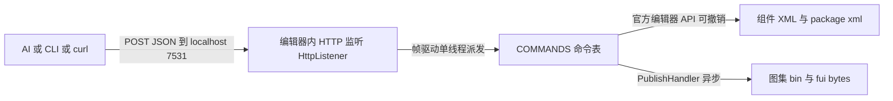
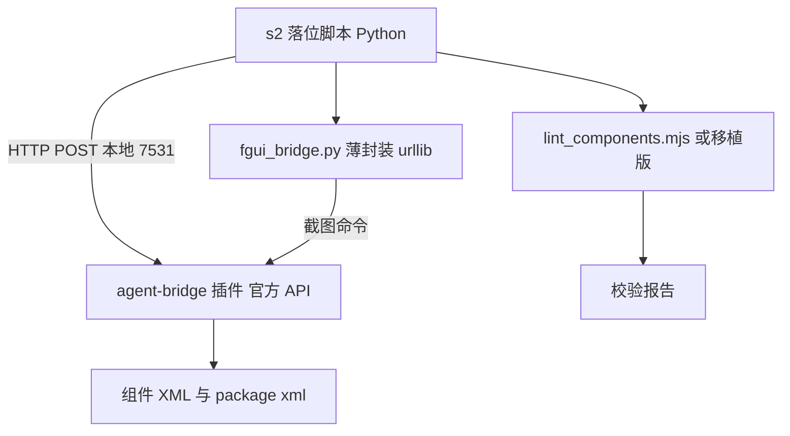

# 参考开源桥构建 FairyGUI 编辑器的可行性分析

> 参考一：`thirdparties/FairyGUI-MCP`（https://github.com/kaohum/FairyGUI-MCP，锁 `7b54465`）—— 文件轮询桥，偏「读 + 截图」
> 参考二：`thirdparties/fairygui-agent-bridge`（https://github.com/wingcd/fairygui-agent-bridge，锁 `4b3abc1`）—— HTTP 桥，偏「写 + 发布」
> 目标：判断能否 / 如何给 xc-ui-flow 的 FGUI 流程接一个编辑器桥，补上「改完自动验收」和「改得进编辑器内存」这两环。

## 一、结论先行

| 问题 | 结论 |
|---|---|
| 技术可行吗 | **可行，而且不用自己造**。两个开源项目已经把 FairyEditor 的扩展点、失效 API、免费版限制全趟平了 |
| 用哪个当底座 | **以 `fairygui-agent-bridge` 为底座**（HTTP + 官方编辑器 API + 可撤销 + 发布逐字节一致 + Node 零依赖） |
| 另一个还有什么用 | 只抄两样：①用 FairyGUI 自己的 `GetScreenShot` 截组件画布（底座那套 Unity `ScreenCapture` 在作者那个编辑器构建里被裁掉了）；②文件轮询桥的「热重载 + 旧回调自杀」思路（HTTP 方案不需要） |
| 最大价值单点 | **把 s2 的「人看一眼效果」闸门变成机器截图对比**，顺带把「直写 XML 编辑器看不见 / 可能被回写覆盖」这个隐患根治（改走官方 API 写） |
| 最意外的收获 | 底座的 `STANDARDS.md` + `scripts/lint_components.mjs` 与 s2 的「校验清单」高度重合，可以直接收编 |
| 最大风险 | 插件必须装进 client 工程 `plugins/` 目录（会混进交付给程序的工程文件）；「打开组件再截图」这条路在此编辑器构建里**不通**（`OpenDocument` 被裁），得换方案 |

## 二、参考一：FairyGUI-MCP（文件轮询桥）

### 2.1 架构


Lua 侧 `main.lua`（131 行）值得抄的四个机制：

| 机制 | 实现 | 为什么 |
|---|---|---|
| 轮询 | `CS.FairyGUI.Timers.inst:Add(0.1, 0, cb)` | 插件没有事件回调入口，只能拉 |
| 后台运行 | 每轮重设 `Application.runInBackground = true` | F5 / Preview 会反复覆盖该值，设一次不够 |
| 热重载 | 检测 `bridge/reload_signal` 文件 → `dofile` 重载 | 改插件不用重启编辑器 |
| 旧回调自杀 | `_G._mcpBridgeCallbackId` 与闭包内 ID 比对，不等就 `Timers:Remove` 自己 | 重载后旧定时器不停会双跑 |

### 2.2 能力与代码规模

25 个 action：工程读取（`list_packages`/`list_components`）、打开与预览（`open_component`/`preview`）、截图（`screenshot`/`capture_preview`）、选择（`get_selection`/`select_element`）、控制器（`list_controllers`/`switch_controller`）、预览测试（`start_test` 系列）、重载（`reload`）、发布（`publish_package`/`publish_all`）、元能力（`probe_plugin_api`）。

| 部分 | 行数 | 复用价值 |
|---|---|---|
| `plugin/MCPBridge/main.lua` | 131 | 中（HTTP 方案不需要轮询骨架） |
| `plugin/MCPBridge/src/command_handler.lua` | 2543 | **高**：`GetScreenShot` 组件截图、剪切坐标 Y 轴翻转、`PublishHandler` 用法 |
| Python `tools/*.py` | 2070 | 低（业务与 fastmcp 装饰器耦在一起） |
| Python `parsers/*.py` | 782 | 低（我们已有 `scan_fgui.py`） |
| Python `bridge/command_queue.py` | 163 | 低（HTTP 方案不需要） |

### 2.3 它自己承认的死路

| 限制 | 根因 | 对我们的意义 |
|---|---|---|
| `select_element` 无法让右侧检查器同步 | `Document.inspectingTarget` 是 C# `{get; private set;}`，反射 `canWrite=false` | 别指望桥能模拟完整人工操作 |
| `capture_preview` 清晰度受用户手滚缩放影响 | `docContainer:SetScale` 会影响整个编辑器渲染 | 截图必须固定参数、固定预览缩放 |
| `start_test` 切设备分辨率无效 | 试过的 5 条路径全失败（`GRoot.SetContentScaleFactor` / `contentPane:SetSize` 为 nil / `viewWidth` / `stage:SetSize` 为 nil） | 多分辨率验收走 Adaptation 设置或跳过 |
| `fg_write_component` / `fg_create_resource` **被禁用** | 直写磁盘与编辑器内存态冲突 | **直接印证我们 s2 直写 XML 的隐患** |

`PublishHandler` 的两条结论与参考二完全一致、可交叉验证：入口是 `CS.FairyEditor.PublishHandler(pkg, branch):Run()`（`FProject`/`FPackage`/`App` 都没有 `Publish` 方法）；`Run()` 异步，`isSuccess` 在命令返回时还没更新，**判完成只能看产物 mtime**（或像参考二那样挂 `add_onComplete`）。

## 三、参考二：fairygui-agent-bridge（HTTP 桥）

### 3.1 架构



关键设计（`plugin/main.js`，684 行，Jint/ES 风格，非 TypeScript）：

| 机制 | 实现 |
|---|---|
| 传输 | `CS.System.Net.HttpListener`，默认 7531，端口占用自动递增 21 次；`port.txt` 可指定。仅 localhost |
| 线程模型 | 严格单线程：`BeginGetContext` 每帧 `IsCompleted` 轮询，请求入队、主线程执行、主线程应答，**JS 绝不跨线程** |
| 串行 | 一个 `Bridge.current` 异步任务 + `queue`；发布这类异步命令跨帧 `stepPublish` 推进 |
| 后台 | `Application.runInBackground = true`（窗口最小化/失焦仍服务） |
| 多实例 | 启动时把 `{port, pid, project}` 注册到 `~/.fgui-agent-bridge/instances/<port>.json`，退出/卸载只删自己那条；存活靠 HTTP 心跳不靠 PID |
| 工程定位 | 插件装在 `<工程>/plugins/agent-bridge`，反推 `projectDirectory()` = `PluginDir` 上两级 |
| 探活 | `ping` 返回 `version / port / projectPath / projectOpen / project` |

### 3.2 命令表（19 条）

| 类别 | 命令 |
|---|---|
| 探活与工程 | `ping`、`project_info`、`list_packages`、`list_items`（资源树含 id/路径/尺寸） |
| 读 | `read_component`（**直接 `File.ReadAllText` 读盘**）、`list_children` |
| 写 | `create_component`（`CreateComponentItem`）、`insert_object`、`set_property`（走官方 API，**支持撤销**）、`remove_object`、`save_all`、`refresh` |
| 文档 | `open_doc`、`close_doc` |
| 发布 | `publish`（`PublishHandler` + `add_onComplete`，**完成才返回**，产物与 GUI 手动发布 md5 一致） |
| 其它 | `screenshot`、`bridge_log`、`delete_item` |

### 3.3 它踩过、我们不用再踩的坑

| 坑 | 事实 | 对我们影响 |
|---|---|---|
| **`OpenDocument` 不可靠** | 作者那个构建里 `App.docView.OpenDocument(url, true)` 静默返回 null；`OpenDocument(item)` 抛 "overload is striped by unity" | 「程序化打开组件 → 截图」这条路要重新设计（见 §六） |
| **`ScreenCapture` 被裁** | `CaptureScreenshotAsFile` / `CaptureScreenshot` 都不可用；且 Jint 里被裁方法可能是 truthy 但不可调用，`typeof` 守卫拦不住，必须 try/catch 实调 | `screenshot` 命令在此构建会明确报错 → 走 OS 级窗口截屏，或用 FairyGUI 自己的 `GetScreenShot` |
| 编辑器 Unity 裁剪 | `Encoding.UTF8.GetBytes(string)` 重载没了（用 `StreamWriter`）；`Path.GetFullPath` 重载没了（`projectDirectory` 改纯字符串切分） | 写插件代码时优先纯字符串处理，少调 .NET 重载 |
| 窗口最小化暂停主循环 | 设 `runInBackground` 解决 | 与参考一一致 |
| 包对象懒加载 | `getPkg` 统一做 `EnsureOpen` | 直接调 API 前必须确保包已开 |
| `CreateComponentItem` 参数 | `path` / `extentionId` 未用时**必须传 `null` 而非 `""`** | 传给它的空串会被当成路径 |
| 手写 XML 8 位色 | `#RRGGBBAA` 运行时可能只取后 6 位（`#000000c8` → 纯蓝 `(0,0,200)`） | 我们生成/改色时必须 6 位色 + `alpha="0.x"` 分开写 |
| 免费版能不能发布 | `batchmode` 被 `CheckProLicense` 拦（专业版功能）；但**走插件的 `PublishHandler` 免费版可发布** | 我们的 `publish_package` 走插件即可，无需专业版 |

### 3.4 白送的规范与 lint

`STANDARDS.md`（146 行）+ `scripts/lint_components.mjs`（172 行）是面向「AI 手写 FairyGUI 工程」的强制规范，与 s2 的校验清单几乎一一对应：

| 规范条款 | 内容 | 与 s2 校验清单的关系 |
|---|---|---|
| §1 目录规范 | `assets/<pkg>/components/<功能>/`，`package.xml` 的 `path` 与物理目录一致 | 我们「新图与登记」「其它联动文件」两节可直接引用 |
| §2 组件化纪律 | 单组件显示对象 ≤ 80；复用件抽 `common/`；动态列表用 `list` + `defaultItem` | 对应我们「结构」校验 |
| §2.5 引擎自带能力 | 九宫格/GLoader fill/color+alpha/relation/controller+Gear/GList/ScrollPane/Transition/GGraph/grayed —— **禁止手搓** | 对应我们「复用优先 7 级决策」的判据 |
| §2.6 类型白名单 | displayList 只有 10 种标签；`extention` 只有 8 种合法值；`text input="true"` 才是输入框；拼写就是 `extention` | **直接补强我们的种类判定**，避免「发明标签」导致组件打不开 |
| §2.7 九宫格范围 | 不是所有图都能切：胶囊/全圆头单轴专用切法，圆形/放射/对角纹理禁切；生效对象范围（loader 外部图/graph/jta/组件整体**不生效**） | 我们 s2 已有「先看 `package.xml` 有没有 `scale9grid`」，这里补上「该不该切」 |
| lint 检查项 | 格式非法/中心区越界（读 png IHDR 对账）✗、负值 ⚠、发明标签 ✗、非法 extention ✗、`extension` 拼写 ✗、>80 对象 ⚠ | **可直接接入 s2「补校验报告」一步** |

## 四、我们的现状与痛点

### 4.1 s2 现在怎么改工程


### 4.2 痛在哪，桥能不能补

| 痛点 | 现状 | 谁能补 |
|---|---|---|
| 验收靠人 | 唯一闸门要求「人看一眼效果」，脚本无法自证 | 截图（参考一的 `GetScreenShot` 或 OS 级截屏） |
| 直写 XML 后编辑器看不见变化 | 依赖人手动刷新工程或重开包 | 参考二 `refresh` / `save_all` / `set_property` 直改内存态 |
| 直写 XML 可能被编辑器回写覆盖 | 编辑器有内存缓存，保存时可能覆盖磁盘 | 参考二：**写入改走官方 API**，从根上消除冲突 |
| 人指节点难对齐 | 「就这个按钮」→ 靠坐标猜 | 参考二 `list_children` + `read_component` 拿 id/name；参考一 `get_selection` |
| 多态组件只看一态 | 控制器状态靠人点 | 参考一 `switch_controller`；参考二暂无（计划中） |
| 发布要手点 | s4 之后人工发布 | 参考二 `publish`（免费版可用、逐字节一致） |
| 校验靠人眼 | 校验清单是一条条人工对照 | 参考二 `lint_components.mjs` 机器跑 |

### 4.3 最关键的一条：直写磁盘 vs 编辑器内存态

两个项目在这一点上给了同向结论：

- 参考一把 `fg_write_component` / `fg_create_resource` **整段注释禁用**；
- 参考二干脆不提供「写盘」命令，`set_property` / `insert_object` / `create_component` 全部走官方编辑器 API（且可撤销），`read_component` 才读盘。

直写磁盘的三个后果：编辑器内存里还是老版本（看不见改动）→ 编辑器保存时可能回写覆盖 → `package.xml` 与组件 XML 不一致时 `RefreshPackage` 可能报错或丢登记。

**这正是我们 s2 现在的做法。** 当前没炸，靠的是操作顺序默契（改的时候人在编辑器里刷）。

结论：**桥的第一价值不是「让 AI 能改」，而是「让改完能立刻被验证」+「把改写进编辑器认的地方」**。落地顺序上，先用桥补验收（低风险），再评估把写入迁到官方 API（收益大但要重跑回归）。

## 五、四种构建方案对比

| 维度 | A 全套用 MCP | B 全套用 agent-bridge | **C 以 agent-bridge 为底座 + 抄 MCP 的截图**（推荐） | D 全自建最小桥 |
|---|---|---|---|---|
| 传输 | 文件轮询（100ms） | HTTP localhost | HTTP localhost | 自选 |
| 语言栈 | Lua + Python(fastmcp/pydantic/pywin32/Pillow) | Jint JS + Node 零依赖 | 同 B | 自写 |
| 写入方式 | 直写磁盘（写命令已禁用） | **官方 API + 可撤销** | 同 B | 取决于实现 |
| 发布 | `PublishHandler`（需判 mtime） | `PublishHandler` + `onComplete`（完成才返回） | 同 B | 要自己踩 |
| 截图 | `GetScreenShot` 截组件画布（可用） | Unity `ScreenCapture`（此构建**被裁**） | **两者互补** | 要自己踩 |
| 打开文档 | `OpenDocument` 可用 | `OpenDocument` **被裁** | 需实测我们自己的编辑器构建 | 要自己踩 |
| 规范与 lint | 无 | **有 `STANDARDS.md` + `lint_components.mjs`** | 直接收编 | 无 |
| 多工程 | 无 | **注册表 + 端口递增 + `project` 路由** | 直接可用 | 无 |
| 依赖 | Python 3.10+ + 4 个包 | Node 18+（仓库已有） | 同 B | — |
| 改动面 | 要改路径探测（`.mcp.json` + `client/ui_project` 假设） | 装插件 + 一个 HTTP 客户端封装 | 同 B + 一条截图命令 | 大 |
| 风险 | 抽象层不匹配、双份维护 | 截图不可用需替换 | 低 | 中（重踩所有坑） |

### 为什么选 C

1. **调用方匹配**：我们的执行层是 Python（`scan_fgui.py` / `lookup.py`），但桥只需要 HTTP——Python 标准库 `urllib` 三行就能调，比文件轮询更简单也更实时。仓库已有 Node（bun），CLI/MCP 层不装也能用 `curl` / `urllib`。
2. **写入正确性**：官方 API 写 = 可撤销、不用管缓存、`package.xml` 登记由编辑器自己做。这是参考一明确放弃、参考二明确解决的问题。
3. **白送的东西值钱**：`STANDARDS.md` 五条规范 + lint 脚本直接对接 s2 的「校验清单」，比我们自己攒判据省事得多。
4. **截图单独补**：参考二的 `ScreenCapture` 在他那个构建被裁，但参考一用 FairyGUI 自己的 `displayObj:GetScreenShot(nil, scale)` 在编辑器里是可用的——这是**组件画布截图**，比整窗截屏更适合比对。两套各抄一招，拼成一个完整的桥。

### 类比理解

参考一是**邮政系统**：把命令写成信投进邮筒，编辑器每 0.1 秒开一次信箱，办完再回一封信。可靠、跨进程、但慢，而且「寄信改文件」这件事本身有风险——文件躺在磁盘上，编辑器内存里那份还以为自己是正本。

参考二是**柜台窗口**：你走过去说一句话，柜台当场用编辑器自己的手（官方 API）把事办了，办完立刻把结果递回给你。办理过程可撤销（按 Ctrl+Z 能退），因为动作记在编辑器的操作历史里。

我们要的显然是柜台。而参考一还留了一样柜台办不到的服务：**给组件画布拍照**（`GetScreenShot`），因为柜台那台照相机的镜头被 Unity 裁掉了。

## 六、方案 C 的最小设计

### 6.1 分层



要新增的东西只有两件：

1. `.opencode/lib/fgui_bridge.py` —— HTTP 薄封装（~120 行，`urllib.request` 即可，无第三方依赖）；
2. 截图能力 —— 优先实测参考二的 `screenshot` 在我们编辑器构建上到底能不能用；不能就**照参考一的做法在插件里加一条 `capture_component` 命令**（`doc.content:GetScreenShot`）。

### 6.2 收编顺序（按风险从低到高）

| 阶段 | 用什么 | 风险 | 收益 |
|---|---|---|---|
| **P0 探活** | `ping` / `project_info` / `list_packages` | 极低（只读） | 确认桥在 client 工程里能起来、端口、多实例 |
| **P1 校验机器化** | `lint_components.mjs` 或其检查项移植进 `lookup.py --check` | 极低（只读） | 校验报告从人眼对照变成脚本输出 |
| **P2 读取替代** | `list_items` / `read_component` / `list_children` | 低（只读） | `facts.json` 可从内存态取，不再怕编辑器未保存的脏读 |
| **P3 验收闭环** | 截图命令（`screenshot` 或自加 `capture_component`） | 中（受构建裁剪影响） | 闸门降级为「机器先看 + 人抽检」 |
| **P4 写入迁移** | `set_property` / `insert_object` / `create_component` | 高（要重跑全部回归） | 根治直写与缓存冲突 |
| **P5 发布** | `publish` | 低（产物可比对） | s4 后自动出包，md5 可自证 |

写入（P4）**不要在 P0~P3 之前做**：现有的直写 + 备份 + 回退链路已经验证可用，先拿它换验收能力，等验收闭环稳定了再用「桥写入」替换「直写」，两者不要同时动。

### 6.3 接线形状

```python
from fgui_bridge import Bridge

fgui = Bridge()                                   # 自动 discover 端口 / 或指定 project
fgui.call("ping")                                 # {"version", "port", "projectOpen", ...}
fgui.call("list_items", pkg="boxKaWuXing_main", depth=2)
fgui.call("read_component", pkg="boxKaWuXing_main", name="MainPanel")
fgui.call("refresh")                              # 直写 XML 后让编辑器重看盘
fgui.call("publish", pkg="boxKaWuXing_main")      # 完成才返回
```

多工程场景直接用参考二的 `project` 参数路由，不用改配置（`project` 可传目录 / `.fairy` 文件 / 唯一工程名）。

## 七、待验证清单（动手前必须确认）

| # | 待验证 | 方法 | 不通过的退路 |
|---|---|---|---|
| 1 | 插件装在 client 工程 `plugins/` 会不会污染交付 | 看 `.gitignore` / 交付说明能否容纳；试插件目录是否可放在工程外 | gitignore + 交付前剔除，并在交付说明里写明「本目录为开发工具，可删」 |
| 2 | 我们的编辑器构建里 `OpenDocument` 是否可用 | 手工跑 `open_doc` 一次 | 不可用则不做「打开组件再截图」，改走「人在编辑器打开 + 脚本只截图」 |
| 3 | `screenshot`（Unity `ScreenCapture`）在我们构建是否可用 | 手工跑 `screenshot` 一次 | 自加 `capture_component` 命令，用 `doc.content:GetScreenShot(nil, scale)` |
| 4 | 直写 XML + `refresh` 是否 100% 生效（含 `package.xml` 新登记资源） | 连续 10 次直写 + refresh + 目视 | 退化为「先 close_doc → 写 → 再 open」或直接上 P4 |
| 5 | 编辑器版本升级后 API 是否失效 | 锁版本；记下 `plugin/TsAPI/editor.d.ts` 与 `CS_FairyEditor_*.lua` 声明文件位置 | 与两个上游同风险，写进经验文档 |
| 6 | 多实例（同时开多个 client 工程）会不会串台 | 开两个工程跑 `discover` + `project` 路由 | 固定 `port.txt` + 显式 `project` |

## 八、落地阶段与成本

| 阶段 | 内容 | 估时 |
|---|---|---|
| P0 | 装插件、`ping` 通、`fgui_bridge.py` 落地 | 半天 |
| P1 | lint 收编进 `lookup.py --check`，产出机器校验报告 | 半天 |
| P2 | `facts.json` 增加「内存态」来源（只读命令） | 半天 |
| P3 | 截图验收闭环 + 10 次稳定性回归 | 1~2 天 |
| P4 | 写入迁移 + 全量回归（独立决策，可推迟） | 2~3 天 |

| 项 | 估 |
|---|---|
| 新增维护面 | 1 个插件目录（跟上游同步，301K/小仓库）+ 1 个 Python 薄封装 |
| 不改的东西 | s2 的备份与回退、方案模板、闸门本身、`scan_fgui.py` 的静态事实采集 |
| 每需求省下 | 验收从「人开着编辑器看 + 口述问题」变成「截图 + 差异报告 + lint 报告」，约 10~30 分钟且不依赖人在场 |

## 九、引用说明

### 参考一：`thirdparties/FairyGUI-MCP`

- `plugin/MCPBridge/main.lua` —— `Timers` 轮询、`runInBackground` 重置、热重载与旧回调自杀、`fprint` 日志缓冲
- `plugin/MCPBridge/src/command_handler.lua` —— 25 个 action 的编辑器侧实现；`GetScreenShot` 组件截图 + Unity Y 轴翻转裁剪；`PublishHandler` 单包发布
- `src/mcp_fairygui/bridge/command_queue.py` —— 命令/结果文件协议（`cmd_<uuid8>.json` → `results/<id>.json`）
- `src/mcp_fairygui/tools/component_tools.py` —— `fg_write_component` 被整段注释禁用（直写磁盘冲突的直接证据）
- `README.md` / `TODO.md` / `CHANGELOG.md` —— 架构图、工具清单、已知死路（检查器同步、预览缩放、设备切换、发布异步）

### 参考二：`thirdparties/fairygui-agent-bridge`

- `plugin/main.js` —— HTTP `HttpListener` + 帧驱动单线程派发；`COMMANDS` 命令表；`PublishHandler` + `add_onComplete`；多实例注册；`runInBackground`；被裁 API 的 try/catch 实调写法
- `STANDARDS.md` —— **§2.5 引擎自带能力**、**§2.6 类型白名单（10 种 displayList 标签 / 8 种 `extention`）**、**§2.7 九宫格使用范围**
- `scripts/lint_components.mjs` —— 机器校验（`scale9grid` 格式与中心区越界读 png IHDR 对账、发明标签、非法 `extention`、>80 对象）
- `cli/fgui.mjs` / `cli/instances.mjs` / `mcp/server.mjs` —— CLI、多实例发现、MCP 包装（我们只用 HTTP 层，这两层可选）
- `README.md` —— 架构图、命令表、`v0.1.1` 实测记（`OpenDocument` 不可靠、`ScreenCapture` 被裁、Unity 裁剪重载、8 位色坑、免费版可发布）

### 本仓库相关

- `卡五星自动化流程-10-20/.opencode/skills/fgui-flow/SKILL.md` —— s2 的落位执行、复用优先 7 级决策、单一闸门
- `卡五星自动化流程-10-20/.opencode/skills/fgui-flow/scripts/scan_fgui.py` —— 现有静态事实采集（`facts.json`）
- `卡五星自动化流程-10-20/.opencode/skills/fgui-flow/scripts/lookup.py` —— `--check` 用 mtime 判过期，lint 收编的落点
- `卡五星自动化流程-10-20/.opencode/skills/fgui-env/SKILL.md` —— client 工程定位规则（`workspace.json` 的 `client_dir`）
- 官方插件 API 权威定义：https://github.com/fairygui/FairyGUI-Editor 的 `plugin/TsAPI/editor.d.ts`
