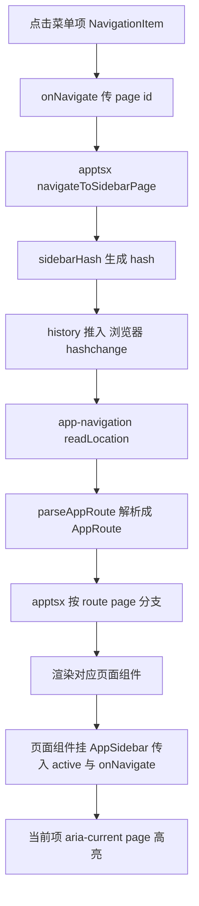

# 侧边栏菜单项与对应页面代码逻辑分析

> 对象：`http://127.0.0.1:43120/#/` 左侧 `<nav aria-label="主导航">` 的 10 个菜单项。
> 逐项说明：点击后走什么 hash → 解析成什么 route → 渲染哪个组件 → 该组件的数据来源、状态机与关键行为。
> 配置层（怎么增删改菜单）见 `docs/zh-CN/sidebar-config.md`；可配置化改造背景见 `dev-docs/design/侧边栏主导航可配置化分析.md`。

## 一、总览：一次点击的完整链路



三个固定事实：

1. **菜单项本身不持有页面逻辑**，只传一个 `SidebarPage` 字符串（`app-sidebar.tsx` 的 `NavigationItem` → `onNavigate(id)`）。
2. **真正的页面选择在 `app.tsx` 的一串 if 里**（顺序判断，从上到下第一个命中即返回）。
3. **每个页面组件自己再挂一次 `AppSidebar`**（通过 `SidebarPageLayout` 或直接引用），并把 `active` 传死。所以侧边栏是「每个页面各挂一份」，不是一个全局常驻壳。

## 二、hash 与 page id 对照

| 菜单项文案 | page id | hash（`sidebarHash`） | 渲染组件 | active 值 |
|---|---|---|---|---|
| 首页 | `home` | `#/` | `Home`（`home.tsx`） | `home` |
| 项目 | `projects` | `#/projects` | `ProjectsPage`（`projects.tsx`） | `projects` |
| 素材库 | `library` | `#/library` | `LibraryPage`（`library.tsx`） | `library` |
| 插件 | `plugins` | `#/plugins` | `PluginsSettings`（`plugins.tsx`） | `plugins` |
| 社区 | `community` | `#/community/games` | `GamesPage`（`games.tsx`） | `community` |
| 网页游戏 | `web-game` | `#/web-game` | `GameStudioHome`（projectType=`web-game`） | `web-game` |
| 互动故事 | `interactive-story` | `#/interactive-story` | `GameStudioHome`（projectType=`interactive-story`） | `interactive-story` |
| Godot | `godot` | `#/godot` | `GameStudioHome`（projectType=`godot-game`） | `godot` |
| 素材画布 | `asset-canvas` | `#/asset-canvas` | `AssetCanvasHome`（`asset-canvas-home.tsx`） | `asset-canvas` |
| 通用 | `general` | `#/general` | `GameStudioHome`（projectType=`general`） | `general` |

注意两个不对称点：

- `home` 的 hash 是 `#/` 而不是 `#/home`（`sidebarHash` 特判）。
- `community` 的 hash 是 `#/community/games` 而不是 `#/community`（走 `communityHash()`）。

## 三、逐项分析

### 1. 首页 `home` → `Home`（src/renderer/home.tsx，170 行）

| 维度 | 内容 |
|---|---|
| 入口条件 | `route.page === "home"`；**同时是 onboarding 的大门**：`onboarding.state.status === "pending"` 时直接返回 `Onboarding`，`!onboarding.state` 时返回 `OnboardingLoading`，两者都优先于 `Home` |
| 挂载方式 | 直接 `<AppSidebar active="home">`（不走 `SidebarPageLayout`，因为首页布局是 `.home-shell` + 左侧栏 + 内容区，与工具页不同） |
| 数据来源 | `waitForRuntime()` → `listProjects()`；示例位 `useExamples()` |
| 状态机 | `phase: "loading" \| "ready" \| "error"`，失败进 error 分支并显示重试 |
| 关键逻辑 | 最近项目卡片列表 + 新建入口（`ProjectCreateDialog`）+ 改名/删除/复制（`renameProject` / `deleteProject` / `duplicateProject`）+ 提示词直开（`ProjectPromptCreator` 回传 `onCreate`，`app.tsx` 里 `openCreatedProject` 拿 `initialPrompt` 跳转到 project 页）+ 窗口 `welcoming` 时加 `inert` 屏蔽交互并播 `OnboardingArrival` 动画 |
| 副作用 | `useProjectActivity` 轮询项目活跃度实时刷新卡片；`useProjectShelfLayout` 按宽度算列数与「最近项目」上限 |

**它是唯一带 onboarding 门禁的页面**——首次启动或 replay 时，首页会被引导流程整体替换。

### 2. 项目 `projects` → `ProjectsPage`（src/renderer/projects.tsx，198 行）

| 维度 | 内容 |
|---|---|
| 入口条件 | `route.page === "projects"`，且可带筛选参数：`#/projects?type=web-game&q=xx&sort=name` |
| 挂载方式 | `SidebarPageLayout active="projects"`（工具页标准骨架） |
| 数据来源 | `waitForRuntime()` → `listProjects()`；导入走 `importProject`，上限常量 `PROJECT_ARCHIVE_MAX_BYTES` |
| 状态机 | `phase: loading/ready/error` + `importing` |
| 关键逻辑 | 搜索框 / 类型筛选 / 排序（`filterAndSortProjects`）都**写回 URL**：`onFiltersChange(filters, replace)` → `projectsHash(filters)`，刷新或分享链接后筛选状态保留；卡片操作：改名、复制、删除、导入归档包 |
| 与首页差别 | 首页只展示最近几项，这里全量 + 筛选。项目**类型**入口在侧边栏「工作室」分组，不在本页 |

### 3. 素材库 `library` → `LibraryPage`（src/renderer/library.tsx，169 行）

| 维度 | 内容 |
|---|---|
| 入口条件 | `route.page === "library"` |
| 挂载方式 | `SidebarPageLayout active="library"` |
| 数据来源 | `loadLibraryAssets()` → `waitForRuntime()` → `listLibraryAssets()`，映射成 `LibraryAsset`（`assetId = id`，`path = name`） |
| 状态机 | 加载态 + `media` 过滤（图片/视频等）+ 搜索词，筛选逻辑抽在 `filterLibraryAssets` |
| 关键逻辑 | 预览大图、**删除前查引用**（`listLibraryAssetReferences`：被哪个项目/节点引用，有引用走 `forceDeleteLibraryAsset` 二次确认）、改名（`ProjectRenameDialog` 复用）、视频裁剪后回存（`saveTrimmedVideo`）、下载（`downloadLibraryAsset`） |
| 特色 | 唯一以「素材」为单位而非「项目」为单位的页面；资源来自各项目产出的图片/视频/3D |

### 4. 插件 `plugins` → `PluginsSettings`（src/renderer/plugins.tsx，720 行，最大）

| 维度 | 内容 |
|---|---|
| 入口条件 | `route.page === "plugins"`；带 `pluginId` 时进详情：`#/plugins/<id>`（`pluginHash`）；旧路径 `#/settings/plugins`、`#/settings/connections` 会被 `parseAppRoute` 重定向到 `plugins` |
| 挂载方式 | `app.tsx` 里包了 `creationGate.dialog`（插件集成建项目弹窗）+ `SidebarPageLayout active="plugins"` |
| 数据来源 | `listPlugins()` 返回 `{ plugins, errors }`——**errors 不吞**，聚合成 `catalogWarning` 显示 |
| 状态机 | `phase` + `collection: "public" / "personal"` 双 Tab（带 role=tablist 键盘左右切换）+ 详情子状态 `detailResult` + 安装流程 `installSource` / `installCandidates` / `selectedCandidate` |
| 关键逻辑 | 启用/禁用（`updatePluginSettings`）、卸载（`uninstallPlugin`）、安装（`inspectPluginSource` 先探测来源候选 → `installPlugin`）、技能浏览（`readPluginSkill`）、MCP 开关、**试玩**（`onTryPlugin` → `app.tsx` 建临时项目 + 会话 + 把插件 mention token 塞进草稿，直接跳到会话） |
| 特色 | 唯一有「安装器」状态机的页面；也是唯一会被 `creationGate`（插件集成闸门）打断的页面 |

### 5. 社区 `community` → `GamesPage`（src/renderer/games.tsx，357 行）

| 维度 | 内容 |
|---|---|
| 入口条件 | `route.page === "community"`（hash `#/community/games`）；同文件还导出 `GamePlayer`（`#/community/games/<id>`）与其它页面复用的 `CommunityProfilePage`（`#/community/creators/<id>`） |
| 挂载方式 | `SidebarPageLayout active="community"` |
| 数据来源 | `waitForRuntime()` → `listExploreGames()`；单游戏 `getExploreGame(gameId)`；封面 `useGameCover` |
| 状态机 | `phase` + 筛选 `DEFAULT_COMMUNITY_FILTERS`（`filterCommunityGames`）+ 详情/分享弹窗 |
| 关键逻辑 | 网格列表 + 我的主页入口（`communityProfileHash`）+ 刷新；进游戏后 `GameDetail` 负责 iframe 播放、分享（`GameShareDialog`）、全屏、统计（`GameStats`） |
| 特色 | 依赖登录态 `useAuth`；唯一「内容消费」型页面（其余都是生产型）；品牌图标仍 import `ohmygame-mark-v2.svg`（未接入 `SIDEBAR_BRAND`） |

### 6~9. 工作室四页：`web-game` / `interactive-story` / `godot` / `general`

**同一个组件 `GameStudioHome` 复用四次**，靠 `projectType` 区分：

| page id | 传入 projectType | 文案来源（`studios.ts` 的 `GAME_STUDIOS`） |
|---|---|---|
| `web-game` | `web-game` | `studio.web.title/placeholder/new` |
| `interactive-story` | `interactive-story` | `studio.story.*` |
| `godot` | `godot-game` | `studio.godot.*` |
| `general` | `general` | `studio.general.*` |

`app.tsx` 一个分支吃掉四页：

```tsx
if (route.page === "general" || route.page === "web-game" || route.page === "interactive-story" || route.page === "godot")
  return <GameStudioHome key={route.page} projectType={route.page === "godot" ? "godot-game" : route.page} ... />;
```

| 维度 | 内容 |
|---|---|
| 挂载方式 | 直接 `<AppSidebar active={studio.page}>`（不走 `SidebarPageLayout`，布局同首页：标题 + 提示词框 + 示例架 + 最近项目） |
| 数据来源 | `waitForRuntime()` → `listProjects()`，再用 `recentStudioProjects(listProjects(), projectType, MAX_RECENT_PROJECTS)` **按类型过滤 + 按 updatedAt 倒序 + 截断**；示例 `useExamples()` 再按 `example.type === projectType` 过滤一次 |
| 状态机 | `phase` + `actionError`（动作错误内联显示，不整页报错） |
| 关键逻辑 | `ProjectPromptCreator` 带类型化 placeholder 直建项目、空白新建（`ProjectCreateDialog`）、最近项目卡片（改名/删除）、「查看全部」跳 `projectsHash()` |
| 差异点 | `key={route.page}` 强制换页时重建组件，避免上一个工作室的项目列表残留 |
| 与首页差别 | 首页是全类型混合 + onboarding 门禁；工作室页是单类型筛选 + 各自文案，无 onboarding |

**`godot` 的 page id 与 projectType 不同名**（`godot` ↔ `godot-game`），加新的工作室类型时要同时处理这层映射。

### 10. 素材画布 `asset-canvas` → `AssetCanvasHome`（src/renderer/asset-canvas-home.tsx，164 行）

| 维度 | 内容 |
|---|---|
| 入口条件 | `route.page === "asset-canvas"` |
| 挂载方式 | 直接 `<AppSidebar active="asset-canvas">` |
| 数据来源 | `listProjects()` 后用 `recentAssetCanvasProjects` 过滤（`type === "asset-canvas"`，取最近 8 个）；快捷启动 `ASSET_CANVAS_QUICK_STARTS` |
| 快捷启动 | 7 个：图像 / 视频 / 3D / GPT Image 2.5 / Nano Banana 2 / Seedance 2.0 / Seedance 2.5。带 `modelId` 的项**要求该模型已连接**，否则抛 `QuickStartModelUnavailableError` 提示「需要配置 provider」 |
| 模型预热 | `app.tsx` 启动时就 `loadQuickStartModels()`（拉 `listImageModels` + `listVideoModels` 并缓存，带 in-flight 复用与 `MODELS_CHANGED_EVENT` 失效），避免点击时等几秒 |
| 关键逻辑 | 点击快捷项 → `createAssetCanvasQuickStart` 建项目 + 画布初始文档（`createAssetCanvasStarterDocument`）→ `onOpenProject(projectId, nodeId)` 跳 `#/projects/<id>` 并带 `initialCanvasNodeId` 定位到节点 |
| 特色 | 唯一「不是对话流」的创作入口：产物是画布文档而非会话；也是唯一在 `app.tsx` 顶层预热模型的页面 |

## 四、侧边栏底部（非主导航区）

`app-sidebar.tsx` 在 `<nav>` 之外还有两块，容易被忽略：

| 区域 | 内容 | 逻辑 |
|---|---|---|
| `home-sidebar-brand` | 品牌图标 + 品牌名 | 读 `SIDEBAR_BRAND`（`name` / `mark`），见 `docs/zh-CN/sidebar-config.md` |
| `home-sidebar-account` | 登录态卡片 + `MoreHorizontal` 菜单 | 已登录显示头像/名字，未登录显示「登录」；弹层里「设置」调 `onNavigate("settings")` → `app.tsx` 走 `settingsHash(DEFAULT_SETTINGS_SECTION)` 并带 `state.settingsEntry = true`（让设置的返回按钮走 `history.back()` 而不是跳首页） |
| `home-sidebar-resizer` | 宽度拖拽条 | 宽 208~272，默认 240，持久化 localStorage `ohmygame-sidebar-width`，写 CSS 变量 `--sidebar-width` |

**设置页不在主导航里**，只能从底部账户菜单进；`<720px` 窗口时组件会把 `[aria-current="page"]` 自动滚进可视区。

## 五、不在侧边栏但可达的路由（对照用）

`SidebarPage` 只是页面 id 的一个子集，`AppRoute` 还有这些「进去就藏起来」的页面：

| route.page | hash | 组件 | 特点 |
|---|---|---|---|
| `settings` | `#/settings/<section>` | `SettingsPage` | 无侧边栏，独立全屏页；9 个 section |
| `project` | `#/projects/<id>` | `ProjectShell` | 项目工作区（对话/画布），带 `projectReturnTo` 记住从哪来 |
| `plugin-builder` | `#/plugins/builder/<uuid>` | `PluginBuilder` | 无侧边栏 |
| `community-profile` | `#/community/creators/<id>` | `CommunityProfilePage` | 有侧边栏，active=community |
| `game` | `#/community/games/<id>` | `GamePlayer` | 有侧边栏，active=community |
| `playtest` / `thumbnail` | `#/playtest/<id>`、`#/thumbnail/<id>/<node>` | 返回 `null` | 被 Electron 排除在外的辅助路由（无 UI 主体） |

## 六、共用机制（每个菜单页都吃这套）

| 机制 | 位置 | 作用 |
|---|---|---|
| `waitForRuntime()` | 每个页面的加载函数第一句 | 等 daemon 就绪再请求，避免冷启动报错 |
| `useReadyRuntimeGeneration()` | 每个页面顶部 | daemon 重启后 generation 变化，触发 `useEffect` 重新拉数据 |
| `SidebarPageLayout` | `sidebar-page.tsx` | 工具页统一骨架：`home-shell` + 侧边栏 + `WindowDragRegion` + `sidebar-page-inner` |
| `SidebarPageHeader` | 同上 | 标题 / 面包屑 / 操作按钮 / 工具栏 |
| `useProjectActivity` | 列表类页面 | 轮询项目状态，卡片实时更新 |
| `t()` | 所有文案 | i18next，语言偏好存 `ohmygame:language` |

## 七、改菜单时的落点速查

| 想改 | 改哪里 |
|---|---|
| 菜单显示/顺序/分组/隐藏 | `src/renderer/sidebar-config.ts` |
| 菜单文案 | `src/renderer/locales/zh-CN.ts` + `en.ts` |
| 某页内部逻辑 | 该页组件（见第二节表格） |
| 工作室页文案 | `src/renderer/studios.ts` 的 `GAME_STUDIOS` |
| hash 规则 / 新增页面 id | `src/renderer/routes.ts`（`SidebarPage` 类型、`SIDEBAR_PAGES` 白名单、`parseAppRoute`、`sidebarHash`） |
| 页面分支 | `src/renderer/app.tsx` 的 if 链 |
| 图标 | `src/renderer/styles.css` 的 `.home-nav-icon-*`（新增种类） |

## 引用说明

- `src/renderer/app-sidebar.tsx`、`sidebar-config.ts`、`sidebar-page.tsx` —— 侧边栏组件与配置
- `src/renderer/routes.ts`、`app-navigation.ts` —— hash 解析、白名单、返回栈
- `src/renderer/app.tsx` —— 页面分支与 `navigateToSidebarPage`
- `src/renderer/home.tsx`、`projects.tsx`、`library.tsx`、`plugins.tsx`、`games.tsx`、`game-studio-home.tsx`、`asset-canvas-home.tsx` —— 各菜单页实现
- `src/renderer/studios.ts`、`project-types.tsx`、`asset-canvas-quick-start.ts`、`library-assets.ts` —— 页面内数据与筛选逻辑
- `docs/zh-CN/sidebar-config.md` —— 菜单配置使用指南
- `dev-docs/design/侧边栏主导航可配置化分析.md` —— 可配置化改造过程
