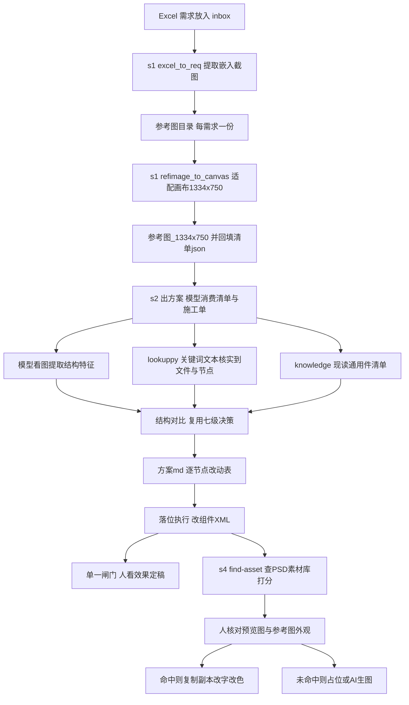
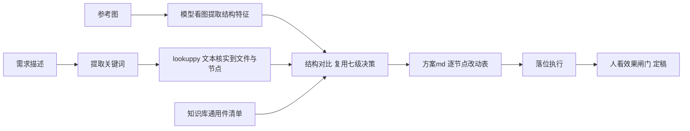

# 截图适配与组件匹配机制分析

> 本文回答两个问题：
> 1. 需求里的截图是如何被适配、然后匹配到现有组件库（FGUI 工程组件 + PSD 素材库）的？
> 2. `scan_fgui.py` 是怎么定位工程并生成 `facts.json` 的？
>
> 结论先行：**截图适配是脚本机械规则；截图/描述到组件的匹配没有任何自动图像算法，靠"模型看图 + 文本检索核实 + 结构匹配规则 + 人审闸门"。**

## 一、全链路总览



## 二、截图适配机制（s1，纯脚本确定性处理）

### 2.1 提取

`excel_to_req.py` 扫描 `.opencode/inbox/` 下的 Excel，**每行需求生成独立目录** `.opencode/work/<game_key>/<需求>/`，嵌入图片抽到 `参考图/`。列名自动识别（资源名称/资源说明/资源类型/参考图）。

### 2.2 适配画布（`refimage_to_canvas.py`）

| 情况 | 处理 |
|---|---|
| 同位比（宽高比一致，容忍 1px 取整） | 直接 resize 到 1334x750 |
| 异位比 | 按高缩放居中、四周填纯黑（不留安全边） |
| 按高缩放会超宽 | 改按宽缩放兜底 |

输出到 `参考图_1334x750/`，并把路径**回填**进 `清单.json` 对应条目的 `参考图_1334x750` 字段（按参考图 basename 命中回填）。

适配的意义：把任意尺寸的参考截图规范到与 FGUI 画布一致的比例，后续模型看图判断布局时坐标感是对的。

## 三、匹配现有组件库的两条线

### 3.1 线 A：FGUI 工程组件（s2 出方案时，语义匹配）

- 底座：`scan_fgui.py` 扫出 `facts.json`（包/组件/节点/资源/引用关系）+ `美术清单.备注.txt`（中文说明唯一来源）
- 模型读适配后的截图（清单里指向的 `参考图_1334x750`），用 `lookup.py` 按关键词定位到具体文件与节点（中文备注是中文关键词的主要命中源）
- 匹配口径是**结构对结构**，走"复用优先 7 级决策"：

| 级 | 手段 | 说明 |
|---|---|---|
| 1 | 改现有节点尺寸/位置/颜色/透明度 | 成本最低 |
| 2 | 九宫格拉伸 | 先看 package.xml 有没有 scale9grid |
| 3 | 非等比拉伸/缩放/镜像/旋转/变色 | fill="scaleFree" 等 |
| 4 | 换一张已有的相似图 | |
| 5 | 复用现成通用件（组件） | 结构对得上才复用，实例上覆盖 title/icon/titleColor |
| 6 | 用文字节点顶掉图 | 文案类默认系统文字 |
| 7 | AI 生图 | 必须给全规格，且要说清前 6 级为什么不行 |

- 通用件复用判断口径：**拿需求要的"结构"去对通用件的"结构"，不是看名字像不像**。对得上就复用（确认/取消/关闭这类普通方按钮）；对不上（如多状态卡牌硬套 Button9Scale）就单独建；拿不准把两边结构摆出来问人。
- 报新图必须说清"试过哪几种手段、为什么不行"；改共用图/通用件前先查引用（共用资源一改影响所有引用它的界面）。

### 3.2 线 B：PSD 素材库（s2 可选预查 `find-asset`，s4 强制取件，脚本打分）

素材库 `.opencode/PSD素材库/`：运行态**纯只读**。`build_index.py` 离线维护 `index.json`（素材 id/文件/分类/种类/结构/尺寸/外观/**制作单元**[lyid/名/预览图/文字内容/底图组/可复用方式]）+ 各分类 `_预览/` 缩略图。

`workspace.py find-asset <需求>` 对清单里"待制作"条目（来源为 AI生图/占位/空 或状态为 待制作/占位中）逐条打分：

| 匹配维度 | 规则 |
|---|---|
| 种类 | **硬条件**，不同直接不候选（返回 -1） |
| 结构 | 命中一个 +2 分 |
| 尺寸 | 精确相等 +3；不同但素材支持"改尺寸" +1 |
| 外观 | 素材支持换色/套样式 +1 |

- 候选按分排序，列出每个制作单元（lyid、文字内容、底图组）和预览图路径
- **必须人工/模型核对预览图与参考图外观**后才确认
- 命中 → 素材库 PSD 只读，**复制**到 `<需求>/psd/制作/<槽位名>.psd` 改字改色，清单回填 `来源=素材库命中`；未命中 → 保留占位、报 AI 生图

### 3.3 关键结论

- 截图适配是机械规则（脚本保证）；截图/描述到组件的匹配是**模型语义判断 + 结构化打分**，最终都有人确认闸门兜底
- 素材库打分只用种类/结构/尺寸/外观四个字段，**截图本身不参与打分**，图像层比对完全靠模型/人看预览图
- 当前**没有**"参考图对预览图做感知哈希/特征比对预筛"的环节，这是现状与理想态的最大空档（可讨论加进 find-asset 打分）

## 四、scan_fgui.py 如何定位工程并生成 facts.json

原则：**事实全部来自 package.xml、组件 xml、图片文件头；不做猜测**。

### 4.1 定位工程根（三级回退）

```
--root 参数  →  workspace.json 的 client_dir  →  从 cwd 向上找「*.fairy + assets/」（最多 6 层）
```

- 优先 `resolve_workspace_paths()`：读 `.opencode/workspace.json` 里 s0 写的 `client_dir`
- 都没有则 `find_root()` 向上找同时含 `*.fairy` 文件和 `assets/` 目录的层
- 找不到 `assets/` 直接报错退出（不猜）

输出目录同理：`--out` → `out_root = <工作区根>/.opencode/work` → 兜底 `工程根/fgui文档`。

### 4.2 扫描链（5 步，确定性解析）

| 步骤 | 干什么 | 产出 |
|---|---|---|
| `scan_fairy()` | 解析第一个 `*.fairy` XML 头 | 工程文件名/id/type/version |
| `scan_settings()` | 读 `settings/*.json` | 设计分辨率（Adaptation.json）、发布配置（Publish.json）等 |
| `scan_packages()` | 遍历 `assets/` 每个包目录解析 `package.xml` | 包 id、资源登记表（id/name/path/exported/九宫格/atlas）；逐条算 relpath、核对磁盘存在性；PNG/JPEG **直接读文件头**取像素尺寸；交叉比对"磁盘有但未登记 / 登记了但缺失"记异常 |
| `scan_components()` | `rglob *.xml`（跳过 package.xml）解析 `<component>` 根 | 控制器（页名/备注/动作）+ displayList 全部节点（name/xy/size/text/gears 等）；`src` 引用经 `res_index` 解析（支持跨包 `pkg="…"`）；`ui://包ID资源ID` URL（节点 url / gearIcon / Button icon / list item）逐个解析 |
| `cross_checks()` | 交叉分析 | 同名图多包重复、空目录等异常 |

两个核心索引：
- `res_index[(包目录, 资源id)] → 资源`
- `comp_index[(包目录, 组件路径)] → 组件`

解析不到的引用不静默跳过，记进 `anomalies`（如"节点 src 引用解析不到资源"）。

### 4.3 facts.json 的生成（先写事实表，再渲染文档）

```json
{
  "root":       "工程根",
  "fairy":      "工程文件信息",
  "settings":   "settings 下的 json 内容",
  "packages":   "每包 id、资源登记表、磁盘文件清单（不含 components）",
  "components": "每组件控制器 + 节点表（nodes 去掉 extra）",
  "usage":      "[(包, 资源id) → 谁引用了它 [{pkg, comp, node}]]",
  "anomalies":  "所有异常"
}
```

写入 `.opencode/work/facts.json`（UTF-8），然后用同一份内存数据渲染：
- `工程结构.md`（给技术/LLM：定位索引、文件树、逐包明细、引用关系、异常）
- `美术资源清单.md`（给美术：界面总览、图片明细、九宫格、字模；中文说明优先取 `美术清单.备注.txt`，缺的按文件名词表 `TOKEN_ZH` 自动推断并标 `*`）

### 4.4 新鲜度保障

`lookup.py --check` 拿 facts.json 的 mtime 对比 `assets/` + `settings/` 里最新文件的 mtime——工程被改过就判过期，拒绝查询并要求重扫（"只用实测事实"规矩的落地）。

## 五、需求描述 + 参考图 → FGUI 组件的匹配过程（核心）

**没有自动算法**。这一步是 s2"出方案"阶段由模型（LLM）完成的语义 + 视觉判断，流程用三样东西约束它：文本检索工具、知识库、人审闸门。

### 5.1 五步链路

1. **模型看图，识别结构**：直接读 `参考图_1334x750`（多模态视觉），提取结构特征（"底图+居中文字的按钮"/"头像+角标+昵称成组条目"/"多状态卡牌"）。**参考图在这里才参与匹配，方式就是模型看图，不是像素比对**。
2. **从需求描述提取关键词 → `lookup.py` 文本核实**：如"结算界面自摸标签改色" → 关键词 `结算 自摸 标签` → 在 facts.json 拍平索引里做 AND 包含匹配，覆盖组件文件名/initName/remark、节点名/节点 text/资源名、**中文备注表**（中文关键词主要命中源）、`ui://` 引用关系。命中 0 个时 lookup **不猜**，列全部组件清单让模型/人换词再试。
3. **结构对结构，走复用 7 级决策**（见 3.1）。
4. **逐条落实"哪个文件哪个节点"**：用 `--comp X --nodes` 看全节点、坐标尺寸取 XML 实测值，写进方案.md 的**逐节点改动表（现值 → 新值 → 为什么）**。
5. **人看效果（唯一闸门）**：落位后人在 FGUI 编辑器看实际效果，**这是匹配对错的最终裁判**。方案阶段不设闸门，错了改方案重来。



### 5.2 一句话总结

截图到组件靠"模型看图 + 中文关键词检索核实 + 结构匹配规则"，工具链只负责把工程事实（节点/坐标/引用）精准递到模型面前；匹配本身是模型的语义判断，用"逐节点改动表 + 人审"兜底。**匹配质量 = facts.json 备注的完整度 + 知识库用例的丰富度 + 模型本身**。

## 六、现状空档与可选增强

| 空档 | 现状 | 可选增强 |
|---|---|---|
| 图像相似度预筛 | find-asset 打分不含截图 | 对素材库 `_预览/` 缩略图与适配后参考图做感知哈希（pHash）预筛，加进打分 |
| FGUI 组件无预览 | 工程组件只有文本事实 | 扫描时导出组件缩略图，模型匹配时可"看"候选组件长什么样 |
| 备注依赖人工 | 中文说明靠 美术清单.备注.txt，缺的自动推断置信度低 | 匹配命中后把结论沉淀回备注文件，形成闭环 |

## 引用说明

本文分析基于以下项目内文件（均为本仓库相对路径）：

- `.opencode/skills/fgui-req/SKILL.md` —— s1 需求解析流程定义
- `.opencode/skills/fgui-req/scripts/excel_to_req.py` —— Excel 提取与参考图落盘
- `.opencode/skills/fgui-req/scripts/refimage_to_canvas.py` —— 参考图适配画布规则
- `.opencode/skills/fgui-req/scripts/施工单模板.md` —— 施工单结构
- `.opencode/skills/fgui-flow/SKILL.md` —— s2 落位流程、复用 7 级决策、单一闸门
- `.opencode/skills/fgui-flow/scripts/scan_fgui.py` —— 工程扫描器与 facts.json 生成
- `.opencode/skills/fgui-flow/scripts/lookup.py` —— 关键词定位（facts.json + 中文备注检索）
- `.opencode/skills/psd-style/SKILL.md` —— s4 取件流程、find-asset 查素材库、预览图核对
- `.opencode/lib/workspace.py` —— find-asset 打分实现（score_asset）、清单管理、place 回写
- `.opencode/PSD素材库/README.md` / `index.json` —— 素材库只读边界与索引结构
- `.opencode/knowledge/01-资源复用技巧.md` / `02-对齐与成组.md` —— 复用手段与排版知识库
- `docs/01-总览与架构.md` / `docs/04-技能与脚本参考.md` —— 流程总览与脚本速查
