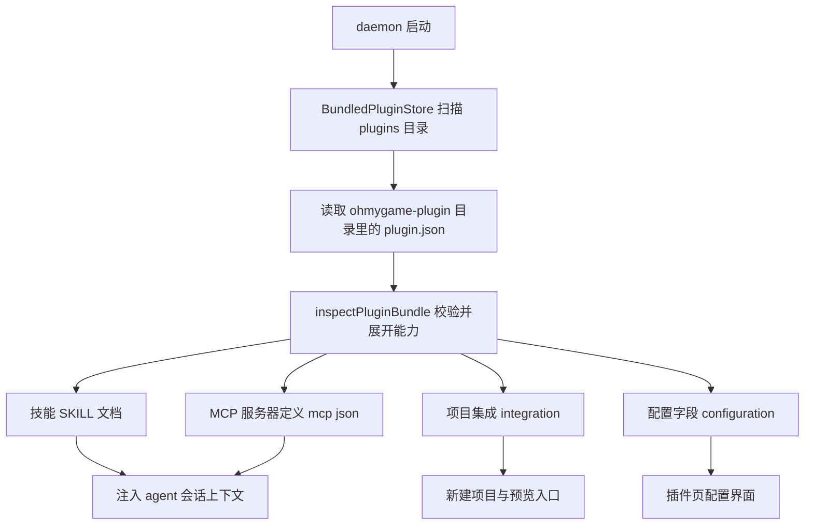

# 插件系统结构分析报告

- 日期：2026-11-03
- 范围：`plugins/` 内置插件、`.ohmygame-plugin` 目录契约、daemon 加载链、插件四层能力（skills / MCP / integration / configuration）
- 关键代码：`src/shared/plugins.ts`（契约 schema）、`src/daemon/bundled-plugins.ts`（内置加载）、`src/daemon/local-plugins.ts`（安装/校验）、`src/daemon/plugin-capabilities.ts`（能力聚合）

## 一、架构总览

工作室是壳，插件是手。daemon 在启动与每个会话创建时聚合插件能力，把技能文档注入 agent 上下文、把 MCP 服务器挂进 Pi 会话：

## 二、插件目录契约

每个插件是一个目录，唯一必需的入口是 `.ohmygame-plugin/plugin.json`（路径常量 `PLUGIN_MANIFEST_PATH`，协议名冻结不改）。可选目录/文件：

| 路径 | 作用 | 契约 |
|---|---|---|
| `.ohmygame-plugin/plugin.json` | 清单，**唯一必需** | 见字段表 |
| `skills/<技能名>/SKILL.md` | agent 技能文档（frontmatter name + description） | 单文件 ≤ 512KB，路径必须以 `./` 开头且不可逃逸 |
| `mcp.json`（清单里 `mcpServers` 指向） | MCP 服务器定义（stdio 或 http） | 相对路径；支持 `${config.字段}` 占位符回填配置值 |
| `assets/` | 图标等静态资源 | 图标 png/webp/svg ≤ 1000 字符路径 |
| integration entry（`.mjs`） | 项目集成脚本（创建项目、文件模板、外部预览） | 必须 `.mjs`；可声明 `projectFiles` 模板与 `preview: "external"` |

### plugin.json 字段（PluginManifestSchema，全量）

| 字段 | 类型 | 说明 |
|---|---|---|
| `name` | 小写连字符标识 | 插件 id 的尾巴（id = `ohmygame:` + name） |
| `version` | 语义化版本 | 必填 |
| `description` | 字符串 | 必填 |
| `enabledByDefault` | bool | 缺省 true |
| `formatVersion` / `minimumHostVersion` | 整数 / SemVer | 格式与宿主版本门槛 |
| `skills` | `./` 路径或路径数组 | 技能目录 |
| `mcpServers` | `./` 路径 | 指向 mcp.json |
| `connections` | 标识符数组 | 引用宿主内置连接（`ohmygame-*`） |
| `integration` | object | `entry` + `createProject` + `projectFiles` + `preview` |
| `configuration` | 字段表 | text/secret/path/boolean/select 五类，label/required/default/options |
| `interface` | object | 用户界面元数据：`beta`、`displayName`、`shortDescription`、`longDescription`、`icon`（preset 或 asset）、`defaultPrompt`（插件页示例提示词）、`projectTypes`（适用项目类型） |
| `requirements` | object | 依赖命令（如 node）与平台（darwin/win32/linux） |

## 三、当前内置插件清单（14 个）

beta 标记与 `enabledByDefault` 均来自 `interface.beta` / `enabledByDefault` 字段：

| 插件 | 版本 | beta | 技能数 | MCP | 默认开 | 适用类型 |
|---|---|---|---|---|---|---|
| aseprite | 0.1.0 | 是 | 1 | - | 关 | - |
| blender | 0.1.0 | 是 | 1 | - | 关 | - |
| cocos-creator | 0.1.0 | 是 | 1 | - | 关 | - |
| douyin-minigame | 0.1.0 | 是 | 1 | - | 关 | - |
| **fairygui** | 0.1.0 | 是 | 1 | node ./mcp/server.mjs（stdio, lazy） | 关 | fairygui, general |
| game-studio | 0.1.0 | 否 | 3 | - | 开 | - |
| godot | 0.2.0 | 是 | 1 | npx @coding-solo/godot-mcp（stdio, lazy） | 关 | - |
| taptap-maker | 0.2.0 | 是 | 1 | node ./scripts/mcp.mjs（stdio, lazy） | 关 | - |
| threejs-world | 0.1.0 | 是 | 1 | - | 关 | - |
| tiled | 0.1.0 | 是 | 1 | - | 关 | - |
| unity | 0.1.0 | 是 | 1 | - | 关 | - |
| unreal-engine | 0.1.0 | 是 | 1 | `${config.endpoint}`（http, lazy） | 关 | - |
| web-game-studio | 0.1.0 | 否 | 9 | - | 开 | - |
| wechat-minigame | 0.1.0 | 是 | 1 | - | 关 | - |

补充事实：

- beta 插件 11 个默认关闭；`game-studio`（3 技能：game-foundations/game-qa/game-studio）与 `web-game-studio`（9 技能，覆盖 playtest/UI 前端/Phaser/React-Three-Fiber/sprite 管线等）默认开启且非 beta。
- MCP 服务器均为 `lifecycle: "lazy"`（首次用到才拉起）；godot/taptap/unreal 用官方或上游 CLI，fairygui 是自研桥（`plugins/fairygui/mcp/` 三文件 + 编辑器侧 `editor-plugin/main.js`，源码真身在 `thirdparties/xc-link-plugin/`）。
- 插件 id 前缀 `ohmygame:` 是协议（`bundled-plugins.ts` 的 `idPrefix`，冻结不改）。

## 四、插件四层能力

1. **技能（skills）**：SKILL.md 注入 agent 上下文（教 agent 怎么用该引擎/工具），是插件最轻量的形态——14 个插件全部都有技能。
2. **MCP 连接（mcpServers）**：给 agent 挂真正的工具调用；配置值经 `${config.*}` 占位符回填（如 fairygui 的 bridge-url、unreal 的 endpoint）。stdio 与 http 两种传输。
3. **项目集成（integration）**：出现在新建项目对话框（`createProject: true` 时）与项目文件模板/外部预览。当前 14 个内置插件都没用 integration（该机制主要给安装型插件，如测试里的 Maker fixture）。
4. **配置（configuration）**：插件页渲染的设置字段，缺配置的插件显示「需要配置」（configurationStatus: needs-configuration）。fairygui 有 2 个字段（editor-exe、bridge-url），godot 1 个（godot-path），unreal 1 个（endpoint）。

## 五、插件来源（PluginSource 五类）

| 来源 | 说明 | marketplace 归属 |
|---|---|---|
| `builtIn` | `plugins/` 内置（本次分析的 14 个） | ohmygame（public） |
| `preinstalled` | 桌面包 `.runtime/preinstalled-plugins/` 预装 | ohmygame |
| `authored` | Plugin Builder 在应用内创作 | personal |
| `directory` / `git` | 从本地目录或 git 仓库安装（含 Claude marketplace 格式兼容，format: claude/codex/pi/agent-skills） | 按来源 |
| `archive` | 项目归档里带的插件 | personal |

安装校验（`validatePluginBundle`）：归档 ≤ 5000 条目 / ≤ 50MB；隐藏目录只允许 `.agents`、`.claude-plugin`、`.codex-plugin`、`.ohmygame-plugin`；路径不可 `..` 逃逸；integration entry 必须 `.mjs`。

## 六、与显隐配置的联动（当前工具定制现状）

- `HIDDEN_PROJECT_TYPE_IDS`（project-types.tsx）隐藏 4 工作室类型后：插件不删不断——插件页、会话注入、MCP 全部保留，只是新建入口与探索示例不出现。
- fairygui 插件 `projectTypes: ["fairygui", "general"]` 决定它的集成能力挂在哪些项目类型上。
- 升级兼容：`PLUGIN_GUIDE_UPGRADES` 机制保证清单/文档变化不破坏存量工程（同向导模板 hash 升级机制）。

## 引用说明

- 契约 schema：`src/shared/plugins.ts`（`PluginManifestSchema`）
- 加载与校验：`src/daemon/bundled-plugins.ts`、`src/daemon/local-plugins.ts`
- 能力聚合与会话注入：`src/daemon/plugin-capabilities.ts`、`src/daemon/plugin-integration.ts`
- 读者向文档：`docs/plugins.md`（插件包与运行时契约）
- 冻结协议名清单：`docs/protocol-names.md`
